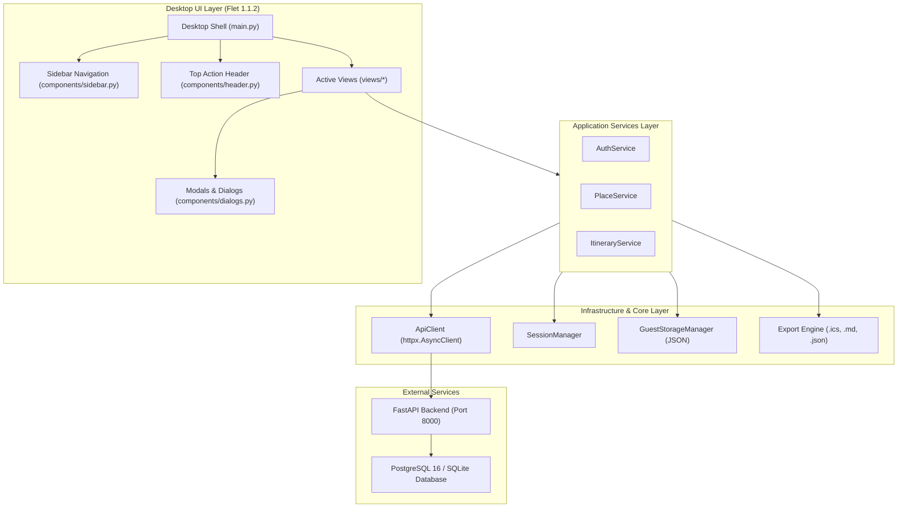

# Desktop Application Architecture: Nueva Ecija Travel

**Client:** Python Flet Desktop Application  
**Runtime:** Flet 1.1.2 (Flutter Material 3 Engine) / Python 3.14.3 (64-bit)  
**Backend:** FastAPI 0.115+ (`http://127.0.0.1:8000/api/v1`)  
**Document Ref:** `DESKTOP_APP_DOCUMENTATION/04_DESKTOP_ARCHITECTURE.md`

---

## 1. Architectural Philosophy

The Nueva Ecija Travel Desktop Client is designed according to **Clean Layered Architecture** principles, maintaining strict boundaries between:
1. **User Interface Controls (`components/`, `views/`)**: Declarative UI controls rendering Flutter widgets via Flet 1.1.2.
2. **Business & Domain Logic (`services/`)**: High-level workflow orchestration, caching, and fallback resolution.
3. **Data & Entity Models (`models/`)**: Strongly typed dataclasses representing Places, Municipalities, Itineraries, and Users.
4. **Infrastructure & Network (`core/`)**: Asynchronous HTTP client, token/session management, disk persistence, and export serialization.
5. **Configuration (`config/`)**: Environment settings, design tokens, color palette, and province constants.



---

## 2. Component Hierarchy & The Desktop Shell Pattern

Desktop applications demand a persistent, responsive navigation paradigm distinct from mobile web single-page applications.

### 2.1 The Shell Pattern
When navigating authenticated or workspace routes (`/dashboard`, `/places`, `/suggested`, `/builder`, `/trips`, `/profile`), the application renders a persistent shell:

```text
+----------------------------------------------------------------------------------+
| Top Application Header (TopHeader)                                               |
| Context Breadcrumb | Server Health Pill | Search Shortcut | Traveler Profile     |
+---------------------+------------------------------------------------------------+
|                     |                                                            |
| Persistent Sidebar  | Active Dynamic View Container (content_area)              |
| Navigation          |                                                            |
| (SidebarNav - 250px)| - DashboardView                                            |
|                     | - PlacesView                                               |
| - Dashboard         | - SuggestedWizardView                                      |
| - Explore Places    | - CustomBuilderView                                        |
| - Suggested Wizard  | - SavedTripsView                                           |
| - Custom Builder    | - TripDetailView                                           |
| - Saved Trips       | - ProfileView                                              |
| - Settings          |                                                            |
| ------------------- |                                                            |
| Theme Toggle        |                                                            |
| Sign In / Log Out   |                                                            |
+---------------------+------------------------------------------------------------+
```

### 2.2 Full-Screen Standalone Routes
Authentication and onboarding flows (`/welcome`, `/login`, `/signup`) bypass the shell and render full-viewport centered cards to prevent user distraction during sign-in.

---

## 3. Directory Structure & Responsibilities

```text
desktop_client/
├── main.py                     # Entrypoint: window setup, route dispatcher, shell assembler
├── requirements.txt            # Python dependencies (flet, httpx, pydantic, pytest)
├── .env.example                # Runtime environment variables template
├── README.md                   # Project overview and quickstart instructions
│
├── config/
│   ├── __init__.py
│   └── settings.py             # Singleton settings, ThemeColors, categories, 32 LGUs
│
├── core/
│   ├── __init__.py
│   ├── api_client.py           # Async httpx client with token injection & error hierarchy
│   ├── session.py              # Credential storage, JWT refresh handler, guest mode state
│   ├── storage.py              # Local JSON persistence mirroring ne_guest_itineraries_v1
│   └── export.py               # RFC 5545 iCalendar, Markdown dossier, and JSON serializer
│
├── models/
│   ├── __init__.py
│   ├── user.py                 # User, AuthTokenResponse, UserUpdatePayload
│   ├── place.py                # Place, Municipality, PaginatedPlaces, PlaceCategory
│   └── itinerary.py            # Itinerary, ItineraryDay, ItineraryItem, SuggestedRequest
│
├── services/
│   ├── __init__.py
│   ├── auth_service.py         # Login, register, token refresh, guest mode transition
│   ├── place_service.py        # 16-category search, 32-LGU filtering, place detail queries
│   └── itinerary_service.py    # Algorithmic clustering, custom building, stop reordering
│
├── components/
│   ├── __init__.py
│   ├── sidebar.py              # Persistent navigation drawer with active route pills
│   ├── header.py               # Top action bar with live server status indicator
│   ├── place_card.py           # Destination card with honest pricing & "+ Add" trigger
│   ├── stop_card.py            # Chronological timeline item with move up/down controls
│   └── dialogs.py              # Place modal, off-grid custom venue dialog, export modal
│
├── views/
│   ├── __init__.py
│   ├── welcome_view.py         # First-time onboarding view
│   ├── login_view.py           # Traveler sign-in form
│   ├── signup_view.py          # Account registration form
│   ├── dashboard_view.py       # Metrics hub, quick action cards, featured destinations
│   ├── places_view.py          # Catalog search with 16 categories and 32 municipalities
│   ├── suggested_wizard_view.py# 4-step wizard with greedy geographical clustering
│   ├── custom_builder_view.py  # Dual-pane schedule editor with zero-stop guard
│   ├── saved_trips_view.py     # Itinerary catalog with cloud/guest filtering
│   ├── trip_detail_view.py     # Read-only timeline inspector with route statistics
│   └── profile_view.py         # Profile editing, theme toggle, local cache management
│
└── tests/
    ├── __init__.py
    ├── test_api_client.py      # HTTP client and error hierarchy tests
    ├── test_auth_service.py    # Session and guest mode tests
    ├── test_place_service.py   # Place models and pricing formatting tests
    ├── test_itinerary_service.py # Itinerary models and cost accumulation tests
    ├── test_storage_export.py  # Guest storage CRUD and export compliance tests
    └── test_live_integration.py# Live integration tests against FastAPI backend
```

---

## 4. State Management & Event Handling

1. **Reactive Navigation**: Handled by `navigate_to(route: str)` in `desktop_client/main.py`. The active view is swapped inside `content_area.content`, and the sidebar updates its active highlight pill.
2. **Session Observer Pattern**: `SessionManager` implements a publish-subscribe listener pattern (`add_listener(callback)`). When a traveler signs in or logs out, the sidebar and header update their user pills automatically without reloading.
3. **Async Task Execution**: Background operations (e.g. backend healthcheck pings every 15s) run via `page.run_task(coroutine)`, preventing UI thread freezing.
4. **Draft Itinerary State**: The Custom Builder (`custom_builder_view.py`) maintains an in-memory draft of days and stops. Reordering moves stops inside the local array and recalculates `sort_order` immediately for a zero-latency desktop feel.

---

## 5. Visual Design System (Anti-Generic Implementation)

The desktop client implements the distinctive Nueva Ecija design identity:

- **Primary Brand Color:** Deep Emerald Green (`#1b4332`, `#2d6a4f`) evoking the Sierra Madre mountains and vast central rice plains.
- **Secondary Accent Color:** Travel Azure Blue (`#0084ff`, `#0066cc`) representing Pantabangan Dam, freshwater reservoirs, and open skies.
- **Surface Neutrals (Light Mode):** Clean white cards (`#ffffff`) on warm gray-tinted slate background (`#f4f6f8`).
- **Surface Neutrals (Dark Mode):** Deep slate charcoal (`#0b0f19`, `#151e2e`, `#1e293b`).
- **Honest Pricing:** Displayed via dedicated green pills (`#d8f3dc` background with `#2d6a4f` text) showing exact admission or meal costs (e.g., "Free Admission", "₱50 - ₱150"), eliminating vague luxury pricing placeholders.
- **Accessibility:** All text-to-background combinations strictly meet or exceed WCAG 2.2 AA (minimum 4.5:1 contrast).
