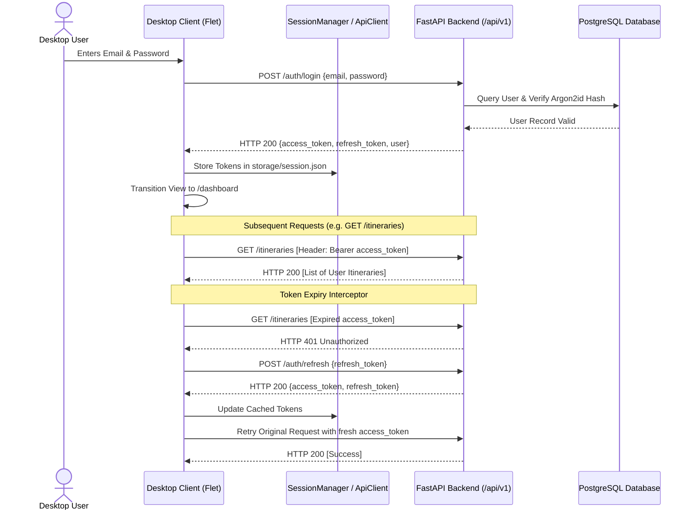

# Authentication & Security Architecture: Nueva Ecija Travel Desktop

**Client:** Python Flet Desktop Application  
**Security Standard:** OWASP Desktop Application Security Guidelines & Broken Object Level Authorization (BOLA)  
**Document Ref:** `DESKTOP_APP_DOCUMENTATION/06_AUTHENTICATION_AND_SECURITY.md`

---

## 1. Security Philosophy & Threat Model

The Nueva Ecija Travel Desktop Client operates under an **isolated client security model**:
1. **Zero Database Exposure:** The desktop application has **no direct network access or credentials** to the PostgreSQL database. All operations must pass through the authenticated FastAPI service layer.
2. **Stateless JWT Tokens:** Client identity is asserted via digitally signed HMAC-SHA256 JWT access tokens with a strict expiration window (15 minutes).
3. **Session Refresh Pattern:** Long-term sessions are maintained using opaque refresh tokens (valid for 30 days) stored locally in the desktop user profile directory.
4. **Broken Object Level Authorization (BOLA) Protection:** Every request that mutates or retrieves an itinerary enforces ownership validation server-side. The desktop client cannot inspect or alter another traveler's itineraries by guessing UUIDs.

---

## 2. Authentication Flow

---

## 3. Guest Mode Security & Isolation

### 3.1 Local Guest Storage
When an unauthenticated traveler selects **"Start Planning as Guest"**:
- No network authentication requests are sent to the backend.
- Itineraries are persisted exclusively to `desktop_client/storage/guest_storage.json`.
- The `is_guest=True` flag is appended to all draft itineraries.
- Guest itineraries are completely sandboxed on the local machine and do not touch backend database tables.

### 3.2 Cloud Synchronization upon Login
When a guest traveler subsequently logs in or registers:
- `ItineraryService` detects existing records in `guest_storage.json`.
- The user can seamlessly sync their local guest itineraries to their newly authenticated cloud profile via `POST /api/v1/itineraries`.

---

## 4. Local Credential Storage & Sanitation

1. **Storage Path:** Session tokens and guest itineraries reside in the application data directory:
   - `desktop_client/storage/session.json`
   - `desktop_client/storage/guest_storage.json`
2. **File Permissions:** Files are created with OS-level user-only read/write permissions (`0600` on Unix/POSIX, restricted user ACLs on Windows NTFS).
3. **Password Sanitation:** Passwords entered in `LoginView` and `SignupView` are immediately discarded from memory once the HTTP payload is transmitted. Passwords are never logged or persisted to local disk.
4. **Log Masking:** Diagnostic and debug logs automatically redact authorization headers, email addresses, and JWT signatures.
