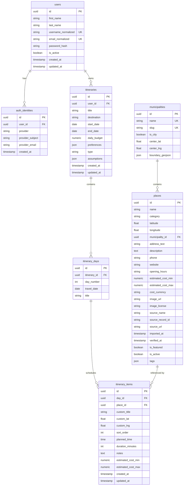

# Database Documentation: Nueva Ecija Travel Itinerary

## 1. Database Architecture & Technologies

- **Production Engine**: PostgreSQL 15+ (accessed locally via `postgresql+psycopg://` on `127.0.0.1:5432`).
- **Testing & Local Fallback Engine**: SQLite (in-memory or file-based `sqlite:///./nueva_ecija_travel.db`).
- **ORM**: SQLAlchemy 2.0 (`Mapped[...]`, `mapped_column(...)`).
- **Migrations**: Alembic (`backend/alembic/`).
- **Type Portability**:
  - `JsonType`: Defined as `JSON().with_variant(JSONB(), "postgresql")` to utilize binary JSON indexing on PostgreSQL while maintaining compatibility with SQLite.
  - `Uuid`: Uses `sa.Uuid(as_uuid=True)` which maps to native `UUID` on PostgreSQL and `CHAR(32)` on SQLite.

---

## 2. Entity-Relationship Diagram (ERD)

---

## 3. Table Specifications

### 3.1 `users`
Persists registered traveler accounts.
- `id` (`UUID`, PK): Unique identifier (`uuid.uuid4`).
- `first_name` (`VARCHAR(80)`, NOT NULL): Traveler first name.
- `last_name` (`VARCHAR(80)`, NOT NULL): Traveler last name.
- `username_normalized` (`VARCHAR(50)`, UNIQUE, INDEX, NOT NULL): Lowercase stripped username.
- `email_normalized` (`VARCHAR(255)`, UNIQUE, INDEX, NOT NULL): Lowercase stripped email.
- `password_hash` (`VARCHAR(255)`, NULLABLE): Argon2id password hash (null for OAuth-only users).
- `is_active` (`BOOLEAN`, NOT NULL, DEFAULT `true`): Account status flag.
- `created_at` (`TIMESTAMPTZ`, NOT NULL, DEFAULT `now()`): Creation timestamp.
- `updated_at` (`TIMESTAMPTZ`, NOT NULL, DEFAULT `now()`): Last update timestamp.

### 3.2 `auth_identities`
Persists linked third-party OAuth identities.
- `id` (`UUID`, PK): Unique identifier.
- `user_id` (`UUID`, FK -> `users.id`, ON DELETE CASCADE, INDEX, NOT NULL).
- `provider` (`VARCHAR(32)`, NOT NULL): Identity provider (e.g., `'google'`, `'apple'`).
- `provider_subject` (`VARCHAR(255)`, NOT NULL): Immutable provider subject ID (`sub`).
- `provider_email` (`VARCHAR(255)`, NULLABLE): Email provided by provider.
- `created_at` (`TIMESTAMPTZ`, NOT NULL, DEFAULT `now()`).
- **Constraint**: `UNIQUE (provider, provider_subject)` (`uq_provider_subject`).

### 3.3 `municipalities`
Reference table for Nueva Ecija's 32 municipalities and cities.
- `id` (`UUID`, PK): Unique identifier.
- `name` (`VARCHAR(100)`, UNIQUE, NOT NULL): Display name (e.g. `'Cabanatuan City'`).
- `slug` (`VARCHAR(100)`, UNIQUE, INDEX, NOT NULL): URL-safe slug (e.g. `'cabanatuan-city'`).
- `is_city` (`BOOLEAN`, NOT NULL, DEFAULT `false`): True for Cabanatuan, Gapan, Muñoz, Palayan, San Jose.
- `center_lat` (`FLOAT`, NOT NULL): Latitude of geographic/administrative center.
- `center_lng` (`FLOAT`, NOT NULL): Longitude of geographic/administrative center.
- `boundary_geojson` (`JSONB` / `JSON`, NULLABLE): GeoJSON polygon boundaries when verified.

### 3.4 `places`
Points of interest (POIs) imported from OpenStreetMap or curated.
- `id` (`UUID`, PK): Unique identifier.
- `name` (`VARCHAR(200)`, INDEX, NOT NULL): Venue or attraction name.
- `category` (`VARCHAR(64)`, INDEX, NOT NULL): One of the 16 canonical categories.
- `latitude` (`FLOAT`, NOT NULL): WGS84 latitude.
- `longitude` (`FLOAT`, NOT NULL): WGS84 longitude.
- `municipality_id` (`UUID`, FK -> `municipalities.id`, ON DELETE SET NULL, INDEX, NULLABLE).
- `address_text` (`VARCHAR(255)`, NULLABLE): Address or barangay text.
- `description` (`TEXT`, NULLABLE): Verified description or facts.
- `phone` (`VARCHAR(64)`, NULLABLE): Contact phone number.
- `website` (`VARCHAR(255)`, NULLABLE): Website URL.
- `opening_hours` (`VARCHAR(255)`, NULLABLE): OSM opening_hours string.
- `estimated_cost_min` (`NUMERIC(10, 2)`, NULLABLE): Minimum cost (null if unverified).
- `estimated_cost_max` (`NUMERIC(10, 2)`, NULLABLE): Maximum cost (null if unverified).
- `cost_currency` (`VARCHAR(3)`, NOT NULL, DEFAULT `'PHP'`).
- `image_url` (`VARCHAR(500)`, NULLABLE): Licensed image URL.
- `image_license` (`VARCHAR(255)`, NULLABLE): Attribution / license text.
- `source_name` (`VARCHAR(64)`, NOT NULL, DEFAULT `'OpenStreetMap'`).
- `source_record_id` (`VARCHAR(128)`, NOT NULL): Unique ID from source (e.g., `'node/12345'`).
- `source_url` (`VARCHAR(500)`, NULLABLE): OSM browse URL.
- `imported_at` (`TIMESTAMPTZ`, NOT NULL, DEFAULT `now()`).
- `verified_at` (`TIMESTAMPTZ`, NULLABLE): Date of human verification.
- `is_featured` (`BOOLEAN`, INDEX, NOT NULL, DEFAULT `false`): Promoted destination flag.
- `is_active` (`BOOLEAN`, INDEX, NOT NULL, DEFAULT `true`): Visibility flag.
- `tags` (`JSONB` / `JSON`, NOT NULL, DEFAULT `[]`): Array of search and category tags.
- **Constraints & Indexes**:
  - `UNIQUE (source_name, source_record_id)` (`uq_place_source_record`).
  - `INDEX ix_places_lat_lng (latitude, longitude)`.

### 3.5 `itineraries`
Multi-day custom or suggested travel plans owned by registered users.
- `id` (`UUID`, PK): Unique identifier.
- `user_id` (`UUID`, FK -> `users.id`, ON DELETE CASCADE, INDEX, NOT NULL).
- `title` (`VARCHAR(160)`, NOT NULL): Itinerary title.
- `destination` (`VARCHAR(120)`, NOT NULL): Destination municipality or anchor name.
- `start_date` (`DATE`, NOT NULL): Start date (Philippine calendar date).
- `end_date` (`DATE`, NOT NULL): End date (`end_date >= start_date`).
- `daily_budget` (`NUMERIC(10, 2)`, NOT NULL): Daily PHP budget.
- `preferences` (`JSONB` / `JSON`, NOT NULL, DEFAULT `[]`): Selected preference categories.
- `type` (`VARCHAR(20)`, NOT NULL): `'suggested'` or `'custom'`.
- `assumptions` (`JSONB` / `JSON`, NOT NULL, DEFAULT `[]`): Algorithmic transparency notes.
- `created_at` (`TIMESTAMPTZ`, NOT NULL, DEFAULT `now()`).
- `updated_at` (`TIMESTAMPTZ`, NOT NULL, DEFAULT `now()`).

### 3.6 `itinerary_days`
Individual calendar days within an itinerary.
- `id` (`UUID`, PK): Unique identifier.
- `itinerary_id` (`UUID`, FK -> `itineraries.id`, ON DELETE CASCADE, INDEX, NOT NULL).
- `day_number` (`INTEGER`, NOT NULL): 1-indexed sequential day counter.
- `travel_date` (`DATE`, NOT NULL): Calendar date for this day.
- `title` (`VARCHAR(120)`, NULLABLE): Optional day title (e.g., `'Day 1 - Bongabon'`).
- **Constraint**: `UNIQUE (itinerary_id, day_number)` (`uq_itinerary_day_num`).

### 3.7 `itinerary_items`
Scheduled stops on a specific itinerary day.
- `id` (`UUID`, PK): Unique identifier.
- `day_id` (`UUID`, FK -> `itinerary_days.id`, ON DELETE CASCADE, INDEX, NOT NULL).
- `place_id` (`UUID`, FK -> `places.id`, ON DELETE SET NULL, NULLABLE): Linked database POI.
- `custom_title` (`VARCHAR(200)`, NULLABLE): Used for custom off-grid stops without a POI.
- `custom_lat` (`FLOAT`, NULLABLE): Latitude for custom stop.
- `custom_lng` (`FLOAT`, NULLABLE): Longitude for custom stop.
- `sort_order` (`INTEGER`, NOT NULL, DEFAULT `1`): Ordering index within the day.
- `planned_time` (`TIME`, NULLABLE): Time slot (e.g., `09:00:00`).
- `duration_minutes` (`INTEGER`, NOT NULL, DEFAULT `90`): Estimated stop duration.
- `notes` (`TEXT`, NULLABLE): Traveler notes.
- `estimated_cost_min` (`NUMERIC(10, 2)`, NULLABLE): Minimum known expense.
- `estimated_cost_max` (`NUMERIC(10, 2)`, NULLABLE): Maximum known expense.
- `created_at` (`TIMESTAMPTZ`, NOT NULL, DEFAULT `now()`).
- `updated_at` (`TIMESTAMPTZ`, NOT NULL, DEFAULT `now()`).

---

## 4. Migrations

- Tool: **Alembic** (`backend/alembic.ini`, `backend/alembic/env.py`).
- Current Migration: `0001_initial_schema` (`backend/alembic/versions/0001_initial_nueva_ecija_schema.py`).
- Downgrade capability: Reversible via `alembic downgrade base`.

