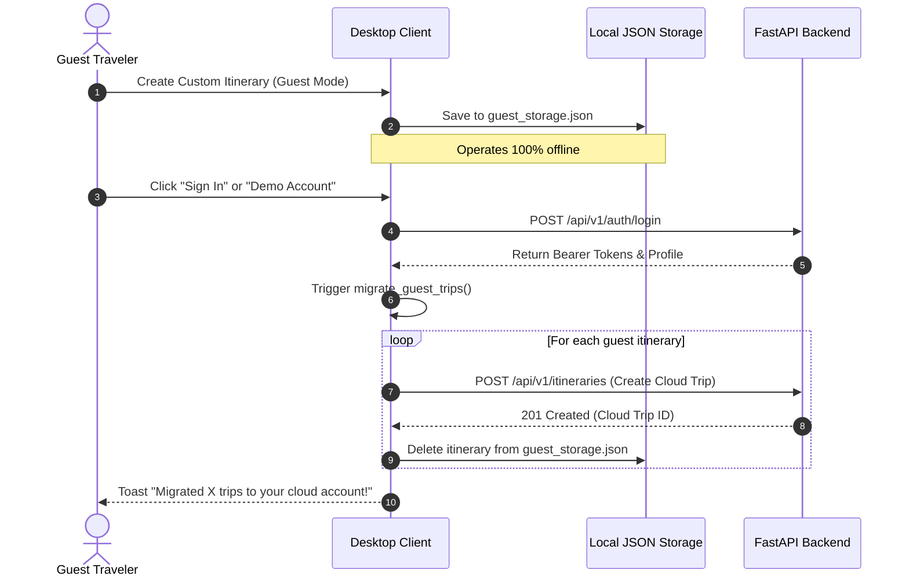

# Desktop Application API Integration & Security Guide

**Framework**: Python Flet / `httpx` Asynchronous REST Client  
**Shared Backend API**: FastAPI 0.115+ at `http://127.0.0.1:8000/api/v1`  
**Authentication Standard**: OAuth2 Password Bearer / PyJWT HS256 / Argon2id  
**Document Ref**: `docs/DESKTOP_APP_API_INTEGRATION.md`  

---

## 1. API Client Architecture (`core/api_client.py`)

The desktop client communicates with the FastAPI backend using an asynchronous HTTP client built on `httpx.AsyncClient`:

```python
class ApiClient:
    def __init__(self, base_url: Optional[str] = None, timeout: float = 15.0):
        self.base_url = (base_url or get_settings().api_base_url).rstrip("/")
        self.timeout = timeout
        self._token_getter: Optional[Callable[[], Optional[str]]] = None
        self._refresh_handler: Optional[Callable[[], Coroutine[Any, Any, bool]]] = None
        self._client: Optional[httpx.AsyncClient] = None
```

### Key Client Capabilities
1. **Dynamic Host & Port Health Probing (`BUG-08` / `DEF-04` Resolved)**:
   Instead of hardcoding a socket check to `127.0.0.1:8000`, `check_health_sync()` dynamically parses the host and port from `self.base_url` using `urllib.parse.urlparse`, supporting remote production domains and Cloudflare tunnels.
2. **Automatic Bearer Token Injection**:
   Every outbound request automatically queries `SessionManager.get_access_token()`. If present, it injects `Authorization: Bearer <token>` into HTTP headers.
3. **Automatic Token Refresh on HTTP 401**:
   If an authenticated request encounters an HTTP 401 Unauthorized status, the client invokes `self._refresh_handler()` to exchange the refresh token for a fresh token pair and seamlessly retries the original request.
4. **Structured Exception Hierarchy**:
   All HTTP error statuses are transformed into typed Python exceptions:
   * `400 Bad Request` $\to$ `BadRequestError`
   * `401 Unauthorized` $\to$ `AuthenticationError`
   * `403 Forbidden` $\to$ `AuthorizationError`
   * `404 Not Found` $\to$ `NotFoundError`
   * `422 Unprocessable Content` $\to$ `ValidationError`
   * `5xx Server Error` $\to$ `ServerError`

---

## 2. API Endpoint Contracts & Payloads

### 2.1 Authentication Endpoints (`/api/v1/auth`)

#### 1. Traveler Registration
* **Endpoint**: `POST /api/v1/auth/register`
* **Request Payload (`UserRegisterIn`)**:
  ```json
  {
    "first_name": "Pattranite",
    "last_name": "Limpatiyakorn",
    "username": "loverrukk",
    "email": "loverrukk@gmail.com",
    "password": "Password123!"
  }
  ```
  *(Note: Strict backend schema adherence resolves `DEF-02`. `first_name`, `last_name`, and `username` are mandatory).*
* **Response (`201 Created` or `200 OK`)**:
  ```json
  {
    "access_token": "eyJhbGciOiJIUzI1Ni...",
    "refresh_token": "eyJhbGciOiJIUzI1Ni...",
    "token_type": "bearer",
    "user": {
      "id": "u_948f22bc",
      "first_name": "Pattranite",
      "last_name": "Limpatiyakorn",
      "username_normalized": "loverrukk",
      "email_normalized": "loverrukk@gmail.com",
      "is_active": true
    }
  }
  ```

#### 2. Traveler Login
* **Endpoint**: `POST /api/v1/auth/login`
* **Request Payload (`UserLoginIn`)**:
  ```json
  {
    "email": "loverrukk@gmail.com",
    "password": "Password123!"
  }
  ```
* **Response (`200 OK`)**: JWT Token Pair + User Profile.

#### 3. Token Refresh
* **Endpoint**: `POST /api/v1/auth/refresh`
* **Request Payload**: `{"refresh_token": "<jwt>"}`
* **Response (`200 OK`)**: Fresh `access_token` and `refresh_token`.

#### 4. Update Profile
* **Endpoint**: `PATCH /api/v1/auth/me`
* **Request Payload (`UserUpdateIn`)**:
  ```json
  {
    "first_name": "Pattranite",
    "last_name": "Limpatiyakorn",
    "phone": "+63 917 123 4567"
  }
  ```
  *(Note: Resolves `DEF-08`. Backend expects split name fields rather than `full_name`).*

---

### 2.2 Places & Discovery Endpoints (`/api/v1/places`)

#### 1. List Places (Paginated & Filtered)
* **Endpoint**: `GET /api/v1/places`
* **Query Parameters (`PlaceFilterParams` — Resolves `DEF-06` and `BUG-02`)**:
  * `q`: Search string (e.g., `"Minalungao"`)
  * `categories`: Filter category (e.g., `"nature_park"`)
  * `municipality_id`: Filter LGU ID
  * `featured`: Boolean flag for popular destinations carousel
  * `limit`: Page size (default `20`)
  * `offset`: Pagination offset (`(page - 1) * limit`)
* **Response (`200 OK`)**:
  ```json
  {
    "total": 64,
    "limit": 20,
    "offset": 0,
    "items": [
      {
        "id": "p_minalungao",
        "name": "Minalungao National Park",
        "category": "nature_park",
        "municipality_name": "General Tinio",
        "latitude": 15.3025,
        "longitude": 121.1411,
        "rating": 4.7,
        "user_rating_count": 320,
        "estimated_cost_min": 100.0,
        "estimated_cost_max": 250.0,
        "opening_hours": "07:00 AM - 05:00 PM",
        "photos": ["popular_destinations/minalungao.png"]
      }
    ]
  }
  ```

#### 2. List Municipalities
* **Endpoint**: `GET /api/v1/municipalities`
* **Response (`200 OK`)**: 32 LGUs with `center_lat` and `center_lng` coordinates (resolves `DEF-14`).

---

### 2.3 Itinerary Planning Endpoints (`/api/v1/itineraries`)

#### 1. Generate Suggested Itinerary
* **Endpoint**: `POST /api/v1/itineraries/suggest`
* **Request Payload (`SuggestedItineraryRequest`)**:
  ```json
  {
    "title": "Bongabon Nature & Heritage Tour",
    "destination": "Bongabon",
    "start_date": "2026-11-20",
    "end_date": "2026-11-22",
    "daily_budget": 2500.0,
    "preferences": ["nature_park", "restaurant", "museum_cultural"],
    "pacing": "moderate",
    "save_immediately": false
  }
  ```
* **Algorithm**: Clustered 2-Opt TSP routing respecting daily budget caps and geographic proximity.

#### 2. Update Itinerary
* **Endpoint**: `PATCH /api/v1/itineraries/{id}` (Resolves `DEF-09`, correcting from `PUT`).
* **Request Payload**: Title, destination, budget, and dates.

#### 3. Reorder Stops
* **Endpoint**: `POST /api/v1/itineraries/{id}/reorder` (Resolves `DEF-05`, correcting from `PUT .../days/{d}/reorder`).
* **Request Payload**:
  ```json
  {
    "items": [
      {"id": "stop_1", "day_id": "day_1", "sort_order": 1},
      {"id": "stop_2", "day_id": "day_1", "sort_order": 2}
    ]
  }
  ```

---

## 3. Offline Resilience & Guest Synchronization


