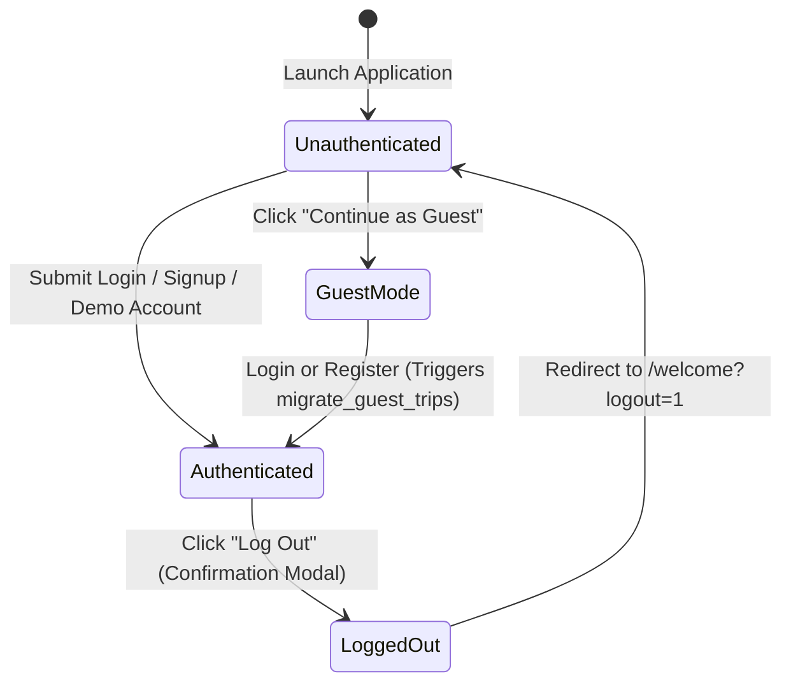

# Desktop Application Architecture: Python Flet Client

**Framework**: Python Flet >= 1.1.2  
**Target Monorepo Directory**: `desktop_client/`  
**Shared Backend API**: FastAPI (`backend/`)  
**Document Ref**: `docs/DESKTOP_APP_ARCHITECTURE.md`  

---

## 1. Directory Structure & Modular Separation

The Python Flet desktop client is organized following strict separation of concerns into configuration, core infrastructure, data models, services, UI components, views, assets, local storage, and automated tests:

```text
desktop_client/
├── assets/                          # Bundled local photography, brand marks, and JSON datasets
│   ├── data/
│   │   └── osm_places.json          # Curated offline OpenStreetMap POI dataset (2,670+ points)
│   ├── popular_destinations/        # Authentic destination photography (Minalungao, Highland Bali, etc.)
│   ├── default_avatar_placeholder.png
│   ├── google_logo.png              # Google brand mark for social sign-in
│   ├── guest_hiker_hero.png         # Guest onboarding hero illustration
│   ├── logout_skyscrapers_blob.png  # After-logout organic skyline frame
│   ├── logout_cityscape_silhouette.png # Bottom skyline silhouette
│   ├── pattranite_avatar.jpg        # Pre-seeded avatar for Pattranite Limpatiyakorn demo persona
│   └── welcome_hero_buildings.png   # Welcome screen bottom cityscape illustration
│
├── config/                          # Application settings, constants, and color palettes
│   ├── __init__.py
│   └── settings.py                  # ThemeColors, ThemePalette, 16 Canonical Categories, 32 LGUs
│
├── core/                            # Foundational cross-cutting utilities
│   ├── __init__.py
│   ├── api_client.py                # Asynchronous httpx REST client with bearer token injection
│   ├── async_utils.py               # Loop-safe task dispatcher (run_async) preventing event loop crashes
│   ├── commute_guide.py             # Municipal transit hubs, tricycle fares, and Haversine leg commute math
│   ├── export.py                    # RFC 5545 iCalendar (.ics), Markdown, JSON, and print HTML export
│   ├── offline_data.py              # Canonical offline places fallback and 32-LGU district metadata
│   ├── session.py                   # SessionManager: JWT bearer credentials, traveler profile, guest mode
│   └── storage.py                   # Local JSON storage engine for guest itineraries and offline cache
│
├── models/                          # Pydantic and dataclass domain entities
│   ├── __init__.py
│   ├── itinerary.py                 # Itinerary, ItineraryDay, ItineraryItem, SuggestedItineraryRequest
│   ├── place.py                     # Place, Municipality, PaginatedPlaces, honest cost calculations
│   └── user.py                      # User, AuthTokenResponse, UserUpdatePayload
│
├── services/                        # Business logic, API communication, and offline orchestration
│   ├── __init__.py
│   ├── auth_service.py              # Login, registration, token refresh, guest trip cloud migration
│   ├── favorites_service.py         # Persistent traveler favorites manager (storage/favorites.json)
│   ├── itinerary_service.py         # Suggested generation, custom CRUD, stop reordering, offline TSP
│   └── place_service.py             # Paginated discovery, search debounce, category filtering, nearby POIs
│
├── components/                      # Reusable, anti-generic Flet UI widgets
│   ├── __init__.py
│   ├── date_range_dialog.py         # Figma travel date picker modal with duration presets (2D/1N, etc.)
│   ├── destination_picker.py        # 32-LGU autocomplete + quick chips + All 32 Towns district modal
│   ├── dialogs.py                   # Rich Place Detail Sheet, Stop Editor, Off-Grid Venue Modal, Export
│   ├── header.py                    # TopHeader: brand title, online/offline status, unread alert bell
│   ├── place_card.py                # Consumer destination card with local photography, rating, honest cost
│   ├── sidebar.py                   # Persistent 4-tab sidebar (Home, Map, Saved, Profile) + dark mode
│   └── stop_card.py                 # Itinerary stop card with inter-stop leg commute badges (time & fare)
│
├── views/                           # High-level full-screen route containers
│   ├── __init__.py
│   ├── custom_builder_view.py       # Dual-pane custom itinerary builder (Catalog + Timeline)
│   ├── dashboard_view.py            # Home dashboard, debounced search, alerts drawer, popular carousel
│   ├── guest_view.py                # Dedicated /guest hero onboarding screen
│   ├── login_view.py                # Traveler login, password reveal, Pattranite demo persona, recovery
│   ├── places_view.py               # Map & POI explorer with split-pane layout and multi-select filter modal
│   ├── profile_view.py              # Profile state machine: Main Menu, Settings, Favorites, Edit, Help, About
│   ├── saved_trips_view.py          # Saved trips grid with days/nights labels and sync status
│   ├── signup_view.py               # 6-field structured registration with M.I. and live validation
│   ├── suggested_wizard_view.py     # 3-view wizard: Questionnaire, Generated Plan Preview, Nearby POIs
│   ├── trip_detail_view.py          # Detailed trip viewer, in-place edit mode, multi-stop Google Maps launcher
│   └── welcome_view.py              # Welcome screen with consumer travel layout and after-logout state
│
├── storage/                         # Local persistence directory (auto-created at runtime)
│   ├── favorites.json               # Persisted user favorites pre-seeded with 3 iconic destinations
│   ├── guest_storage.json           # Offline guest itineraries with JSON schema
│   ├── profile_extra.json           # Local profile metadata (middle initial, custom avatar)
│   └── session.json                 # Persisted JWT tokens and traveler credentials
│
├── tests/                           # Automated pytest verification suites
│   ├── __init__.py
│   ├── test_api_client.py           # ApiClient token injection and exception hierarchy tests
│   ├── test_auth_service.py         # AuthService and SessionManager state transition tests
│   ├── test_itinerary_service.py    # Itinerary calculations, metrics, and payload format tests
│   ├── test_live_integration.py     # Live integration test against running FastAPI backend & SQLite
│   ├── test_place_service.py        # Place model, honest pricing, and category tests
│   ├── test_qa_remediation.py       # Remediation suite for DEF-01 to DEF-15 and BUG-01 to BUG-08
│   ├── test_storage_export.py       # iCalendar, Markdown, JSON export, and guest CRUD tests
│   └── test_ui_consistency.py       # Design system tokens, Figma colors, and view smoke tests
│
└── main.py                          # Application entry point, window constraints, and route manager
```

---

## 2. Monorepo Component Topology & Data Flow

```mermaid
flowchart TD
    subgraph Presentation Layer [Desktop UI (Flet Material 3)]
        Main["main.py (Route Manager & Shell)"]
        Sidebar["SidebarNav (4 Core Tabs + Dark Toggle)"]
        Header["TopHeader (Status & Advisories)"]
        ActiveView["Active View (Preserved Instances)"]
        Main --> Sidebar
        Main --> Header
        Main --> ActiveView
    end

    subgraph Service & Orchestration Layer
        AuthSvc["AuthService"]
        PlaceSvc["PlaceService"]
        ItinSvc["ItineraryService"]
        FavSvc["FavoritesService"]
    end

    subgraph Core Infrastructure Layer
        ApiClient["ApiClient (httpx Async)"]
        SessionMgr["SessionManager (JWT Tokens)"]
        AsyncUtils["async_utils (run_async)"]
        CommuteGuide["commute_guide (Transit Math)"]
        OfflineData["offline_data (OSM & Fallback)"]
        StorageEngine["storage (Guest JSON)"]
    end

    subgraph Backend & Persistence [FastAPI & Databases]
        BackendAPI["FastAPI REST API (/api/v1)"]
        PostgresDB[("PostgreSQL 16 / SQLite 3")]
    end

    ActiveView --> AuthSvc
    ActiveView --> PlaceSvc
    ActiveView --> ItinSvc
    ActiveView --> FavSvc

    AuthSvc --> ApiClient
    AuthSvc --> SessionMgr
    PlaceSvc --> ApiClient
    PlaceSvc --> OfflineData
    ItinSvc --> ApiClient
    ItinSvc --> StorageEngine
    ItinSvc --> CommuteGuide
    FavSvc --> StorageEngine

    ApiClient --> BackendAPI
    BackendAPI --> PostgresDB
```

---

## 3. Reactive UI State Management & View Navigation

### 3.1 Route Management & View Caching in `main.py`
The desktop application employs a single-window shell model with a persistent left sidebar and top contextual header. Rather than discarding view instances on route transitions, `main.py` maintains an internal view cache:

```python
class AppState:
    current_route: str = "/dashboard"
    cached_views: dict[str, ft.Control] = {}
    pending_builder_place: Optional[Place] = None
    selected_trip: Optional[Itinerary] = None
```

* **Preserving Draft State**: When a user switches from `CustomBuilderView` to `PlacesView` to inspect a location, the active builder timeline and unsaved changes are preserved in `cached_views["/builder"]`.
* **Unsaved Changes Guard (`pendingChangesGuard`)**: If an active view reports `has_unsaved_changes = True`, attempting to switch routes opens a modal confirmation dialog:
  ```text
  ┌────────────────────────────────────────────────────────┐
  │  Discard unsaved changes?                              │
  │  You have an unfinished itinerary in progress.         │
  │  Navigating away will discard your draft stops.        │
  │                                                        │
  │     [Keep Editing]       [Discard & Continue]          │
  └────────────────────────────────────────────────────────┘
  ```

### 3.2 Loop-Safe Asynchronous Dispatch (`core/async_utils.py`)
In Python Flet, UI events execute within an active `asyncio` event loop. Attempting to call `asyncio.run(coroutine)` within a synchronous button callback raises `RuntimeError: asyncio.run() cannot be called from a running event loop`.

To guarantee 100% loop safety, all views execute asynchronous logic via `run_async()`:

```python
import asyncio
from typing import Any, Callable, Coroutine

def run_async(coro_func: Callable[[], Coroutine[Any, Any, Any]], page: Any = None) -> None:
    """Dispatches coroutine safely within active Flet environment."""
    if page is not None and hasattr(page, "run_task"):
        page.run_task(coro_func)
        return
    try:
        loop = asyncio.get_running_loop()
        loop.create_task(coro_func())
    except RuntimeError:
        asyncio.run(coro_func())
```

---

## 4. Client Session & Credential Architecture (`core/session.py`)

`SessionManager` operates as a thread-safe singleton managing traveler identity, authentication tokens, and guest mode state:



### Credential Storage & Security Rules
1. **Zero Plaintext Passwords**: Passwords are never stored on disk. They are transmitted over HTTPS/HTTP directly to `/api/v1/auth/login` where they are verified against Argon2id hashes.
2. **Short-Lived Bearer JWTs**: The access token is injected into all outbound API requests via `Authorization: Bearer <token>`.
3. **Session Persistence**: When `persist=True` (Remember Me), tokens are persisted to `desktop_client/storage/session.json`.
4. **Session Clearing on Logout**: Logging out immediately wipes in-memory credentials, deletes `session.json` from disk, and notifies all registered view listeners.

---

## 5. Local Offline Storage Engine (`core/storage.py`)

For guest travelers and offline operations, `GuestStorage` provides atomic, schema-validated file persistence in `desktop_client/storage/guest_storage.json`:

```json
{
  "version": 1,
  "guest_id": "guest_550e8400-e29b-41d4-a716-446655440000",
  "created_at": "2026-11-14T08:00:00Z",
  "itineraries": [
    {
      "id": "itin_local_1",
      "title": "Bongabon Nature & Farm Tour",
      "destination": "Bongabon",
      "start_date": "2026-11-20",
      "end_date": "2026-11-21",
      "daily_budget": 2500.0,
      "days": []
    }
  ]
}
```

* **Atomic File Writes**: Data is serialized to a temporary file (`guest_storage.json.tmp`) and atomically renamed to prevent corruption during unexpected application shutdown.
* **Automatic Cloud Migration**: When an anonymous guest signs in or creates an account, `AuthService.migrate_guest_trips()` transfers all locally stored itineraries to the traveler's cloud account via `POST /api/v1/itineraries`.
