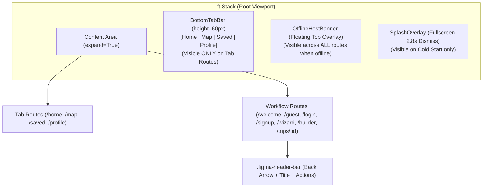
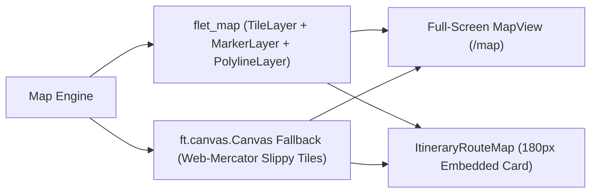
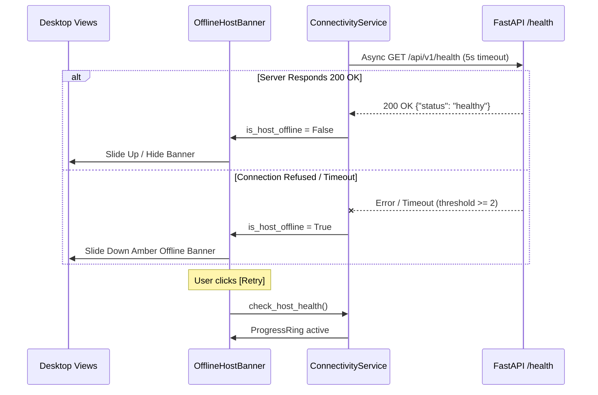

# Desktop Application Architecture: Python Flet Client

**Framework**: Python Flet >= 1.1.2 + `flet-map`  
**Target Monorepo Directory**: `desktop_client/`  
**Shared Backend API**: FastAPI (`backend/`)  
**Document Ref**: `docs/DESKTOP_APP_ARCHITECTURE.md`  

---

## 1. Directory Structure & Modular Separation

The Python Flet desktop client is organized following strict separation of concerns into configuration, core infrastructure, data models, services, UI components, views, assets, local storage, and automated tests:

```text
desktop_client/
├── assets/                          # Bundled local photography, brand marks, and JSON datasets
│   ├── data/
│   │   └── osm_places.json          # Curated offline OpenStreetMap POI dataset (2,673 points)
│   ├── popular_destinations/        # Authentic destination photography (Minalungao, Highland Bali, etc.)
│   ├── default_avatar_placeholder.png
│   ├── guest_hiker_hero.png         # Guest onboarding hero illustration
│   ├── loading_screen.jpg           # Full-bleed splash screen background
│   ├── logout_skyscrapers_blob.png  # After-logout organic skyline frame
│   ├── logout_cityscape_silhouette.png # Bottom skyline silhouette
│   └── welcome_hero_buildings.png   # Welcome screen bottom cityscape illustration
│
├── config/                          # Application settings, constants, and color palettes
│   ├── __init__.py
│   └── settings.py                  # ThemeColors, ThemePalette, 16 Canonical Categories, 32 LGUs
│
├── core/                            # Foundational cross-cutting utilities
│   ├── __init__.py
│   ├── api_client.py                # Asynchronous httpx REST client with bearer token injection
│   ├── async_utils.py               # Loop-safe task dispatcher (run_async) preventing event loop crashes
│   ├── commute_guide.py             # Municipal transit hubs, tricycle fares, and Haversine leg commute math
│   ├── connectivity_service.py      # Host health polling, gateway error tracking, and custom API URL
│   ├── export.py                    # RFC 5545 iCalendar (.ics), Markdown, JSON, and print HTML export
│   ├── offline_data.py              # 2,673 OSM places, 12 canonical curated places, and 32 LGU bounds
│   ├── polyline.py                  # Polyline encode/decode, Haversine, geodesic arc, Google Maps URLs
│   ├── session.py                   # SessionManager: JWT bearer credentials, traveler profile, guest mode
│   └── storage.py                   # Local JSON storage engine for guest itineraries and offline cache
│
├── models/                          # Pydantic and dataclass domain entities
│   ├── __init__.py
│   ├── itinerary.py                 # Itinerary, ItineraryDay, ItineraryItem, SuggestedItineraryRequest
│   ├── place.py                     # Place, Municipality, PaginatedPlaces, honest cost calculations
│   └── user.py                      # User, AuthTokenResponse, UserUpdatePayload
│
├── services/                        # Business logic, API communication, and offline orchestration
│   ├── __init__.py
│   ├── auth_service.py              # Login, registration, token refresh, guest trip cloud migration
│   ├── favorites_service.py         # Persistent traveler favorites manager (storage/favorites.json)
│   ├── itinerary_service.py         # Suggested generation, custom CRUD, stop reordering, offline TSP
│   └── place_service.py             # Paginated discovery, search debounce, category filtering, nearby POIs
│
├── components/                      # Reusable, anti-generic Flet UI widgets
│   ├── __init__.py
│   ├── bottom_tab_bar.py            # 60px 4-tab bottom navigation (Home, Map, Saved, Profile)
│   ├── date_range_dialog.py         # Figma travel date picker modal with duration presets (2D/1N, etc.)
│   ├── destination_picker.py        # 32-LGU autocomplete + quick chips + All 32 Towns district modal
│   ├── dialogs.py                   # Rich Place Detail Sheet, Stop Editor, Off-Grid Venue Modal, Export
│   ├── interactive_map.py           # InteractiveProvinceMap: flet-map with vector canvas fallback
│   ├── itinerary_route_map.py       # ItineraryRouteMap: 180px collapsible day route map with numbered pins
│   ├── offline_banner.py            # Global floating OfflineHostBanner with [Retry] & [X] dismiss
│   ├── place_card.py                # Consumer destination card with local photography, rating, honest cost
│   └── stop_card.py                 # Itinerary stop card with inter-stop leg commute badges (time & fare)
│
├── views/                           # High-level full-screen route containers
│   ├── __init__.py
│   ├── custom_builder_view.py       # 3-stage custom itinerary builder (Form -> Browse -> Timeline)
│   ├── dashboard_view.py            # Home dashboard, debounced search, alerts drawer, popular carousel
│   ├── guest_view.py                # Dedicated /guest hero onboarding screen
│   ├── login_view.py                # Traveler login, password reveal, forgot password modal
│   ├── places_view.py               # Full-screen MapView with search, filter drawer, and Follow-Route mode
│   ├── profile_view.py              # Profile state machine: Main Menu, Settings, Favorites, Edit, Help, About
│   ├── saved_trips_view.py          # Saved trips grid with days/nights labels and sync status
│   ├── signup_view.py               # 6-field structured registration with M.I. and live validation
│   ├── suggested_wizard_view.py     # 3-view wizard: Questionnaire, Generated Plan Preview, Nearby POIs
│   ├── trip_detail_view.py          # Detailed trip viewer, in-place edit mode, multi-stop Google Maps launcher
│   └── welcome_view.py              # Welcome screen with consumer travel layout and after-logout state
│
├── storage/                         # Local persistence directory (auto-created at runtime)
│   ├── favorites.json               # Persisted user favorites pre-seeded with 3 iconic destinations
│   ├── guest_storage.json           # Offline guest itineraries with JSON schema
│   ├── profile_extra.json           # Local profile metadata (middle initial, custom avatar)
│   └── session.json                 # Persisted JWT tokens and traveler credentials
│
├── tests/                           # Automated pytest verification suites
│   ├── __init__.py
│   ├── test_api_client.py           # ApiClient token injection and exception hierarchy tests
│   ├── test_auth_service.py         # AuthService and SessionManager state transition tests
│   ├── test_itinerary_service.py    # Itinerary calculations, metrics, and payload format tests
│   ├── test_live_integration.py     # Live integration test against running FastAPI backend & SQLite
│   ├── test_parity_services_and_components.py # Parity checks: LGUs, offline places, commute, favorites
│   ├── test_place_service.py        # Place model, honest pricing, and category tests
│   ├── test_qa_remediation.py       # Remediation suite for DEF-01 to DEF-15 and BUG-01 to BUG-08
│   ├── test_storage_export.py       # iCalendar, Markdown, JSON export, and guest CRUD tests
│   └── test_ui_consistency.py       # Design system tokens, Figma colors, and view smoke tests
│
└── main.py                          # Application entry point, window constraints, and route manager
```

---

## 2. Layout Shell & Navigation Architecture

The desktop client discards generic enterprise side navigation in favor of the canonical Web App's **Bottom Tab Bar + Contextual Header Architecture**:



### Route Visibility Rules
* **Tab Routes (`/home`, `/map`, `/saved`, `/profile`)**:
  * Main column: `[content_area (expand=True), bottom_tab_bar (height=60)]`.
  * `BottomTabBar` displays 4 centered items: `Home`, `Map`, `Saved`, `Profile`. Active item is colored `#0084ff` (Azure).
  * Tapping the `Map` tab while in Follow-Route Mode automatically exits route focus and returns to full province browse mode.
* **Workflow Routes (`/welcome`, `/guest`, `/login`, `/signup`, `/suggested`, `/builder`, `/trips/:id`)**:
  * `BottomTabBar` is completely hidden.
  * Screen uses a `.figma-header-bar` containing a `←` back arrow, clean title, and contextual action buttons.
* **Global Overlays**:
  * `OfflineHostBanner`: Placed at the top of the root `ft.Stack` with top margin `12px` and `border_radius=14`. Visible across **every route** whenever `connectivity_service.is_host_offline` is `True`.
  * `SplashOverlay`: Covers the entire viewport on application cold start (`loading_screen.jpg`) with a 2.8s timer, dismissible on click or Escape key.

---

## 3. Interactive GIS Mapping Engine

The desktop client provides two interactive mapping layers using `flet-map` with a reliable `flet.canvas.Canvas` Web-Mercator vector fallback:



### 1. Full-Screen Map Tab (`MapView` in `places_view.py`)
* **Layer 1 (Base Map)**: OpenStreetMap raster tiles centered on Nueva Ecija `(15.58, 121.0)`, bounded between `[15.05, 120.55]` and `[16.25, 121.55]`.
* **Layer 2 (Pins)**: Category-colored teardrop pins across 16 canonical categories or numbered route badges (`1..N`) in Follow-Route Mode.
* **Layer 3 (Overlays)**:
  * Top floating search bar with 300ms debounce and clear button.
  * `[Filters]` button opening the **Multi-Select Filter Modal** (Categories, 32 LGUs, Price Tiers).
  * 17 quick horizontal category pills.
  * Right floating controls: Live OSM Overpass query button, Locate button, Province reset button, Zoom `+ / -`.
  * Bottom floating `List View (N)` pill opening the collapsible POI drawer.
  * Slide-up **Interactive POI Bottom Sheet** on pin click.
* **Follow-Route Mode**: Shows active day stops, draws road polyline, displays top route bar (`[← Back to Plan]`, Day pills, Nearby toggle), and bottom stop carousel.

### 2. Embedded Day Route Map (`ItineraryRouteMap`)
* **Dimensions**: `180px` collapsible card embedded directly inside active days of:
  * `SuggestedWizardView` (View 2)
  * `CustomBuilderView` (Timeline pane)
  * `TripDetailView` (View mode)
* **Functionality**:
  * Fits bounds to active day stops.
  * Decodes polyline or queries OSRM driving route (geodesic arc offline fallback).
  * Plots numbered circular stop badges (`1, 2, 3...`).
  * Features a `[Full Map]` button launching the Map tab in Follow-Route mode.

---

## 4. Global Connectivity Architecture



* **`ConnectivityService` (`core/connectivity_service.py`)**:
  * Tracks `is_host_offline`, `is_checking_health`, `consecutive_errors`, and `custom_api_url`.
  * Polls health endpoint and validates custom URLs against trusted protocols and domains.
* **`OfflineHostBanner` (`components/offline_banner.py`)**:
  * Amber cloud-offline icon, clear explanation that cloud sync is paused while local trips remain accessible.
  * Active `[Retry]` button with spinner and SnackBar feedback.
  * `[X]` dismiss button.

---

## 5. 3-Tier Offline Resilience Architecture

1. **Tier 1 (Places & Municipalities)**:
   * When offline, `PlaceService.get_places()` immediately queries the in-memory index of 2,673 OSM places + 12 curated places.
   * `PlaceService.get_municipalities()` returns all 32 LGUs with accurate local counts.
2. **Tier 2 (Suggested Itinerary Generation)**:
   * When offline, `ItineraryService.generate_suggested_itinerary()` invokes `generate_offline_suggested_itinerary()`.
   * Enforces corridor clustering, preference scoring, midday lunch anchor, mountain summit limit, and transparent assumptions.
3. **Tier 3 (Authenticated Write Fallback)**:
   * If network error occurs during trip creation, update, or stop editing, the operation automatically falls back to `GuestStorageService` (`guest_storage.json`).

---

## 6. Clean Authentication Architecture

* **Zero Demo Account**: No fake `"Pattranite Persona"` button. Authenticated users see their real profile; unauthenticated users see `"Guest Explorer"`.
* **Zero Dead Social Buttons**: No non-functional `"Continue with Google"` or `"Continue with Apple"` buttons.
* **Clean Email/Password Flow**:
  * `LoginView`: Email, Password, Eye toggle, Remember me, `Forgot password?` Account Recovery modal, and `Continue as Guest` link.
  * `SignupView`: 6 structured fields (First Name, Middle Initial, Last Name, Username, Email, Password $\ge 8$ chars) with auto-suggested usernames.
  * `GuestView`: Dedicated `/guest` screen with hero image and cloud migration explanation.
