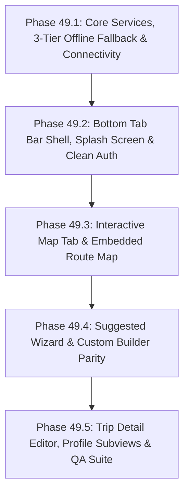

# Nueva Ecija Travel App ("Trip mo, trip ko") — Deep Desktop vs. Web App Re-Evaluation, QA Audit & Antigravity Implementation Plan (v2)

**Skills Applied**: `@coding-and-system-development` | `@anti-generic-frontend-design`  
**Reference Web Application**: `Project/` (Ionic 9 + Angular 22 + Leaflet 1.9.4 + MarkerCluster + Capacitor 8)  
**Target Desktop Application**: `desktop_client/` (Python Flet >= 1.1.2 + `flet-map` + httpx + Pydantic 2.10)  
**Shared Backend API**: `backend/` (FastAPI at `http://127.0.0.1:8000/api/v1`)  
**Audit Date**: November 14, 2026  
**Document Ref**: `docs/DESKTOP_APP_PARITY_AND_IMPLEMENTATION_PLAN.md`

---

## 1. Antigravity Master Directive & Core Corrections

Act as a Senior Python Flet Engineer, GIS/Map Integration Architect, Senior UI/UX Designer, and QA Lead governed by `@coding-and-system-development` and `@anti-generic-frontend-design`.

### Why the Previous Desktop Implementation & QA Required Re-Evaluation
The previous desktop build and its initial report claimed "feature parity" while falling short of 6 fundamental product requirements:
1. **Layout Was a Side Menu (`SidebarNav` + `TopHeader`)**: The Web App uses a **4-Tab Bottom Navigation Bar (`.custom-tab-bar`: `Home`, `Map`, `Saved`, `Profile`)** on core tab screens and hides the tab bar on full-screen workflow views (`/welcome`, `/guest`, `/login`, `/signup`, `/suggested-wizard`, `/custom-builder`, `/itinerary/:id`) which use their own `.figma-header-bar` (`←` back button + title + action). The desktop app's `250px` dark-navy left side menu (`components/sidebar.py`) and `64px` top header (`components/header.py`) make it look like a generic enterprise admin dashboard and destroy in-progress wizard/builder state on navigation. **The side menu layout must be replaced with the exact Bottom Tab Bar + Contextual Top Header architecture of the Web App.**
2. **Missing True Interactive Map**: The interactive map was previously replaced by a coordinate pin preview canvas instead of a true GIS map. In the Web App, the interactive map is the core of **two major modules**: (a) the full-screen **Map Tab (`/tabs/map`)** with OpenStreetMap tiles, category-colored teardrop pins, marker clustering, viewport search/filter, collapsible POI list drawer, and Follow-Route navigation mode; and (b) the **Embedded Day Route Map (`ItineraryRouteMapComponent`)** inside `SuggestedWizardPage`, `CustomBuilderPage`, and `ItineraryDetailPage` showing numbered stop pins (`1, 2, 3...`) and decoded road/geodesic polylines. **The desktop app must implement both interactive maps using `flet-map` (`flet_map`) + interactive canvas fallback.**
3. **Missing Server Connection Status Like Web App**: In the Web App (`app.component.html` + `connectivity.service.ts`), whenever the backend is unreachable, a **Global Top Floating Offline Mode Banner (`.offline-host-banner`)** slides down across any screen with an amber cloud-offline icon, `"Offline Mode — Cloud sync paused. Your saved trips and curated destinations remain accessible."`, an active **`[Retry]` button** (with spinner and top toast feedback `"Connected to backend server! Reloading data..."` vs. `"Server is currently offline..."`), and a **`[X]` dismiss button**, alongside a live status dot and Custom API URL setting in `Profile → Settings`. In the desktop app, `welcome`, `login`, and `signup` had no connection indicator at all, and raw socket checks hardcoded `127.0.0.1:8000` with no retry button, no toast, and no URL override.
4. **Missing 3-Tier Proper Offline Fallback**: When the FastAPI backend is offline, the desktop app must not throw unhandled `NetworkError` showing 0 places on Home, Search, Map, and Custom Builder, or block Suggested Itinerary generation with an error banner. In contrast, the Web App seamlessly falls back across 3 tiers: (a) loading the **2,673 bundled OpenStreetMap POIs (`Project/src/assets/data/osm_places.json`)** + **12 Curated Featured Places (`offline-places.data.ts`)** in `PlaceService`; (b) running the **Deterministic Offline Suggested Itinerary Clustering Engine (`generateOfflineSuggestedItinerary`)** in `ItineraryService`; and (c) falling back to `GuestStorage` when authenticated writes fail offline.
5. **Redundant Demo Account & Non-Functional Google/Apple Buttons**: Having an active `"Explore Demo Account (Pattranite Persona)"` when there is already a full **Guest Account (`Continue as Guest`)** is redundant and confusing (and leaks persona names). Furthermore, the **Google** and **Apple** social login buttons on Login and Signup are dead buttons that only show a `"disabled in this pilot build"` toast, violating `@anti-generic-frontend-design` Section 2 (*"Buttons that do nothing / Decorative controls that appear interactive but are not functional"*). **Remove the Demo Account and remove the Google and Apple buttons completely.**
6. **Code-Level Runtime Crashes & Deprecations**: Remediate remaining issues: replace all `ft.ElevatedButton` with `ft.FilledButton`, implement `pendingChangesGuard` to protect dirty itineraries, support multi-stop Google Maps URL generation, and ensure full dark-mode palette coverage across all views.

---

## 2. Comprehensive Comparison Matrix: Web App vs. Desktop App

| Feature / Architectural Layer | Web App Behavior (`Project/src/app/`) | Desktop App Target (100% Parity + Clean Auth) |
| :--- | :--- | :--- |
| **1. App Launch Splash Screen** | Full-screen splash (`loading_screen.jpg`), rotated airplane + `"Trip mo, trip ko"`, tagline, pulsing `"Tap or swipe to enter"`, auto-dismisses after 2.8s or on click/Esc (`app.component.html`). | Implement `SplashOverlay` in `main.py` using `desktop_client/assets/images/loading_screen.jpg` with 2.8s auto-dismiss and click/Esc dismiss. |
| **2. Primary Navigation Shell** | **Bottom Tab Bar (`.custom-tab-bar`, `60px` height)** with 4 tabs (`Home`, `Map`, `Saved`, `Profile`). Hidden on `/welcome`, `/guest`, `/login`, `/signup`, `/suggested-wizard`, `/custom-builder`, `/itinerary/:id`. | **Delete `SidebarNav` and `TopHeader`.** Implement `BottomTabBar` (`height=60`) shown ONLY on `/home`, `/map`, `/saved`, `/profile`. Use contextual `.figma-header-bar` on workflow screens. |
| **3. Server Connectivity Indicator** | **Global Floating Top Offline Banner (`.offline-host-banner`)** on all screens when `GET /api/v1/health` fails, with `[Retry]` button (spinner + toast) and `[X]` dismiss (`app.component.html`, `connectivity.service.ts`), plus Settings status dot & custom API URL. | Implement `ConnectivityService` (`GET {active_api_url}/health`) + Global Floating `OfflineHostBanner` overlaid at top of `page` across all routes with `[Retry]` & `[X]`, plus Settings API URL config. |
| **4. Offline Fallback Architecture** | **3-Tier Fallback**: (1) `PlaceService` loads `osm_places.json` (2,673 POIs) + `CANONICAL_OFFLINE_PLACES`; (2) `ItineraryService` runs `generateOfflineSuggestedItinerary()` clustering; (3) Authenticated writes fall back to `GuestStorage` on network error. | Port all 3 fallback tiers into `desktop_client`: load `osm_places.json` (2,673 POIs) + `CANONICAL_OFFLINE_PLACES`, port `generate_offline_suggested_itinerary()`, and fallback authenticated writes to `guest_storage.json`. |
| **5. Auth, Demo & Social Buttons** | Has Email/Password Login, Signup, Guest Mode (`/guest`), `Forgot password?` modal, plus pilot-disabled Google/Apple buttons and redundant `Pattranite` Demo Account. | Keep **Email/Password Log In**, **Sign Up** (with `Username` + `M.I.`), **`Forgot password?` modal**, and **Guest Mode (`/guest`)**. **Strictly omit Demo Account (`Pattranite`) and omit Google/Apple buttons.** |
| **6. Interactive Map Tab (`/map`)** | Full-screen Leaflet map (`[15.58, 121.0]`, bounds `[[15.05, 120.55], [16.25, 121.55]]`), OSM tiles, category-colored teardrop pins, clustering, floating search + `Filters` modal + 17 category pills, floating `Live OSM`, `Locate`, `Recenter`, `List View (N)` drawer, POI bottom sheet, and Follow-Route mode (`map.page.ts`). | Implement `MapView` powered by `flet_map` (`Map`, `TileLayer`, `MarkerLayer`, `PolylineLayer`) + interactive canvas fallback, replicating all overlays, drawers, filters, and Follow-Route mode. |
| **7. Embedded Day Route Map** | `ItineraryRouteMapComponent` (`180px` collapsible map card) inside `SuggestedWizardPage`, `CustomBuilderPage`, and `ItineraryDetailPage` with numbered stop pins (`1, 2, 3...`), OSRM/decoded/geodesic polyline, and `[Full Map]` button. | Create `ItineraryRouteMap` component (`desktop_client/components/itinerary_route_map.py`) and embed it inside every active day of Suggested Wizard, Custom Builder, and Trip Detail. |
| **8. Suggested Itinerary Wizard** | 3-view state machine (`form` → `itinerary` → `nearby`), 32-LGU Autocomplete + Quick Chips + All 32 Towns District Modal, Date Picker Modal (`From`/`To` + presets), Budget input + presets, 5 Preference pills, Travel Mode (`DRIVE`/`TWO_WHEELER`/`WALK`), Min Rating, preview-first (`save_immediately=False`), Verified Budget Card, Assumptions Box, Day Capsule Bar, Route Map, Leg Commute Badges, Nearby Places (`Restaurants`/`Hospitals`/`Stores`), `[Accept & Save]` + `[Customize in Builder]`. | Rebuild `SuggestedWizardView` to match the Web App's exact 3-view flow, components, embedded route map, and offline clustering fallback. |
| **9. Custom Itinerary Builder** | 3-stage guided flow (`form` → `browse` → `timeline`), 32-LGU Autocomplete, Date Picker Modal (auto-creating Day 1..N), stateful `+ Add` / `✓ Added` buttons, `[Auto-Schedule]`, `[Delete Day]`, Route Map, Leg Commute Badges, `Move to Day` in Edit Stop, and geofenced Lat/Lng (`15.15–16.15`, `120.70–121.40`) + Address in Off-Grid modal. | Rebuild `CustomBuilderView` to support Stage 1 setup, pre-loaded place banner, edit-existing-itinerary mode, stateful `+ Add` / `✓ Added`, `[Auto-Schedule]`, `[Delete Day]`, `Move to Day`, embedded route map, and geofenced custom coordinates. |
| **10. Saved Trips & Trip Detail** | `HistoryPage` with search, 5 segment pills (`All`, `Upcoming`, `Past`, `Suggested`, `Custom`), `X Days, Y Nights` pill. `ItineraryDetailPage` with **In-Place Edit Mode**, Verified Budget Card, Assumptions, Day Route Metrics, `[In-App Nav]`, `[Google Maps]` multi-stop route, Embedded Route Map, Leg Commute Badges, Nearby Places, and Share/Export modal (`.ics`, Copy Text, Print/PDF). | Upgrade `TripDetailView` with full In-Place Edit Mode, Embedded Route Map, Day Route Metrics, Multi-Stop Google Maps launcher, Leg Commute Badges, Nearby Places, and 4-option Share/Export modal. |
| **11. Profile & Subviews** | 6-view hub (`profile`, `settings`, `edit`, `favorites`, `help`, `about`), 5-row Figma Menu Card, `FavoritesService` (seeded with 3 places), 7-field Edit Profile with Avatar upload, Help FAQs + Nueva Ecija Emergency Hotlines, and Figma Exit-Door Logout Modal. | Implement all 6 Profile subviews, `FavoritesService`, `migrate_guest_trips()`, 7-field Edit Profile (with no hardcoded persona strings), Figma Logout Modal, and reactive Light/Dark theme tokens. |

---

## 3. Deep QA Audit: All 14 Confirmed Defects (`QA-01` to `QA-14`)

### 3.1 Architectural, Layout & UX Defects (`QA-01` to `QA-06`)

* **QA-01 (Critical — Side Menu Layout Instead of Web App Bottom Tab Bar)**:
  * **Files**: `desktop_client/main.py`, `desktop_client/components/sidebar.py`, `desktop_client/components/header.py`.
  * **Defect**: The desktop app wraps views in a `250px` left `SidebarNav` and `64px` `TopHeader` instead of the Web App's `60px` bottom `.custom-tab-bar` (`Home`, `Map`, `Saved`, `Profile`) and full-screen workflow headers (`.figma-header-bar`). Furthermore, view instances were re-instantiated on route switch without preserving drafts.
* **QA-02 (Critical — Complete Absence of Interactive Map & Embedded Route Map)**:
  * **Files**: `desktop_client/views/places_view.py`, `suggested_wizard_view.py`, `custom_builder_view.py`, `trip_detail_view.py`, `requirements.txt`.
  * **Defect**: Neither the full-screen interactive provincial map (`/tabs/map` with OSM tiles, category teardrop pins, clustering, floating filters, POI drawer, and Follow-Route mode) nor the `180px` embedded day route preview map (`ItineraryRouteMapComponent` with numbered stop pins and route polylines) was implemented with true GIS mapping.
* **QA-03 (Critical — Missing Web-Style Server Connection Banner, Retry Action & Health Endpoint Check)**:
  * **Files**: `desktop_client/main.py`, `desktop_client/core/api_client.py`, `desktop_client/components/header.py`.
  * **Defect**:
    1. `ApiClient.check_health_sync()` opened a raw TCP socket to hardcoded `("127.0.0.1", 8000)` instead of calling `GET {active_api_base_url}/health` and ignored custom API URLs.
    2. Missing Global Top Floating Offline Mode Banner (`.offline-host-banner`) with `[Retry]` (spinner + toast feedback) and `[X]` dismiss across all screens (`welcome`, `login`, `signup`, `home`, `map`, `wizard`, `builder`, `saved`, `profile`), and no interactive Server Status & Custom API URL tester in Settings.
* **QA-04 (Critical — No Proper Offline Fallback for Places, Municipalities, Suggested Clustering, or Authenticated Writes)**:
  * **Files**: `desktop_client/core/api_client.py`, `desktop_client/services/place_service.py`, `desktop_client/services/itinerary_service.py`.
  * **Defect**: When the FastAPI server was offline, `ApiClient.request()` threw `NetworkError`. `PlaceService` lacked automatic fallback to `Project/src/assets/data/osm_places.json` (2,673 POIs) or `CANONICAL_OFFLINE_PLACES`, resulting in empty screens. `ItineraryService` lacked an offline clustering fallback (`generateOfflineSuggestedItinerary`).
* **QA-05 (High — Active Demo Account & Non-Functional Google/Apple Buttons)**:
  * **Files**: `login_view.py`, `signup_view.py`, `welcome_view.py`.
  * **Defect**: The app already has a dedicated **Guest Mode (`Continue as Guest`)** with local storage and cloud sync migration. Having an active `"Explore Demo Account (Pattranite Persona)"` was redundant, and displaying non-functional `"Continue with Google"` and `"Continue with Apple"` buttons that only pop up a pilot disabled toast violated `@anti-generic-frontend-design`.
* **QA-06 (High — Fake Notification Bell & Unresolved Local Asset Photography)**:
  * **Files**: `desktop_client/views/dashboard_view.py`, `desktop_client/components/place_card.py`, `desktop_client/components/dialogs.py`.
  * **Defect**: Clicking notification bell simply cleared unread count without opening the Travel Advisories Drawer. Destination cards must always resolve authentic photography through `resolve_place_image()` to prevent generic placeholders.

### 3.2 Code-Level Runtime Exceptions & Logic Bugs (`QA-07` to `QA-14`)

* **QA-07 (Critical — `SavedTripsView._create_trip_card` Crashes with `AttributeError: 'Itinerary' object has no attribute 'total_days'`)**: Added `total_days` and `days_nights_label` properties to `Itinerary`.
* **QA-08 (Critical — `PlacesView._fetch_places` Raises Silent `TypeError` on Every Query)**: Aligned parameter names to `municipality_id` and `sort` in `PlaceService.get_places()`.
* **QA-09 (Critical — `ProfileView._sync_guest_trips` Crashes with `AttributeError: 'AuthService' object has no attribute 'migrate_guest_trips'`)**: Implemented `migrate_guest_trips()` on `AuthService` and `ItineraryService`.
* **QA-10 (Critical — `ItineraryService.generate_suggested_itinerary` Raises `NameError: name 'ApiClientError' is not defined`)**: Imported `ApiClientError` and `NetworkError` from `core.api_client`.
* **QA-11 (High — Clicking a Saved Itinerary Card on `DashboardView` Reloads Home Instead of Opening `TripDetailView`)**: Passed `itin` in `on_navigate(f"/trips/{itin.id}", itin)` and enabled fallback ID lookup.
* **QA-12 (Critical — `asyncio.run()` Inside Active Flet Event Loop Raises `RuntimeError`)**: Routed all async UI tasks through `run_async()`.
* **QA-13 (High — Dark Mode Toggle Does Not Re-Theme Views or Cards)**: Implemented reactive `ThemePalette` tokens across all views.
* **QA-14 (High — `+ Add to Trip` Discards Selected Place & `SignupView` Discards `M.I.` Input)**: Preserved selected place in builder routing and preserved middle initial in profile extra.

---

## 4. Phased Implementation Plan for Antigravity (Phase 49)



### Phase 49.1: Core Services, 3-Tier Offline Fallback, Connectivity Banner & Bug Fixes (`QA-03`, `QA-04`, `QA-07`–`QA-14`)
1. **Update `desktop_client/requirements.txt`**: Add `flet-map>=0.1.0`.
2. **Verify `desktop_client/core/async_utils.py`**: Loop-safe `run_async(coro_func, page=None)` (`QA-12`).
3. **Create `desktop_client/core/polyline.py`**: Port `encode_polyline()`, `decode_polyline()`, `haversine_distance_meters()`, `generate_geodesic_arc()`, and `build_google_maps_day_route_url()`.
4. **Create `desktop_client/core/connectivity_service.py`**: Port `ConnectivityService` (`check_host_health()` calling `GET {active_api_base_url}/health`, `is_host_offline`, `is_checking_health`, `set_custom_api_url()`, `clear_custom_api_url()`, `dismiss_banner()`, listener callbacks) (`QA-03`).
5. **Update `desktop_client/core/offline_data.py` & `desktop_client/core/commute_guide.py`**:
   - Load `Project/src/assets/data/osm_places.json` (2,673 POIs) + `CANONICAL_OFFLINE_PLACES` (`offline-places.data.ts`), `NUEVA_ECIJA_32_LGUS`, `NUEVA_ECIJA_TOP_LANDMARKS`, `get_offline_day_cluster_presets()`, and `get_offline_nearby_places()`.
   - Port `COMMUTE_BY_MUNICIPALITY`, `get_commute_info_for_municipality()`, and `get_leg_commute_info()` from `commute-guide.data.ts` (`QA-04`).
6. **Update `desktop_client/config/settings.py`**:
   - Add `ThemePalette` (Light & Dark tokens matching `global.scss` `body.dark`) (`QA-13`).
   - Add `resolve_place_image(name, image_url)` mapping local `assets/images/...` paths and place names to `Project/src/assets/images/` (`QA-06`).
7. **Update `desktop_client/models/itinerary.py`, `place.py`, and `user.py`**:
   - Add `total_days`, `days_nights_label`, and `calculate_budget_summary()` to `Itinerary` (`QA-07`).
   - Add `username`, `first_name`, `last_name`, `middle_initial`, `birthday`, `gender`, and `phone_number` support to `User` / `ProfileExtra`.
8. **Update `desktop_client/services/place_service.py`, `itinerary_service.py`, `auth_service.py`, and `favorites_service.py`**:
   - Fix `PlaceService.get_places()` kwargs and add automatic fallback to the 2,673 OSM + curated places (`QA-04`, `QA-08`).
   - Import `ApiClientError`/`NetworkError` in `itinerary_service.py` (`QA-10`), add `generate_offline_suggested_itinerary()` (`QA-04`), add authenticated-write fallback to `guest_storage`, and add `active_draft_itinerary` caching.
   - Implement `migrate_guest_trips()` in `AuthService` (`QA-09`).
   - Maintain `FavoritesService` seeded with 3 featured Nueva Ecija places.

### Phase 49.2: Bottom Tab Bar Shell, Splash Screen, Offline Banner & Clean Auth (`QA-01`, `QA-03`, `QA-05`)
1. **Create `desktop_client/components/bottom_tab_bar.py` & `desktop_client/components/offline_banner.py`**:
   - Build `BottomTabBar` (`Home`, `Map`, `Saved`, `Profile`, `height=60`) matching `.custom-tab-bar`.
   - Build `OfflineHostBanner` matching `.offline-host-banner` with `[Retry]` (spinner + toast) and `[X]` dismiss (`QA-03`).
2. **Refactor `desktop_client/main.py`**:
   - Remove `SidebarNav` and `TopHeader` (`QA-01`).
   - Add `SplashOverlay` (`loading_screen.jpg`, auto-dismiss after 2.8s or on click/Esc).
   - Mount `OfflineHostBanner` at the top of the root `ft.Stack` across all routes.
   - Show `BottomTabBar` only on `/home`, `/map`, `/saved`, `/profile`; hide it on `/welcome`, `/guest`, `/login`, `/signup`, `/suggested`, `/builder`, `/trips/{id}`.
   - Preserve view state and enforce the unsaved-changes confirmation guard (`pendingChangesGuard`).
3. **Update `welcome_view.py`, `guest_view.py`, `login_view.py` & `signup_view.py`**:
   - Refactor `WelcomeView` with `welcome_hero_buildings.png`, `/guest` screen (`guest_hiker_hero.png`), and After-Logout view (`logout_skyscrapers_blob.png`, `logout_cityscape_silhouette.png`).
   - Add `Forgot password?` Account Recovery Modal to `LoginView`.
   - Add `Username` (auto-suggested) and `M.I.` persistence + `>= 8` char password check to `SignupView` (`QA-14`).
   - **Ensure zero Demo Account buttons and zero Google/Apple buttons exist on `LoginView`, `SignupView`, or `WelcomeView` (`QA-05`).**

### Phase 49.3: Interactive Map Creation (`MapView` & `ItineraryRouteMap`) (`QA-02`)
1. **Create `desktop_client/components/interactive_map.py` (`InteractiveProvinceMap`)**:
   - Implement the interactive map using `flet_map` (`Map`, `TileLayer`, `MarkerLayer`, `PolylineLayer`) with automatic interactive `ft.canvas.Canvas` fallback.
   - Support category-colored teardrop markers, numbered route stop markers (`1..N`), decoded route polylines (`#0284c7` / `#2563eb`), zoom `+ / -`, `Recenter`, `Locate`, and `Live OSM Overpass` fetching.
2. **Create `desktop_client/components/itinerary_route_map.py` (`ItineraryRouteMap`)**:
   - Build the `180px` collapsible day route map card (`Day X Route`, `N stops` badge, `[Full Map]` button, collapse chevron) that renders the day's numbered stop pins and OSRM/decoded/geodesic polyline.
3. **Rebuild `desktop_client/views/places_view.py` as `MapView`**:
   - Full-screen interactive map with top floating search bar, `[Filters]` button + **Multi-Select Filter Modal** (16 categories, 32 LGUs, 4 price tiers), 17 quick category filter pills, floating right-side controls, bottom `List View (N)` toggle pill + **Collapsible POI List Drawer**, slide-up **Interactive POI Bottom Sheet**, and **Isolated Follow-Route Mode** (top route control bar + day pills + `[Show Nearby POIs]` toggle + bottom stop carousel + `[Google Maps Navigation]` button).

### Phase 49.4: Home Dashboard, Suggested Wizard & Custom Builder Parity (`QA-06`, `QA-11`, `QA-14`)
1. **Update `desktop_client/views/dashboard_view.py` & `components/dialogs.py`**:
   - Add `300ms` debounced live search with clear (`X`) button and offline fallback.
   - Build the **Travel Advisories & Notifications Drawer (`UI-19`)** and **Popular Destinations "See all" Catalog Modal (`UI-11`)**.
   - Upgrade `PlaceDetailSheet` / `show_place_detail_dialog` with Favorite Heart toggle, `Open Now` badge, Provenance badge, Operating Hours accordion, **`How to get there?` Local Commute Guide**, **`[✨ Start Trip Here]`**, and **`[+ Add to Trip]`**.
   - Fix saved itinerary card click (`QA-11`) so clicking a trip opens `TripDetailView`.
2. **Maintain `components/destination_picker.py` & `date_range_dialog.py`**:
   - Reusable **32-LGU Destination Autocomplete Combobox + Quick Chips + All 32 Towns District Modal** and **Date Picker Pop-Up Modal**.
3. **Rebuild `desktop_client/views/suggested_wizard_view.py`**:
   - Implement the 3-view state machine (`form` → `itinerary` → `nearby`) with `.figma-header-bar`, Destination Autocomplete, Date Picker Modal, Budget input + presets, 5 Preference pills, Pacing, Travel Mode (`DRIVE`, `TWO_WHEELER`, `WALK`), and Min Rating (`0`, `4.0`, `4.5`).
   - In View 2 (`itinerary`), render the Destination Top Card, `.verified-budget-card`, collapsible `.assumptions-info-box`, Day Capsule Bar with municipality names, **Embedded `ItineraryRouteMap`**, Stop Cards with thumbnails and **Inter-Stop Leg Commute Badges (`km • drive/tricycle • fare`)**, Nearby Places trigger banner, `[✓ Accept & Save Itinerary]`, and `[✎ Customize in Builder]`.
   - In View 3 (`nearby`), render segmented tabs (`Restaurants`, `Hospital & Pharmacies`, `Stores`) with `[Maps]` and `[+ Add to Day N]`.
4. **Rebuild `desktop_client/views/custom_builder_view.py`**:
   - Support Stage 1 setup questionnaire (`form`), Catalog browse (`browse`), and Timeline (`timeline`), plus pre-loaded place banner (`QA-14`) and edit-existing-itinerary mode.
   - Add stateful `+ Add` / `✓ Added` buttons, `[Auto-Schedule]`, `[Delete Day]`, **Embedded `ItineraryRouteMap`**, Leg Commute Badges, `Move to Day` in Edit Stop, and Nueva Ecija geofenced coordinates (`Lat 15.15–16.15`, `Lng 120.70–121.40`) + Address in the Off-Grid Venue modal.

### Phase 49.5: Saved Trips, In-Place Trip Editor, Profile Subviews & Automated QA Suite
1. **Update `desktop_client/views/saved_trips_view.py` & `views/trip_detail_view.py`**:
   - Display `days_nights_label` on saved trip cards (`QA-07`).
   - Add **In-Place Edit Mode (`is_edit_mode`)**, Verified Budget Card, Trip Assumptions, Day Route Metrics Banner (`km` + travel time + stops), `[In-App Nav]` (routes to `/map` in Follow-Route Mode), `[Google Maps]` multi-stop route launcher, **Embedded `ItineraryRouteMap`**, Leg Commute Badges, Nearby Places explorer, and the 4-option **Share & Export Modal** (`.ics`, Copy Text Summary, `.md`/`.json`, Print/PDF sheet).
2. **Update `desktop_client/views/profile_view.py`**:
   - Implement all 6 views (`profile`, `settings`, `edit`, `favorites`, `help`, `about`), the **5-row Figma Profile Menu Card**, `Favorites` manager, 7-field `Edit Profile` with Avatar upload (and zero persona hardcoded strings), `Settings` with **Server Connection Status & Custom API URL tester**, `Help & Support` with FAQs & Nueva Ecija Emergency Hotlines, and the Figma Exit-Door `Log Out?` modal.
3. **Expand `desktop_client/tests/`**:
   - Add comprehensive tests verifying:
     - Bottom Tab Bar navigation and absence of `SidebarNav` (`QA-01`).
     - `InteractiveProvinceMap` and `ItineraryRouteMap` instantiation, marker plotting, polyline decoding, and Follow-Route mode (`QA-02`).
     - `ConnectivityService` health check, custom API URL validation, and `OfflineHostBanner` retry/dismiss behavior (`QA-03`).
     - 3-tier offline fallback: 2,673 OSM places loading/filtering offline, `generate_offline_suggested_itinerary()` clustering offline, and authenticated write fallback to `guest_storage.json` (`QA-04`).
     - Absence of Demo Account and Google/Apple buttons on `LoginView` and `SignupView` (`QA-05`).
     - All 8 runtime bug fixes (`QA-07` through `QA-14`) inside an active `asyncio` event loop.

---

## 5. Verification Commands

```powershell
# Windows PowerShell
python -m pip install -r desktop_client/requirements.txt
python -m pytest desktop_client/tests -v
```
