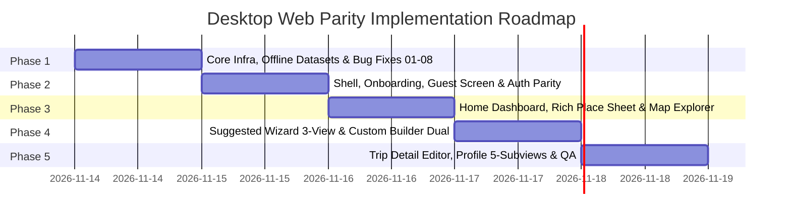

# Desktop Application Visual Parity & Implementation Plan

**Reference Web Application**: `Project/` (Ionic 9 + Angular 22 + Leaflet + Capacitor)  
**Target Desktop Application**: `desktop_client/` (Python Flet >= 1.1.2)  
**Design Standard**: Figma UI/UX Tokens (`Travel Itinerary App.fig`) & `@anti-generic-frontend-design`  
**Document Ref**: `docs/DESKTOP_APP_PARITY_AND_IMPLEMENTATION_PLAN.md`  

---

## 1. Visual Parity & Design System Rubric

### 1.1 Anti-Generic Design Principles Applied
1. **Regional Context & Character**:
   - Primary Accent: **Pantabangan Azure Blue** (`#0084ff` / `#0066cc`) reflecting Central Luzon's water systems.
   - Secondary Accents: **Sierra Madre Emerald** (`#047857` / `#ecfdf5`) for verified budgets and **Midnight Navy** (`#091338` $\to$ `#03081e`) for suggested itinerary action cards.
   - Sky Blue Contour: `1.5px solid #38bdf8` for custom plan action cards.
2. **Authentic Photography Over Placeholders**:
   - Zero grey stub rectangles: Destination cards resolve authentic photography from `desktop_client/assets/` (Minalungao, Highland Bali, Pantabangan Lake, Tagpuan sa Lumang Gapan, etc.).
3. **Honest Consumer Pricing**:
   - Render exact admission fee ranges (`₱min - ₱max`) or `"Free Admission"`. Never default missing fees to `₱0.00`.
4. **Geographic Transit Intelligence**:
   - Surface inter-stop leg commute badges (`🚗 X.X km • X mins drive • ~₱XX-₱YY`) and the `How to get there?` municipal commute guide directly in the UI.

---

## 2. Screen-by-Screen Parity Specifications

### 2.1 App Shell & Navigation (`components/sidebar.py`, `header.py`)
* **4-Tab Navigation**: Persistent Azure pill highlight for `Home` (`/dashboard`), `Map` (`/places`), `Saved` (`/trips`), and `Profile` (`/profile`), with secondary launchers for `Suggested Wizard` and `Custom Builder`.
* **View State Caching**: Active view instances are preserved in memory to prevent discarding unsaved drafts during tab switches.
* **Unsaved Changes Guard (`pendingChangesGuard`)**: Confirmation dialog prevents accidental navigation away from dirty custom builder or trip edit sessions.
* **Theme Switching**: Dark mode toggle dynamically re-renders all controls using `ThemePalette` dark tokens.

### 2.2 Onboarding & Authentication (`welcome_view.py`, `guest_view.py`, `login_view.py`, `signup_view.py`)
* **Welcome View**: Airplane brand mark, `"Your next adventure\nis waiting."`, solid Azure pills (`Log in`, `Sign up`), black outlined `Continue as Guest` pill, bottom-anchored `welcome_hero_buildings.png`.
* **Guest Screen (`/guest`)**: Hero illustration `guest_hiker_hero.png` with floating back arrow, `"Explore as a guest"`, local storage disclosure, and `Continue as Guest` primary CTA.
* **After-Logout Screen (`/welcome?logout=1`)**: Organic skyscraper frame `logout_skyscrapers_blob.png`, `"You're now logged out"`, and bottom silhouette `logout_cityscape_silhouette.png`.
* **Login View**: Back arrow, password visibility eye toggle, `Forgot password?` modal, disabled social pills, and **`Explore Demo Account (Pattranite Persona)`** one-click login (authenticates `@loverrukk@gmail.com` with `pattranite_avatar.jpg`).
* **Signup View**: 6-field structured registration matching `UserRegisterIn`: First Name, Middle Initial, Last Name, Username, Email, Password, and Confirm Password with `>= 8` char live validation.

### 2.3 Home Dashboard & Place Detail Sheet (`dashboard_view.py`, `dialogs.py`)
* **Home Dashboard**: Two-line greeting *"Where are you going next?"*, 300ms debounced search with clear button, Travel Advisories & Notifications Drawer (`UI-19`), Suggested Itinerary Navy Gradient Card, Custom Itinerary Sky-Blue Card, and Popular Destinations Carousel with "See all" modal (`UI-11`).
* **Rich Place Detail Sheet**:
  * Hero photo resolved from local assets.
  * Favorite heart toggle button wired to `FavoritesService`.
  * `Open Now` / `Closed` live status pill computed from `opening_hours`.
  * Multi-photo thumbnail strip when `len(place.photos) > 1`.
  * Operating Hours collapsible accordion.
  * `How to get there?` Local Commute Guide box (transit hub, drop-off point, travel time, estimated fare).
  * CTAs: `[✨ Start Trip Here]` and `[+ Add to Trip]`.

### 2.4 Map & POI Explorer (`places_view.py`)
* **Dual-Pane Layout**: Left scrollable destination cards list + Right interactive map/coordinate preview pane.
* **Multi-Select Filter Modal**: Multi-category selection chips, 32-municipality chips, and price tier chips (`Free`, `Budget <= ₱500`, `Mid <= ₱1,500`, `Luxury > ₱1,500`).

### 2.5 Suggested Itinerary Wizard (`suggested_wizard_view.py`)
* **3-View State Machine**:
  * `view_mode = "form"`: 32-LGU searchable autocomplete with district badges, `[🗺️ All 32 Towns]` modal, Date Picker modal with duration presets (`2D/1N`, `3D/2N`, etc.), daily budget input + preset pills, travel mode, and min rating.
  * `view_mode = "itinerary"`: Destination card, Verified Budget Card, Trip Assumptions Box, Day Capsule Bar with town names, stop cards with Leg Commute Badges, `[Accept & Save]`, and `[Customize in Builder]`.
  * `view_mode = "nearby"`: Segmented capsule tabs (`Restaurants`, `Hospitals`, `Stores`) with one-click `[+ Add to Day N]`.

### 2.6 Custom Itinerary Builder (`custom_builder_view.py`)
* **Dual-Pane Workspace**: Left Catalog Pane (`Add Places`) + Right Timeline Pane (`Your Custom Itinerary`).
* **Workflows**: Stage 1 questionnaire for new trips, pre-loaded place banner for `+ Add to Trip`, and edit mode for existing trips.
* **Features**: Stateful `+ Add` / `✓ Added` buttons, `[Auto-Schedule]`, `[Delete Day]`, `Move to Day` dropdown in edit stop dialog, and geofenced off-grid pins.

### 2.7 Saved Trips & Trip Detail (`saved_trips_view.py`, `trip_detail_view.py`)
* **Saved Trips**: Renders `days_nights_label` (`"3 Days, 2 Nights"` or `"1 Day Trip"`) and honest cost totals.
* **Trip Detail**: In-Place Edit Mode, Day Route Metrics banner, Multi-Stop Google Maps route launcher (`build_google_maps_day_route_url`), Leg Commute Badges, and 4-way Share/Export modal (`.ics`, copy text, dossier, print HTML/PDF).

### 2.8 Profile & The 5 Subviews (`profile_view.py`)
* **Main Profile**: Pattranite avatar photo, verified email handle `@loverrukk@gmail.com`, un-synced guest trips banner with working `[Sync Now]` button (`migrate_guest_trips()`), and 5-row Figma menu card.
* **Subviews**:
  1. `Settings`: Notifications, Change Password, Language, Dark/Light Appearance, Daily Budget Presets, Clear Cache.
  2. `Favorites`: Searchable list of saved favorite places backed by `storage/favorites.json`.
  3. `Edit Profile`: Photo picker + 7 Figma fields.
  4. `Help & Support`: FAQs + Emergency Provincial Hotlines (`PDRRMO: (044) 940 3388`, `PNP: 117 / (044) 463 0565`).
  5. `About`: Version `1.0.0`, provincial coverage, OpenStreetMap attribution.
* **Figma Log Out Modal**: Blue exit door icon, triple-dot indicator, `"Log Out?"`, stacked buttons; routes to `/welcome?logout=1`.

---

## 3. Phased Implementation Roadmap

### Phase 1: Core Infrastructure, Offline Datasets & Bug Fixes
* Implement `core/async_utils.py` (`BUG-06`).
* Implement `core/offline_data.py` and `core/commute_guide.py`.
* Implement `services/favorites_service.py`.
* Implement `ThemePalette` in `config/settings.py` (`BUG-07`) and `resolve_place_image()`.
* Add `total_days` and `days_nights_label` to `models/itinerary.py` (`BUG-01`).
* Fix API client dynamic host/port parsing (`BUG-08`).
* Update services: `itinerary_service.py` (`BUG-04`), `auth_service.py` (`BUG-03`), and `place_service.py` (`BUG-02`).

### Phase 2: App Shell, Onboarding & Authentication Parity
* Update `main.py`, `sidebar.py`, and `header.py` with 4 tabs, view caching, deep-linking (`BUG-05`), and dynamic re-theming (`BUG-07`).
* Update `welcome_view.py`, implement `guest_view.py`, and support after-logout state.
* Update `login_view.py` (Demo Pattranite persona, recovery) and `signup_view.py` (6 fields with M.I.).

### Phase 3: Home Dashboard, Rich Place Sheet & Map Explorer
* Update `place_card.py` and `dialogs.py` with local photo rendering, Favorite Heart toggle, Open/Closed badge, Operating Hours, and Local Commute Guide.
* Update `dashboard_view.py` with debounced search, Travel Advisories drawer (`UI-19`), and "See all" catalog modal (`UI-11`).
* Update `places_view.py` with multi-select filter modal and interactive map explorer pane.

### Phase 4: Suggested Itinerary Wizard & Custom Builder Parity
* Create `components/destination_picker.py` (32 LGUs) and `date_range_dialog.py` (duration presets).
* Update `suggested_wizard_view.py` with 3-view state machine, Verified Budget Card, Assumptions Box, and Leg Commute Badges.
* Update `custom_builder_view.py` with dual-pane layout, Stage 1 questionnaire, pre-loaded place banner (`BUG-08`), and upgraded modals.

### Phase 5: Saved Trips, In-Place Editor, Profile Subviews & Master QA Suite
* Update `saved_trips_view.py` and `trip_detail_view.py` with In-Place Edit Mode, Day Route Metrics, Multi-Stop Google Maps route launcher, and 4-way Share/Export modal.
* Update `profile_view.py` with 5-row Figma menu card and all 5 subviews (`Settings`, `Favorites`, `Edit Profile`, `Help & Support`, `About`).
* Run automated pytest suites verifying 100% pass rates.
