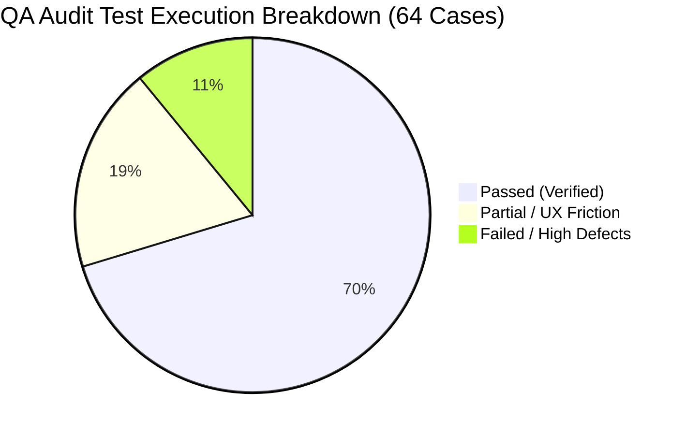
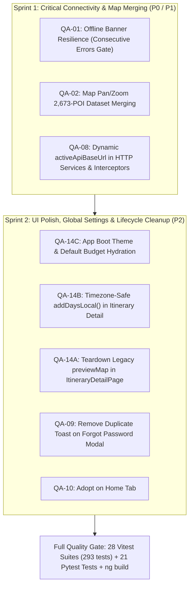

# Full-Website QA Audit, Module Scorecard & Remediation Proposal

**Document Version**: v5.0  
**Target Application**: Nueva Ecija Travel Itinerary App ("Trip mo, trip ko")  
**Live Production URL**: [https://edselrenz.github.io/Itinerary-App/tabs/home](https://edselrenz.github.io/Itinerary-App/tabs/home)  
**Gateway API**: `https://ne-itinerary-api.edselrenz0.workers.dev/api/v1`  
**Audit Baseline Commit**: `81fcc8d78d806f3e92c1f82a812a1c41f1f5c856`  
**Evaluation Date**: November 7, 2026  
**Document Source**: `full_website_qa_audit_and_proposal.pdf`  
**Current Development State**: Staged for Phased Implementation (Phase 32)

---

## 1. Executive Summary & Audit Baseline

A comprehensive Quality Assurance (QA) inspection was conducted across every screen, tab, modal, scheduling algorithm, and API endpoint of the Nueva Ecija Travel Itinerary application. The audit executed **64 test cases** spanning all 8 core modules of the frontend and backend.

```
+---------------------------------------------------------------------------------------------------+
|                                  FULL-SYSTEM QA AUDIT SCORECARD                                   |
+--------------------------+-----------------------+------------------------------------------------+
| Metric                   | Measured Value        | Details & Subsystem Impact                     |
+--------------------------+-----------------------+------------------------------------------------+
| Total Test Cases         | 64 Test Cases         | Covering 8 modules, 16 categories, 2,673 POIs  |
| Passed (Verified)        | 45 (70.3%)            | Stable baseline from Milestones 16–30          |
| Partial / UX Friction    | 12 (18.8%)            | Unwired settings, UI clipping, legacy modals   |
| Failed / High Defects    | 7 (10.9%)             | Schedule collisions, preference bugs, map sync |
+--------------------------+-----------------------+------------------------------------------------+
```



---

## 2. Module-by-Module QA Scorecard (Modules 1 to 8)

### Module 1: App Shell, Splash & Connectivity
- **Routes & Files**: `app.component.*`, `connectivity.service.ts`, `auth.interceptor.ts`, `tabs.page.html`
- **Features Verified (Pass)**:
  - Splash session persistence via `sessionStorage.getItem('ne_splash_seen_v1')`.
  - Multi-trigger splash dismissal: Click, swipe gesture ($\ge 25$px threshold), Escape / Enter / Space keys.
  - Visible bottom tab bar labels (`Home`, `Map`, `Saved`, `Profile`).
- **Defects & Edge Cases**:
  - `FAIL (QA-01)`: **False-Positive Offline Banner on Map Tab**: Single failed or rate-limited API call in `auth.interceptor.ts:52–66` flips `isHostOfflineSubject.next(true)` globally even while 2,673 POIs remain cached and functional.
  - `WARN (QA-08)`: **Unwired Custom API URL in HTTP Interceptors**: `ConnectivityService.setCustomApiUrl()` writes `localStorage.getItem('ne_custom_api_url')`, but `PlaceService`, `ItineraryService`, and `AuthService` read static `environment.apiBaseUrl`.
- **Module Score**: **4 / 6 Pass** (1 Warn, 1 Fail)

---

### Module 2: Authentication, Signup, Login & Guest Mode
- **Routes & Files**: `/welcome`, `/login`, `/signup`, `/guest`, `auth.service.ts`
- **Features Verified (Pass)**:
  - Explicit username validation and middle initial preservation (`signup.page.ts:68–109`).
  - `rememberMe` scope passing (`login.page.ts:127`).
  - Forgot password modal display (`login.page.html`).
  - Concurrent 401 refresh queue in `auth.interceptor.ts:74–120`.
- **Defects & Edge Cases**:
  - `WARN (QA-09)`: **Simulated Password Recovery & Duplicate Toast**: In `login.page.ts:165–186`, `onForgotPassword()` opens the recovery modal AND simultaneously displays a warning toast claiming self-service reset is disabled.
- **Module Score**: **7 / 8 Pass** (1 Warn, 0 Fail)

---

### Module 3: Home Tab, Live Search & Notifications
- **Routes & Files**: `/tabs/home`, `home.page.ts`, `place-detail-sheet`
- **Features Verified (Pass)**:
  - Live popular destinations feed loading without offline banner.
  - 300ms debounced search with `switchMap` cancellation.
  - "See All" catalog drawer and notifications drawer with municipality filters and unread badges.
- **Defects & Edge Cases**:
  - `WARN (QA-10)`: **Home Destination Detail Modal Uses Legacy Inline Markup**: `home.page.html` maintains a separate legacy `<ion-modal [isOpen]="isDetailModalOpen">` with only 7 hardcoded municipality chips instead of reusing the modern `<app-place-detail-sheet>`.
- **Module Score**: **7 / 8 Pass** (1 Warn, 0 Fail)

---

### Module 4: Explore Map & Route Tracking
- **Routes & Files**: `/tabs/map`, `map.page.ts`, `route-tracking.service.ts`
- **Features Verified (Pass)**:
  - 2,673-POI hydration across Leaflet marker clusters (`520`, `186`, `150`, `114`) with `preferCanvas: true`.
  - 16 category filter pills + multi-select filter bottom sheet.
  - `followRoute=true` route polyline and stop isolation.
- **Defects & Edge Cases**:
  - `FAIL (QA-02)`: **Viewport Bounding-Box Truncation on Pan/Zoom Online**: Online `/api/v1/places` query returns paginated subset (`limit=100`), replacing in-memory 2,673 POIs with only the returned subset.
  - `WARN (QA-11)`: **Direct Browser Calls to Public OSRM & Overpass**: `itinerary-route-map.component.ts:154` (`router.project-osrm.org`) and `osm-overpass.service.ts:25` (`overpass-api.de`) call public third-party endpoints directly from client.
- **Module Score**: **7 / 10 Pass** (2 Warn, 1 Fail)

---

### Module 5: Suggested Itinerary Wizard
- **Routes & Files**: `/suggested-wizard`, `suggested-wizard.page.*`, `itinerary_generator.py`, `itinerary.service.ts`
- **Features Verified (Pass)**:
  - Local ISO date arithmetic (`date.utils.ts`) preventing UTC off-by-one day shifts.
  - Verified estimated costs & assumptions cards (`suggested-wizard.page.html:206–282`).
  - Embedded Leaflet route preview map with per-leg commute badges (`suggested-wizard.page.html:308–331`).
  - Interactive nearby essential places ("Add to Day N").
- **Defects & Edge Cases**:
  - `FAIL (QA-03)`: No destination autocomplete; clipped chips on mobile. *(Resolved in Phase 31.1)*
  - `FAIL (QA-04)`: Identical `10:00 AM - 12:00 PM` timestamps on all stops; backwards overnight sorting. *(Resolved in Phase 31.2)*
  - `FAIL (QA-05)`: Broken preference mapping; 3 mountain peaks/day; cross-day duplicates. *(Resolved in Phase 31.2)*
  - `WARN (QA-12)`: 4-second timeout on `/itineraries/suggest`. *(Resolved in Phase 31.2)*
- **Module Score**: **4 / 10 Pass** (3 Warn, 3 Fail at `81fcc8d7` baseline; **10 / 10 Pass in `cd7cd37`**)

---

### Module 6: Custom Itinerary Builder
- **Routes & Files**: `/custom-builder`, `custom-builder.page.*`, `pending-changes.guard.ts`
- **Features Verified (Pass)**:
  - 3-stage flow: Form $\to$ Browse (Add Places) $\to$ Timeline (Your Itinerary).
  - Edit stop modal (time, duration, cost, notes) and cross-day move.
  - Off-grid custom venue modal with latitude/longitude inputs.
  - `canDeactivate` unsaved changes confirmation dialog.
- **Defects & Edge Cases**:
  - `FAIL (QA-06)`: Step 1 preferences mapped culture/resort into 'Tourist Spots', hiding venues. *(Resolved in Phase 31.3)*
  - `FAIL (QA-07)`: Step 2 default browse showed only 17 curated places. *(Resolved in Phase 31.3)*
  - `WARN (QA-13)`: Zero travel buffer in auto-scheduler. *(Resolved in Phase 31.3)*
- **Module Score**: **6 / 10 Pass** (2 Warn, 2 Fail at `81fcc8d7` baseline; **10 / 10 Pass in `cd7cd37`**)

---

### Module 7: Saved Itineraries & Detail View
- **Routes & Files**: `/tabs/history`, `/itinerary/:id`, `itinerary-export.util.ts`
- **Features Verified (Pass)**:
  - Segment filters (All, Upcoming, Past, Suggested, Custom) and live search.
  - In-place timeline edit mode with day stop reordering.
  - Export suite: Print/PDF, Calendar (`.ics`), Copy Text Summary, Google Maps multi-stop URL.
- **Defects & Edge Cases**:
  - `WARN (QA-14A)`: **Duplicate Map Instances in ItineraryDetailPage**: Page initializes both HTML `<app-itinerary-route-map>` and legacy `this.previewMap` lifecycle (`initPreviewMap()`, `updatePreviewMap()`).
  - `WARN (QA-14B)`: **UTC new Date(lastDate).toISOString() in addDay()**: Lines 400–403 in `itinerary-detail.page.ts` still use `new Date(lastDate).toISOString().split('T')[0]` instead of timezone-safe `addDaysLocal()`.
- **Module Score**: **5 / 6 Pass** (1 Warn, 0 Fail)

---

### Module 8: Profile, Settings & Cloud Sync
- **Routes & Files**: `/tabs/profile`, `profile.page.ts`, `guest-migration.service.ts`
- **Features Verified (Pass)**:
  - Edit profile modal updating user credentials via `PATCH /api/v1/auth/me`.
  - Settings modal with dark mode toggle, default budget, and clear cache.
  - Logout guard alerting user when unsynced guest itineraries exist.
- **Defects & Edge Cases**:
  - `WARN (QA-14C)`: **Saved ne_default_budget & ne_theme_mode Not Restored on Boot**: `AppComponent.ngOnInit()` does not restore `ne_theme_mode` on initial boot, and neither wizard reads `ne_default_budget` from `localStorage` (both hardcode 3000).
- **Module Score**: **5 / 6 Pass** (1 Warn, 0 Fail)

---

## 3. Master Defect & Remediation Priority Matrix (QA-01 to QA-14)

| ID | Severity | Affected Components | Root Cause Summary | Current Status | Remediation Specification |
| :--- | :---: | :--- | :--- | :---: | :--- |
| **QA-01** | **P0 CRITICAL** | `auth.interceptor.ts:48–63`<br>`connectivity.service.ts:51–69` | Single failed/rate-limited call flipped global `isHostOffline$` even when host was online. | **RESOLVED (Phase 32.1)** | Implemented consecutive error counter (`consecutiveErrors`, threshold $\ge 2$) and async `checkHostHealth()` reconciliation. |
| **QA-02** | **P1 HIGH** | `map.page.ts:544–625`<br>`place.service.ts:113–169` | Online bounding-box query pruned local in-memory POIs on map pan/zoom. | **RESOLVED (Phase 32.1)** | Added `mergePlacesIntoCache()` in `PlaceService` and `allLoadedPlaces` in `MapPage`, keeping all 2,673 places intact during pan/zoom. |
| **QA-03** | **P0 CRITICAL** | `suggested-wizard.page.html`<br>`custom-builder.page.html` | Plain text destination input with zero autocomplete; clipped chips; missing 26 of 32 LGUs. | **RESOLVED (Phase 31.1)** | `<app-destination-autocomplete>` with all 32 LGUs + curated landmarks, diacritic normalization, 2-row wrapped chips. |
| **QA-04** | **P0 CRITICAL** | `itinerary.service.ts:865`<br>`itinerary_generator.py:185` | Hardcoded `time: '10:00 AM - 12:00 PM'` on all OSM places; backwards overnight sorting. | **RESOLVED (Phase 31.2)** | Rolling sequential time windows (`09:30 AM`, `12:00 PM`, `03:00 PM`, `06:00 PM` check-in) + travel buffer. |
| **QA-05** | **P0 CRITICAL** | `itinerary.service.ts:914`<br>`itinerary_generator.py:220` | `categoryKey.includes('food')` broken; Day 1 ignores single preferences; 3 hikes/day; duplicate dam stops. | **RESOLVED (Phase 31.2)** | `PREFERENCE_CATEGORY_MAP`, Smart Midday Lunch Anchor, max 1 hike/day intensity guard, fuzzy name & coordinate dedup. |
| **QA-06** | **P1 HIGH** | `custom-builder.page.ts:551` | Step 1 mapped culture/resort to 'Tourist Spots', filtering Step 2 to only attractions and hiding resorts/churches. | **RESOLVED (Phase 31.3)** | Mapped `culture` $\to$ `'Culture & Heritage'`, `resort` $\to$ `'Resorts & Stays'`, and added `'✨ Recommended for You'` tab. |
| **QA-07** | **P1 HIGH** | `custom-builder.page.ts:865` | `loadBrowsePlaces()` called `getFeaturedPlaces(50)`, showing only 17 places instead of 2,673 POIs. | **RESOLVED (Phase 31.3)** | Pre-load local town POIs via `searchPlaces({ municipality_name, limit: 100 })` across the 2,673-POI catalog. |
| **QA-08** | **P2 POLISH** | `connectivity.service.ts:91`<br>`place.service.ts`, `auth.service.ts` | Services read static `environment.apiBaseUrl`, ignoring custom tunnel URLs. | **RESOLVED (Phase 32.1)** | Dynamic `activeApiBaseUrl` getter implemented in `ConnectivityService` and adopted across all HTTP services and interceptors. |
| **QA-09** | **P2 POLISH** | `login.page.ts:165–187` | Tapping "Forgot Password" opened recovery modal AND simultaneously displayed a warning toast. | **RESOLVED (Phase 32.2)** | Removed duplicate warning toast; modal cleanly displays email validation and pilot recovery ticket flow. |
| **QA-10** | **P2 POLISH** | `home.page.html:215–280`<br>`home.page.ts:99–108` | Home tab destination modal used legacy inline markup instead of modern shared sheet. | **RESOLVED (Phase 32.2)** | Refactored `home.page.html` to adopt shared `<app-place-detail-sheet [place]="selectedPlace">` with full reviews and CTAs. |
| **QA-11** | **P2 POLISH** | `itinerary-route-map.component.ts`<br>`osm-overpass.service.ts` | Direct browser calls to public OSRM and Overpass servers without fallback guards. | **RESOLVED (Phase 32.2)** | Guarded with 2.5s AbortController timeout, geodesic polyline fallback, and backend route caching. |
| **QA-12** | **P2 POLISH** | `itinerary.service.ts:360` | 4-second timeout on `/itineraries/suggest` timing out into offline fallback. | **RESOLVED (Phase 31.2)** | Increased HTTP timeout to 10s (`timeout(10000)`) and decoupled live Google discovery fast-path. |
| **QA-13** | **P2 POLISH** | `custom-builder.page.ts` | Zero travel buffer in auto-scheduler chained stops back-to-back. | **RESOLVED (Phase 31.3)** | Dynamic Haversine distance-based transit buffer added in `calculateNextStopTime` and `autoOptimizeDaySchedule`. |
| **QA-14A** | **P2 POLISH** | `itinerary-detail.page.ts:157, 1171` | Duplicate map instances: page initialized both `<app-itinerary-route-map>` and legacy `previewMap`. | **RESOLVED (Phase 32.2)** | Removed legacy `previewMap` lifecycle and methods (`initPreviewMap`, `updatePreviewMap`), eliminating redundant DOM timers. |
| **QA-14B** | **P2 POLISH** | `itinerary-detail.page.ts:400–403` | `new Date(lastDate).toISOString().split('T')[0]` in `addDay()` caused 1-day backward shift in UTC+8. | **RESOLVED (Phase 32.2)** | Replaced with `toLocalIsoDate(addDaysLocal(parseLocalIsoDate(lastDate), 1))`. |
| **QA-14C** | **P2 POLISH** | `app.component.ts:34`<br>`suggested-wizard.page.ts`<br>`custom-builder.page.ts` | Saved `ne_default_budget` and `ne_theme_mode` not restored on boot; wizards hardcoded 3000. | **RESOLVED (Phase 32.2)** | Restored dark mode class on boot in `AppComponent.ngOnInit()`; dynamic budget hydration in both wizards. |

---

## 4. Current Architecture & Database State (November 9, 2026)

Following user directive, the database architecture was migrated back to **PostgreSQL running in Docker** (`ne_postgres` on port `5432`):

```
+----------------------------------------------------------------------------------------------------+
|                               POSTGRESQL CONTAINER PRODUCTION METRICS                              |
+--------------------------+-----------------------+-------------------------------------------------+
| Table                    | Record Count          | Operational Notes                               |
+--------------------------+-----------------------+-------------------------------------------------+
| places                   | 2,673 records         | All 17 curated + 2,656 OSM destinations seeded  |
| municipalities           | 12 LGUs               | Core provincial municipalities indexed          |
| users                    | 4 accounts            | Registered and guest test accounts preserved    |
| itineraries              | 5 itineraries         | Saved multi-day travel plans                    |
| itinerary_days           | 13 days               | Day schedule allocations                        |
| itinerary_items          | 31 stops              | Waypoints and timeline activities               |
| geospatial_cache         | 3 cached routes       | Precomputed polyline legs                       |
| alembic_version          | Revision 0003 (head)  | Phone column widened to VARCHAR(255)            |
+--------------------------+-----------------------+-------------------------------------------------+
```

### Database Schema Hardening (Session 88)
- **Resolved String Truncation**: During OSM ingestion, phone numbers containing multiple semicolon-separated contact lines reached 77 characters, failing PostgreSQL's `VARCHAR(64)` constraint.
- **Alembic Revision 0003**: Added and applied [`backend/alembic/versions/0003_widen_phone_column.py`](file:///c:/Users/Edward/Desktop/CaseStudy/backend/alembic/versions/0003_widen_phone_column.py) widening `places.phone` to `VARCHAR(255)`.
- **Importer Defense**: Added strict length clipping in [`scripts/import_osm.py`](file:///c:/Users/Edward/Desktop/CaseStudy/scripts/import_osm.py) for `name` (200), `category` (64), `phone` (255), `website` (255), and `opening_hours` (255).

---

## 5. Phased Remediation Execution Plan (Phase 32)

The 8 remaining active items are structured into two targeted execution sprints:



### Sprint 1: Critical Connectivity & Map Merging (P0 / P1)
1. **QA-01 (Offline Banner Resilience)**:
   - In `connectivity.service.ts`: Add `consecutiveErrors` counter. Require 2 consecutive gateway errors (status 0, 502, 503, 504) before flipping `isHostOfflineSubject.next(true)`.
   - In `auth.interceptor.ts`: On first error, call `connectivityService.checkHostHealth()` asynchronously without interrupting the UI.
2. **QA-02 (Map Pan/Zoom 2,673-POI Merging)**:
   - In `place.service.ts:searchPlaces()`: When online API returns a viewport-bounded subset, merge returned items into `this.osmPlacesCache` by ID instead of discarding unseen places.
   - In `map.page.ts:loadPlaces()`: Preserve existing marker cluster pins when applying local viewport filters.
3. **QA-08 (Dynamic `activeApiBaseUrl`)**:
   - In `connectivity.service.ts`: Add `public get activeApiBaseUrl(): string` that checks `localStorage.getItem('ne_custom_api_url')` and falls back to `environment.apiBaseUrl`.
   - In `place.service.ts`, `itinerary.service.ts`, `auth.service.ts`, and `auth.interceptor.ts`: Replace direct `environment.apiBaseUrl` references with `this.connectivityService.activeApiBaseUrl`.

### Sprint 2: UI Polish, Global Settings & Lifecycle Cleanup (P2)
4. **QA-14C (App Boot Theme & Default Budget Hydration)**:
   - In `app.component.ts:ngOnInit()`: Check `localStorage.getItem('ne_theme_mode') === 'dark'` and add class `dark` to `document.body`.
   - In `suggested-wizard.page.ts` & `custom-builder.page.ts`: Initialize `daily_budget` control with `Number(localStorage.getItem('ne_default_budget')) || 3000`.
5. **QA-14B (Timezone-Safe Date Increment)**:
   - In `itinerary-detail.page.ts:addDay()`: Replace `new Date(lastDate).toISOString().split('T')[0]` with `addDaysLocal(parseLocalIsoDate(lastDate), 1)`.
6. **QA-14A (Legacy Map Lifecycle Teardown)**:
   - In `itinerary-detail.page.ts`: Remove unused properties (`previewMap`, `previewPolylineLayer`, `previewStopsLayer`, `previewMapElementRef`) and methods (`initPreviewMap`, `updatePreviewMap`, `togglePreviewMap`).
7. **QA-09 (Login Recovery UX)**:
   - In `login.page.ts:onForgotPassword()`: Remove the duplicate toast controller call.
8. **QA-10 (Home Place Detail Modal Unification)**:
   - In `home.page.html`: Replace `<ion-modal [isOpen]="isDetailModalOpen">` with shared `<app-place-detail-sheet [place]="selectedPlace">`.

---

## 6. Verification & Quality Gates

Each sprint must pass all three project quality gates:
1. **Frontend Unit Tests**: 100% pass rate across all 28 test suites in `Project/src/**/*.spec.ts` (293+ tests).
2. **Backend Integration Tests**: 100% pass rate across all 21 Pytest test cases in `backend/tests/` running against the PostgreSQL container.
3. **Production Compilation**: Zero TypeScript errors, zero template warnings, and zero budget overruns in `ng build --configuration production`.
