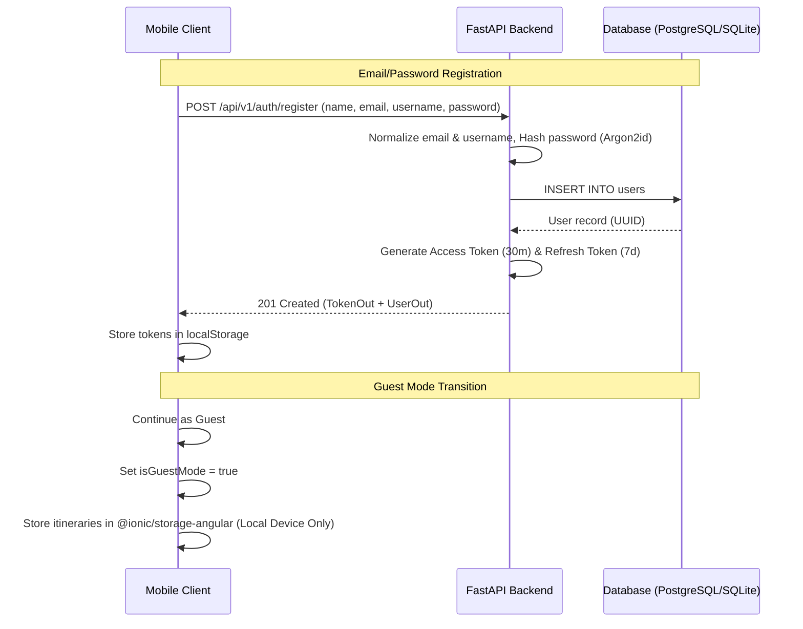
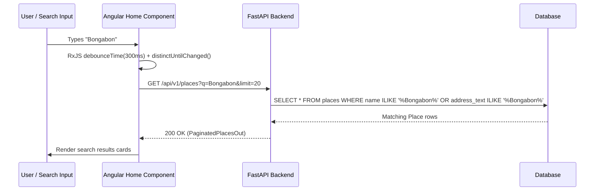
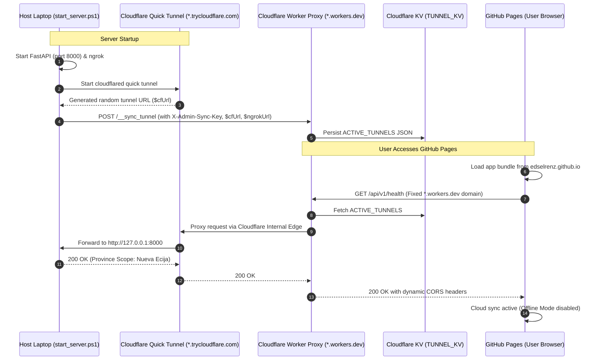
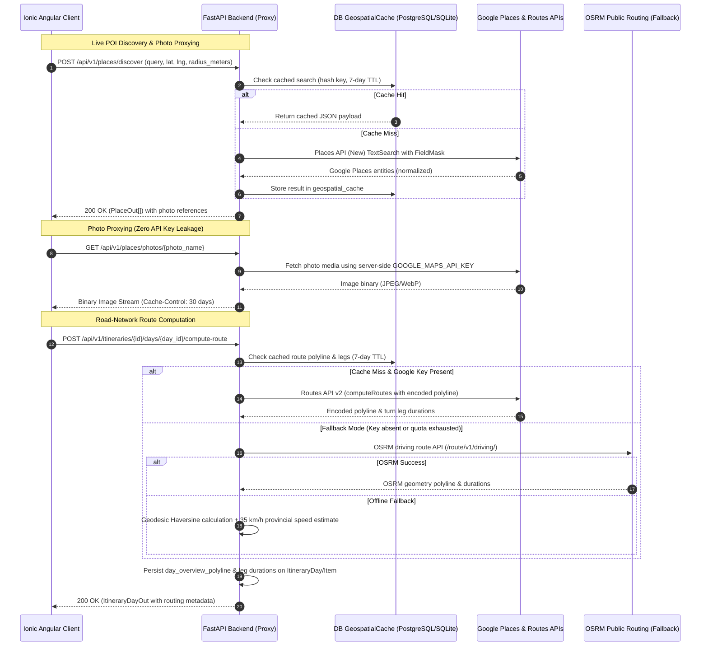

# System Architecture: Nueva Ecija Travel Itinerary

## 1. High-Level Component Topology

The system is organized as a monorepo containing a standalone client, an asynchronous REST API backend, an offline data processing pipeline, and a relational database:

```text
┌────────────────────────────────────────────────────────────────────────┐
│                        Ionic Angular Client (Project/)                 │
│  ├── Welcome / Login / Signup / Guest Onboarding                       │
│  ├── Home Tab: Debounced Search, Entry Cards, Popular Carousel         │
│  ├── Map Tab: Leaflet Map, 16 Category Filters, POI Bottom Sheet       │
│  ├── Itinerary Flow: Suggested Generator, Custom Builder, Day Timeline │
│  └── Storage: AuthService (JWT) & GuestStorageService (@ionic/storage) │
└───────────────────────────────────┬────────────────────────────────────┘
                                    │ HTTPS REST / JSON
                                    ▼
┌────────────────────────────────────────────────────────────────────────┐
│                        FastAPI Backend (backend/)                      │
│  ├── /api/v1/health: Liveness and provincial scope check               │
│  ├── /api/v1/auth: Argon2id hashing, JWT tokens, Google OAuth verify   │
│  ├── /api/v1/places: Full-text & bounding-box search, category filters │
│  ├── /api/v1/itineraries: BOLA-protected CRUD, stop reordering         │
│  └── algorithms/itinerary_generator: Deterministic Haversine clustering│
└───────────────────────────────────┬────────────────────────────────────┘
                                    │ SQLAlchemy 2.0 ORM
                                    ▼
┌────────────────────────────────────────────────────────────────────────┐
│                    Relational Database (PostgreSQL / SQLite)           │
│  ├── users & auth_identities (Accounts and linked Google OAuth)        │
│  ├── municipalities & places (Provincial entities & 16 POI categories) │
│  └── itineraries, itinerary_days, itinerary_items (Multi-day plans)    │
└───────────────────────────────────▲────────────────────────────────────┘
                                    │ Seed & Upsert Scripts
┌───────────────────────────────────┴────────────────────────────────────┐
│                    Offline Data Pipeline (scripts/)                    │
│  ├── import_osm.py (Overpass JSON ingestion with NE bounding box check)│
│  └── seed_featured_places.py (Curated Nueva Ecija featured destinations│
└────────────────────────────────────────────────────────────────────────┘
```

---

## 2. Component Responsibilities

### 2.1 Hybrid Mobile Client (`Project/`)
- **Technology**: Ionic 9, Angular 22, Capacitor 8, SCSS.
- **Role**: Renders the complete mobile application UI aligned with Figma design specifications (`Travel Itinerary App.fig`).
- **Data Boundary**: The client **never** communicates directly with PostgreSQL or third-party mapping geocoders. All dynamic data is fetched from the FastAPI backend via `HttpClient`.
- **Offline / Laptop-Down Resilience**: Intercepts HTTP 0, 502, and 504 errors via `authInterceptor` to alert users that the host laptop may be asleep while allowing local guest itineraries to remain operational.

### 2.2 REST API Backend (`backend/`)
- **Technology**: Python 3.14 / 3.11+, FastAPI, Pydantic v2, Uvicorn.
- **Role**: Validates payloads, manages authentication, performs database transactions, executes search queries, runs the deterministic itinerary recommendation engine, and enforces Broken Object-Level Authorization (BOLA) security checks.
- **Security**: Password hashing uses Argon2id (`pwdlib`), JWT token generation uses PyJWT with HMAC-SHA256, and Google ID tokens are verified cryptographically server-side.

### 2.3 Relational Database Layer
- **Production Mode**: Local PostgreSQL 15+ running on development host/container.
- **Development / Test Mode**: In-memory SQLite or file-based SQLite database with cross-compatible portable types (`JsonType = JSON().with_variant(JSONB(), "postgresql")`).
- **Isolation**: PostgreSQL port 5432 is strictly bound to `127.0.0.1` and never exposed over Wi-Fi or public interfaces.

### 2.4 Offline Ingestion Pipeline (`scripts/`)
- **`fetch_osm_places.py`**: Queries live Overpass API for all amenities, tourism, leisure, and shopping nodes/ways in Nueva Ecija (`15.15°N–16.15°N, 120.70°E–121.40°E`), saving raw JSON to `data/raw/nueva_ecija_osm.json`.
- **`import_osm.py`**: Reads raw OpenStreetMap Overpass JSON exports, filters coordinates strictly within the Nueva Ecija bounding box, maps tags to 16 canonical categories, and idempotently upserts records (2,656 real-world places ingested).
- **`seed_featured_places.py`**: Seeds the 12 core Nueva Ecija municipalities and 17 curated featured places with verified descriptions, opening hours, and honest cost ranges.
- **`export_osm_to_client_asset.py`**: Exports all 2,673 places into a lean, pre-indexed client static asset (`Project/src/assets/data/osm_places.json`) ensuring 100% offline and standalone map availability.

### 2.5 Real-Time OpenStreetMap Overpass Client Service
- **`OsmOverpassService` (`Project/src/app/core/services/osm-overpass.service.ts`)**: Enables client-side real-time querying of OpenStreetMap's live Overpass API (`https://overpass-api.de/api/interpreter`) for current map viewport bounds on demand, merging live crowd-sourced findings into the active map state.

### 2.6 Target Spatial & Routing Architecture (Proposal Blueprint)
> Ref: [itinerary_app_map_and_routing_proposal.pdf](file:///c:/Users/Edward/Desktop/CaseStudy/itinerary_app_map_and_routing_proposal.pdf) & [MAP_AND_ROUTING_PROPOSAL.md](./MAP_AND_ROUTING_PROPOSAL.md)
- **ESM-Safe Marker Clustering (`MAP-01`)**: Canonical Leaflet object unwrapping (`(L as any).default ?? L`) and top-level assignment to `(window as any).L` prior to plugin evaluation, paired with a runtime fallback to native `L.layerGroup()` if clustering fails, ensuring pins always render under modern Angular esbuild bundlers.
- **Corridor-First Spatial Clustering (`ROUTE-02`)**: Restructures travel day presets into coherent geographic corridors (East/Bongabon 1.5 km, North/San Jose–Pantabangan 13.8 km, South/Cabanatuan–Gen. Tinio–Gapan 45.5 km) with 2-opt TSP sequencing, slashing cross-province transit distances by 66.3% (from 176.2 km to 59.4 km).
- **Reusable Route Map & Multi-Stop Waypoints (`ROUTE-01`)**: A unified `ItineraryRouteMapComponent` rendering numbered pins, OSRM road polylines with offline Catmull-Rom geodesic spline fallback, and universal multi-waypoint Google Maps URLs (`&origin=...&destination=...&waypoints=...`).
- **Leg-Aware Provincial Commute Engine (`ROUTE-05`)**: Leg-level commute intelligence comparing consecutive stops to provide contextual recommendations: walking/tricycles ($\le 1.2$ km, ₱15–₱25), local tricycles ($> 1.2$ km), and direct inter-municipality highway corridor transfers across all 32 municipalities without routing through Cabanatuan City.

### 2.7 Trip Lifecycle & Presentation Architecture (Flagship Alignment)
> Ref: [itinerary_app_ui_ux_evaluation_report.pdf](file:///c:/Users/Edward/Desktop/CaseStudy/itinerary_app_ui_ux_evaluation_report.pdf) & [UI_UX_EVALUATION_REPORT.md](./UI_UX_EVALUATION_REPORT.md)
- **Visual Flagship Parity (`UIUX-01`, `UIUX-03`, `UIUX-09`)**: Eliminates post-save visual downgrade by preserving 68×68px stop photo thumbnails, full start-end time ranges (`12:00 PM - 2:00 PM (2 hrs)`), and segmented sticky day switcher tabs across `/itinerary/:id`.
- **Zero-Fabricated-Cost Accounting (`UIUX-02`)**: Enforces strict adherence to ADR-001 by removing synthetic `?? 200` cost fallbacks in `itinerary-detail.page.ts`, showing truthful *Fee not listed* labels on unpriced venues, and synchronizing bottom activity expenses with top `budgetSummary` ledgers.
- **One-Tap Multi-Waypoint Navigation (`UIUX-08`)**: Implements client-side `buildGoogleMapsDayRouteUrl()` generating universal cross-platform Google Maps URLs chaining the day's entire stop sequence (`&origin=...&destination=...&waypoints=...`), reducing navigation friction from 8 taps to 1 tap.

---

## 3. Data Flow Diagrams

### 3.1 Authentication & Session Flow


### 3.2 Place Search Flow (Zero Nominatim Calls)


---

## 4. Security & Compliance Boundaries

1. **Broken Object-Level Authorization (BOLA / IDOR)**:
   - On every itinerary mutation (view, edit, delete, reorder), the backend verifies `itinerary.user_id == current_user.id`. A traveler guessing another user's UUID receives an immediate `404 Not Found`.
2. **OpenStreetMap Compliance**:
   - Tile layer requests standard OSM raster tiles with full attribution (`© OpenStreetMap contributors`).
   - Nominatim is strictly excluded from client-side search to respect OSM usage policies.
   - Overpass queries are run exclusively offline during data preparation.
3. **External Navigation Hand-Off**:
   - The app does not embed Google routing engines or incur API costs. It opens directions via standard browser URL schemes: `https://www.google.com/maps/dir/?api=1&destination={latitude},{longitude}`.
4. **Token Storage & Refresh Architecture (SEC-02 Roadmap)**:
   - *Current Implementation (Pilot Phase)*: The pilot SPA hosted on GitHub Pages authenticates against decoupled backend tunnel environments. JWT access tokens (30m expiry) and refresh tokens (7d expiry, rotated on consumption) are managed via `AuthService` in client memory and synced to `window.localStorage` to maintain sessions across page refreshes.
   - *Web Production Target (Custom Domain)*: Once frontend and backend are unified under a shared parent domain (e.g., `app.tripmo.ph` and `api.tripmo.ph`), refresh tokens will transition to `HttpOnly; Secure; SameSite=Strict; Path=/api/v1/auth/refresh` cookies, completely shielding refresh tokens from browser script execution and rendering XSS token exfiltration impossible. Access tokens will be retained purely in-memory within Angular reactive service state (`BehaviorSubject`).
   - *Mobile Native Target (Capacitor)*: In Android and iOS binary builds, tokens will be persisted into hardware-backed keystores via `@capacitor-community/secure-storage-plugin` (Android Keystore with AES-GCM and iOS Keychain with kSecAttrAccessibleAfterFirstUnlock), providing hardware enclave protection at rest.

---

## 5. Live Tunnel & Cloudflare Worker Reverse Proxy Architecture (Option 2)

To bridge the static GitHub Pages application (`https://edselrenz.github.io/Itinerary-App/`) with the developer's laptop backend without being subject to residential ISP DNS blocks (PLDT, Converge, Globe, Smart) or home router NXDOMAIN caching, the system supports an automated Cloudflare Worker Reverse Proxy.

### 5.1 Architecture Data Flow



### 5.2 Key Architectural Benefits
1. **Zero Client-Side DNS Configuration**: End users connect exclusively to standard `*.workers.dev` domains, which resolve reliably across all telecommunications providers.
2. **Zero Manual Copy-Paste**: `scripts/start_server.ps1` publishes the newly generated ephemeral Cloudflare Tunnel URL automatically within 2 seconds of startup.
3. **Multi-Tunnel Failover**: The Worker attempts the active Cloudflare Tunnel first; if the connection fails or returns >= 502, it instantly fails over to the permanent ngrok tunnel.
4. **SEC-01 Compliance**: Frontend hostname allowlist explicitly validates `*.workers.dev` alongside `*.trycloudflare.com` and `*.ngrok-free.dev`.

---

## 6. GIS Upgrade, Live Google Places Discovery & Turn-by-Turn Route Tracking (Phase 25)

Phase 25 introduces enterprise GIS and real-time turn-by-turn route tracking while preserving strict multi-engine database portability (PostgreSQL in production, SQLite in test harnesses) and offline resilience.

### 6.1 Topology & Secret Protection Architecture



### 6.2 Key Architectural Subsystems

1. **Strict Secret Protection**:
   - `GOOGLE_MAPS_API_KEY` is strictly confined to the backend environment and never exposed in client bundles, network requests, or query strings.
   - All Google Places searches, place details lookups, photo media downloads, and road routing calculations are proxied through FastAPI.
2. **Multi-Engine Database Portability**:
   - The `geospatial_cache` table uses portable `JsonType` (`JSON().with_variant(JSONB(), "postgresql")`) and `sa.Uuid()`, executing flawlessly on both PostgreSQL 15+ in production and SQLite in memory for lightning-fast CI test runs.
3. **Google Terms of Service Compliance Caching**:
   - Search query results are cached up to 7 days.
   - Rich place details and photo assets are refreshed within 30 days.
   - Cached records store hashes of query parameters and place identifiers.
4. **Resilient Multi-Tier Routing Fallback**:
   - Primary: Google Routes API v2 with traffic-aware road distance and turn-by-turn polyline.
   - Secondary: Public OpenStreetMap OSRM routing (`http://router.project-osrm.org/`).
   - Tertiary: Offline Haversine calculations with provincial road factor (1.3×) and realistic travel speeds (35 km/h drive, 4.5 km/h walk).
5. **Algorithmic Itinerary Recommendation Engine**:
   - **Bayesian Quality Scoring**: Prevents low-review anomalies from outranking established landmarks.
   - **Operating Hours Gate**: Parses structured `regularOpeningHours` and OSM `opening_hours`, applying a -50 point penalty for closed venues.
   - **2-Opt TSP Permutations**: Computes factorial ordering of daily travel stops to eliminate backtracking.
   - **Dynamic Road-Paced Scheduling**: Arrival and departure times are calculated dynamically from road distance legs rather than arbitrary time blocks.
6. **Mobile Geolocation Tracking (`RouteTrackingService`)**:
   - Uses `@capacitor/geolocation` with `enableHighAccuracy: true`.
   - **10m Movement Throttle**: Filters stationary GPS jitter.
   - **Polyline Segment Snapping**: Calculates orthogonal distance to active polyline.
   - **100m Off-Route Detection**: Dispatches `rerouteNeeded$` event for route recalculation.
   - **50m Stop Arrival Detection**: Automatically marks stops visited and advances to next waypoint.
7. **Unified Presentation (`PlaceDetailSheetComponent`)**:
   - Standalone Angular component consolidating POI details across Map, Itinerary Detail, and Wizard previews.
   - Displays photo carousel/thumbnails, ratings, open/closed status badges, weekly operating schedule accordion, review snippets, and direct itinerary actions.
