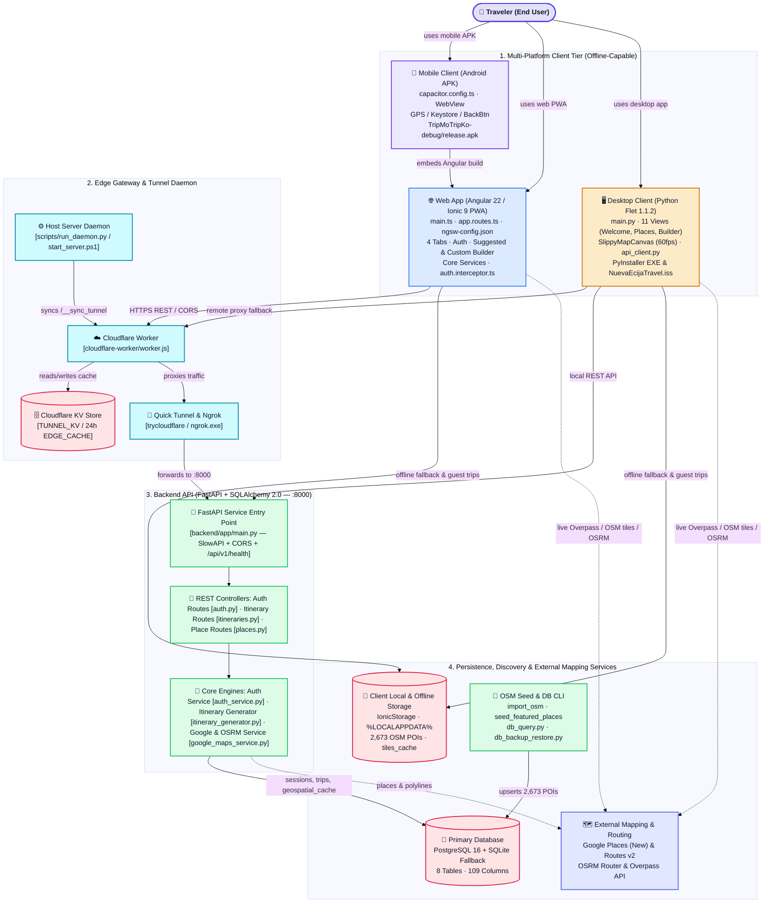
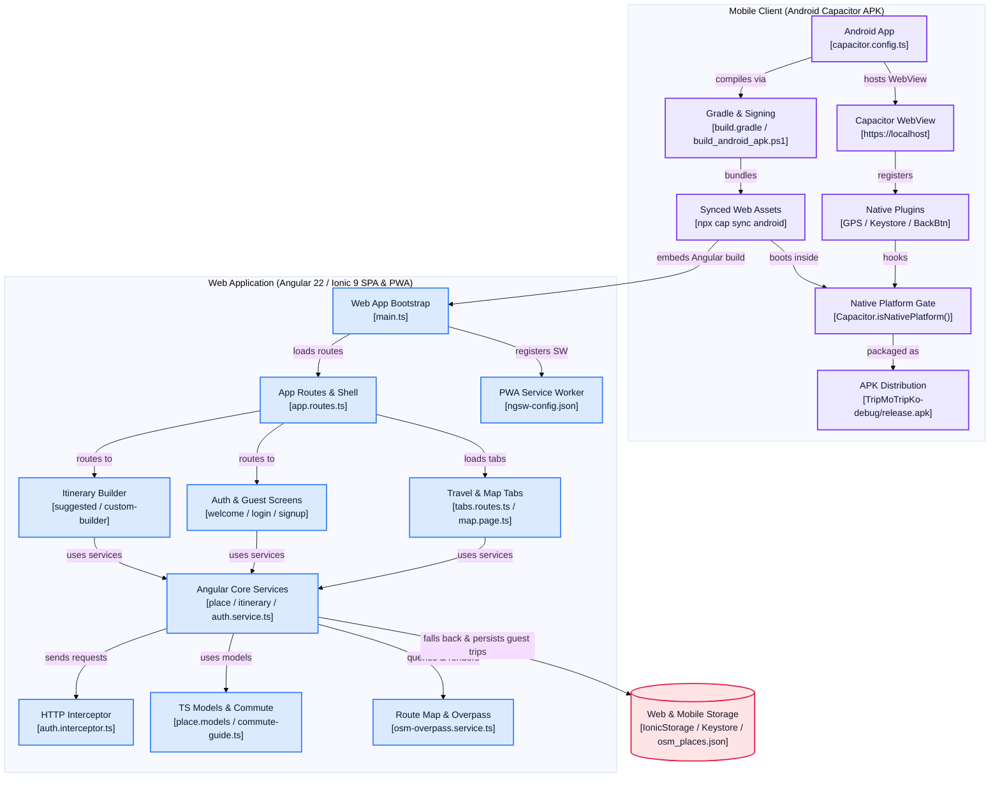
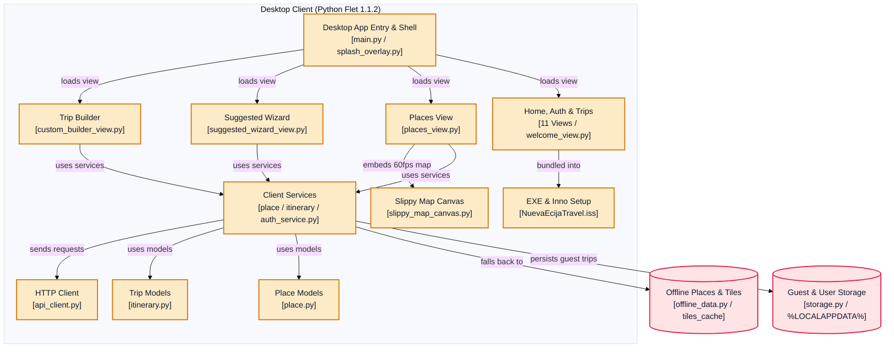
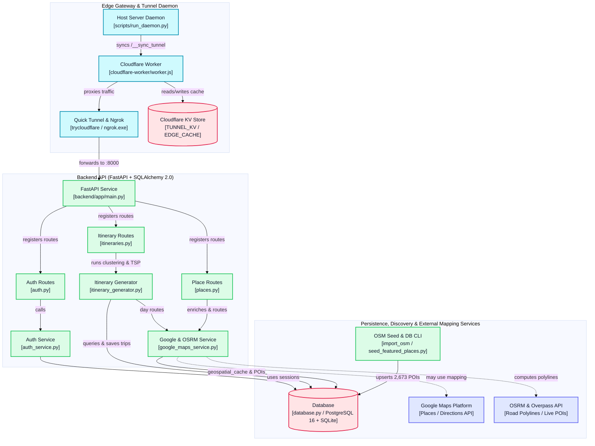
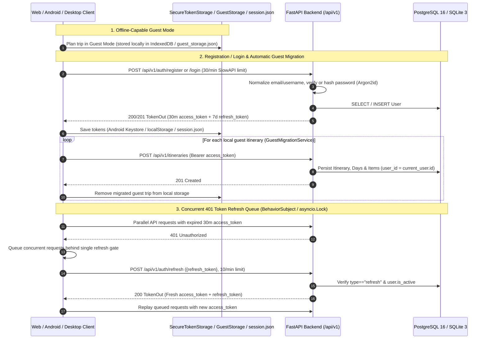
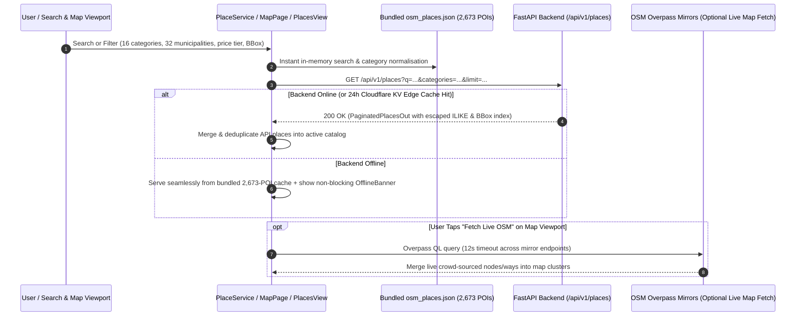
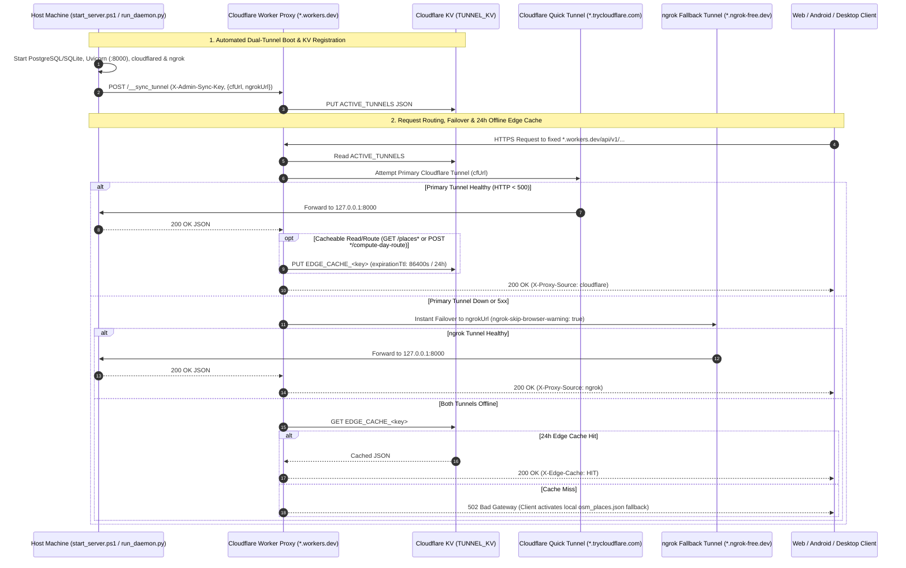
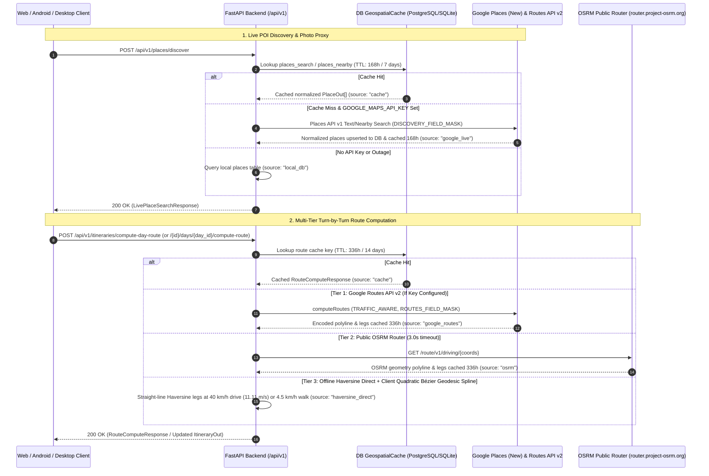

# System Architecture: Trip Mo, Trip Ko — Nueva Ecija Travel Itinerary (`v1.0.0`)

> **Verification Status**: Updated through **Phase 62 (`v1.0.0` Final Release Verification)** (`488` automated tests passing: `348` Web Vitest + `119` Desktop Pytest + `21` Backend Pytest). For the complete 17-part technical and layman-friendly documentation suite, see [`system_discussion/README.md`](../system_discussion/README.md).

---

## 1. High-Level Component Topology

The system is a **decoupled, multi-client, offline-resilient full-stack application** organized across seven architectural subgraphs (`Mobile Client`, `Web Application`, `Desktop Client`, `Edge Gateway & Tunnel Daemon`, `Backend API`, `Persistence and Discovery`, and `External Mapping & Routing Services`).

To ensure every component box is large and legible without zooming in Markdown viewers, the architecture flow is presented below as:
1. **1.1 Master End-to-End Architecture Flow** (Top-to-Bottom 7-Tier Overview)
2. **1.2 Client Tier Detail Flow** (`Mobile Client`, `Web Application`, and `Desktop Client`)
3. **1.3 Edge, Backend, Persistence & External Services Detail Flow**

> **Interactive Full-Canvas Diagram**: For the single-canvas pan/zoom/inspectable SVG diagram, open [`system_discussion/trip_mo_trip_ko_full_stack_repository_architecture_diagram.html`](../system_discussion/trip_mo_trip_ko_full_stack_repository_architecture_diagram.html).

### 1.1 Master End-to-End Architecture Flow (7 Subgraphs)

---

### 1.2 Client Tier Detail Flow (Mobile APK, Web SPA/PWA & Desktop Client)

#### A. Mobile Client (`Android Capacitor APK`) & Web Application (`Angular 22 / Ionic 9`)

#### B. Desktop Client (`Python Flet 1.1.2`)

---

### 1.3 Edge Gateway, Backend API, Persistence & External Services Detail Flow

---

## 2. Component Responsibilities

### 2.1 Web / PWA & Hybrid Mobile Client (`Project/`)
- **Technology**: Angular `22.2.3` (zoneless standalone via `provideZonelessChangeDetection()`), Ionic Angular `^9.0.0`, Capacitor `8.6.0` (`ph.nuevaecijatravel.app`), Leaflet `1.9.4` + `leaflet.markercluster 1.5.3`, RxJS `~7.8.0`, Vitest `~5.0.5` (`348` unit tests across `32` specs).
- **Routing & Bootstrap (`Project/src/main.ts`)**: Hash location routing (`withHashLocation()`) with `404.html` and `.nojekyll` for GitHub Pages SPA compatibility; global `Object.defineProperty(window, 'L', ...)` property guard preserving `MarkerClusterGroup`; conditional Angular Service Worker (`ngsw-config.json`) enabled on production web builds and disabled (`--no-service-worker`) on native Android Capacitor WebView builds.
- **Data & Network Boundary**:
  - Primary dynamic data and itinerary persistence flow through the FastAPI backend via `HttpClient` and `authInterceptor` (`Authorization: Bearer <token>`, `ngrok-skip-browser-warning: true`, and an RxJS `BehaviorSubject` refresh queue that serializes concurrent HTTP `401` token refreshes).
  - For map resilience and zero-cost routing, the client also queries **OpenStreetMap Overpass API** mirrors (`OsmOverpassService`) for live viewport discovery, **public OSRM** (`router.project-osrm.org`) in `ItineraryRouteMapComponent` when backend polylines are absent, and **OpenStreetMap Tile Servers** (`tile.openstreetmap.org`).
- **Multi-Layer Offline Resilience**:
  - Tracks consecutive gateway failures (`status === 0, 502, 503, 504`, or `404` on `/health`) in `ConnectivityService` (`ERROR_THRESHOLD = 2`) before displaying a non-blocking floating offline host banner.
  - Bundles all **2,673** Nueva Ecija POIs in `Project/src/assets/data/osm_places.json` and curated venues in `offline-places.data.ts`.
  - Caches API responses (`municipalities-api` 7d, `places-api` 3d) and up to `1,500` map tiles (`osm-tiles-nueva-ecija` 14d) via Angular Service Worker (`ngsw-config.json`).
  - Persists guest itineraries in IndexedDB / LocalStorage via `@ionic/storage-angular` (`GuestStorageService`) and automatically migrates them to PostgreSQL upon login/registration via `GuestMigrationService`.

### 2.2 Native Windows Desktop Client (`desktop_client/`)
- **Technology**: Python `3.12+`, Flet `>= 1.1.2` (Flutter desktop engine), `flet-map >= 0.1.0`, `httpx >= 0.28.1`, Pydantic v2, Pytest (`119` unit & regression tests across `10` modules, `TC-01`–`TC-40`).
- **Visual & Workflow Parity with Web (`TC-35`–`TC-40`)**:
  - **Full-Screen Splash Overlay (`splash_overlay.py`, `TC-39`)**: Pins `loading_screen.jpg` edge-to-edge (`left=0, top=0, right=0, bottom=0, width=float("inf"), height=float("inf"), fit=ft.BoxFit.COVER`) with a dark gradient scrim, centered `✈️ Trip mo, trip ko` branding, and bottom loading spinner + `"Click anywhere to enter"` pill.
  - **Boxless Welcome & Auth Views (`welcome_view.py`, `guest_view.py`, `login_view.py`, `signup_view.py`, `TC-40`)**: Eliminates enclosed card boxes in favor of the Web App's clean full-screen canvas (`#f8fafc` light / `#0b0f19` dark) and anchors a seamless 3-tile horizontally mirrored widescreen cityscape (`welcome_hero_buildings_wide.png`, `1848 × 336`, `[Flip(T) | T | Flip(T)]`) flush across 100% of the bottom window edge on resize.
  - **Responsive Forms & Modals (`TC-37`, `TC-38`)**: Centers `Edit Profile` inputs at full card width (`width=card_w`) and uses `expand=True` on paired `ft.Row` fields inside `Off-Grid Custom Venue` and `Edit Stop` modals to prevent horizontal overflow.
  - **Custom Slippy Map & In-App Navigation (`slippy_map_canvas.py`, `TC-35`, `TC-36`)**: 1,618-line tile canvas supporting pan/zoom, pre-seeded zoom 9–13 Nueva Ecija tiles (`assets/tiles/`), spatial marker clustering, OSRM / quadratic Bézier geodesic spline polylines, and direct in-app turn-by-turn route handoff (`_launch_in_app_nav()`) from `TripDetailView` into `PlacesView`.
- **Writable `%LOCALAPPDATA%` Storage & Tile Cache Fallback (`PKG-REV-01` / `TC-35`)**:
  - Resolves bundled read-only assets via `get_settings().assets_dir` (supporting PyInstaller `sys._MEIPASS`).
  - Performs a startup `.write_probe` check on `storage_dir` and `tiles_cache`; when installed under a read-only path (such as `C:\Program Files\NuevaEcijaTravel`), automatically relocates runtime JSON persistence (`session.json`, `guest_storage.json`, `favorites.json`, `profile_extra.json`) and cached map tiles to `%LOCALAPPDATA%\NuevaEcijaTravel\storage`.

### 2.3 REST API Backend (`backend/`)
- **Technology**: Python `3.12`, FastAPI `>= 0.115.0`, Uvicorn `>= 0.30.0`, SQLAlchemy `>= 2.0.30`, Alembic `>= 1.13.2`, Pydantic v2, SlowAPI `>= 0.1.9`, `pwdlib[argon2]`, `PyJWT`, `google-auth`, `httpx`.
- **Role**: Exposes 27 REST endpoints under `/api/v1` (`/health`, `/auth/*`, `/municipalities`, `/places/*`, `/itineraries/*`), enforces proxy-aware rate limiting (`120/min` global, `30/min` register/login, `10/min` refresh, `5/min` Google OAuth), validatesproduction JWT secrets (`Settings.validate_secrets()`), locks down `/docs` and `/redoc` when `APP_ENV != "development"`, and enforces strict BOLA checks (`Itinerary.user_id == current_user.id`).

### 2.4 Relational Database Layer (`PostgreSQL 16` & `SQLite 3`)
- **Primary DBMS**: PostgreSQL `16-alpine` (`docker-compose.yml` bound to `127.0.0.1:5432`; `docker-compose.prod.yml` for containerized production), connected via `psycopg` v3 (`postgresql+psycopg://...`).
- **Automatic 2-Second SQLite Fallback**: On startup (`backend/app/core/database.py`), SQLAlchemy probes the configured PostgreSQL connection with `connect_timeout=2`. If PostgreSQL is offline or unreachable, it logs a warning and falls back to `sqlite:///<repo_root>/nueva_ecija_travel.db`.
- **Complete 8-Table, 109-Column Schema (`backend/app/models/entities.py`)**:
  1. `users` (15 columns — includes extended profile columns from migration `0004`)
  2. `auth_identities` (6 columns — linked OAuth provider subjects)
  3. `municipalities` (7 columns — Nueva Ecija cities & municipalities)
  4. `places` (36 columns — OSM, curated, and Google Places v1 POIs across 16 categories)
  5. `itineraries` (12 columns — saved user trips with `preferences` and `assumptions`)
  6. `itinerary_days` (9 columns — calendar days with `day_overview_polyline` & `route_legs`)
  7. `itinerary_items` (19 columns — chronological stops with per-leg distance, duration & polyline)
  8. `geospatial_cache` (5 columns — TTL cache for Google Places/Details/Routes and OSRM responses, added in migration `0002`)
- **Cross-Engine Portability**: Uses `JsonType = JSON().with_variant(JSONB(), "postgresql")` and `UUID(as_uuid=True)` so identical ORM queries run on PostgreSQL and SQLite.

### 2.5 Offline Ingestion, Operations & Packaging Pipeline (`scripts/`)
- **`fetch_osm_places.py` & `import_osm.py`**: Queries Overpass API (`15.15°N–16.15°N, 120.70°E–121.40°E`) and idempotently upserts **2,656** OpenStreetMap POIs across 16 canonical categories.
- **`seed_featured_places.py`**: Idempotently seeds **12** core Nueva Ecija municipalities and **18** curated featured destinations with verified descriptions, opening hours, and honest cost ranges.
- **`export_osm_to_client_asset.py`**: Exports all **2,673** active database places into `Project/src/assets/data/osm_places.json` (mirrored to `desktop_client/assets/data/osm_places.json`).
- **`db_query.py` & `db_backup_restore.py`**: Dual-engine (SQLite & PostgreSQL) interactive/one-shot SQL query CLI (`--tables`, `--postgres`, `--limit`) and automated `pg_dump` / SQLite backup & restore tool.
- **`build_standalone_exe.py` & `build_desktop_installer.ps1`**: Stages PyInstaller builds in `build_temp/dist_stage/NuevaEcijaTravel` (bundling `flet/controls/material/icons.json`, `cupertino_icons.json`, `certifi`, `tzdata`, and `desktop_client/assets/`), overlays `dist/NuevaEcijaTravel` with an NTFS `.old` rename hot-swap fallback, compiles `dist_installer/NuevaEcijaTravel_Setup_v1.0.0.exe` (`156.58 MB`) via Inno Setup 6 (`installer/NuevaEcijaTravel.iss`), and archives `dist_installer/NuevaEcijaTravel_Portable_Installer_v1.0.0.zip` (`232.64 MB`).
- **`build_android_apk.ps1`**: Runs `npx ng build --configuration production --no-service-worker`, syncs Capacitor 8.6.0, and compiles `dist_apk/TripMoTripKo-debug.apk` (`30.88 MB`) and RSA-2048 signed `dist_apk/TripMoTripKo-release.apk` (`29.72 MB`) using JDK 21 and Gradle 8.13 (`android.builder.sdkDownload=true`).

---

## 3. Data Flow Diagrams

### 3.1 Authentication, Concurrent 401 Refresh Queue & Guest Migration Flow

### 3.2 Place Discovery Flow (Bundled Offline Catalog + Backend + Live Overpass)

---

## 4. Security & Compliance Boundaries

1. **Broken Object-Level Authorization (BOLA / IDOR)**:
   - Every itinerary read, update, delete, reorder, and persistent route endpoint in [`backend/app/api/v1/itineraries.py`](../backend/app/api/v1/itineraries.py) filters by `where(Itinerary.id == itinerary_id, Itinerary.user_id == current_user.id)`, returning `404 Not Found` on mismatch so unauthorized users cannot infer resource existence.
2. **Proxy-Aware Rate Limiting (`SlowAPI`)**:
   - [`backend/app/core/limiter.py`](../backend/app/core/limiter.py) enforces `120/min` global, `30/min` on `/auth/register` and `/auth/login`, `10/min` on `/auth/refresh`, and `5/min` on `/auth/oauth/google`. `get_client_ip()` trusts `CF-Connecting-IP` and `X-Forwarded-For` **only** when the direct socket peer is loopback (`127.0.0.1`, `localhost`, `::1`, `testclient`), preventing header spoofing on direct connections.
3. **Production Secret & OpenAPI Lockdown**:
   - [`backend/app/core/config.py`](../backend/app/core/config.py) aborts backend startup if `APP_ENV != "development"` and `JWT_SECRET_KEY` is blank, `< 32` characters, or matches default placeholders. Swagger (`/docs`) and ReDoc (`/redoc`) are disabled (`None`) outside `development`.
4. **Cross-Platform Token Storage (`SecureTokenStorageService` & `SessionManager`)**:
   - **Native Android APK**: Persists tokens in hardware-backed Android Keystore via `capacitor-secure-storage-plugin` ([`secure-token-storage.service.ts`](../Project/src/app/core/services/secure-token-storage.service.ts)).
   - **Web / PWA**: Uses an in-memory synchronous cache backed by `localStorage` (`rememberMe = true`) or `sessionStorage` (`rememberMe = false`), with `authInterceptor` scoping `Authorization: Bearer` headers strictly to trusted API base URLs (`isTrustedApiHostname()`).
   - **Windows Desktop**: Persists session state in `storage/session.json` (or `%LOCALAPPDATA%\NuevaEcijaTravel\storage\session.json` when installed in a read-only folder).
5. **Zero Google API Key Leakage**:
   - `GOOGLE_MAPS_API_KEY` remains strictly server-side. Place photos are streamed through `GET /api/v1/places/photos/{photo_name:path}` with `Cache-Control: public, max-age=86400` (24 hours) and a 1×1 transparent SVG fallback.

---

## 5. Live Tunnel & Cloudflare Worker Reverse Proxy Architecture

To connect the static GitHub Pages PWA (`https://edselrenz.github.io/Itinerary-App/`), Android APK, and remote Desktop clients to a host machine running the FastAPI backend without residential ISP DNS issues or manual URL changes, the system uses [`cloudflare-worker/worker.js`](../cloudflare-worker/worker.js) + Cloudflare KV (`TUNNEL_KV`).

---

## 6. GIS Discovery, Deterministic Itinerary Engine & Multi-Tier Routing

### 6.1 Topology & Multi-Tier Fallback Sequence

### 6.2 Verified Caching TTLs & Pacing Constants
1. **`geospatial_cache` Database TTLs ([`backend/app/core/config.py`](../backend/app/core/config.py))**:
   - `google_places_cache_ttl_hours = 168` (**7 days** for Text & Nearby discovery searches).
   - `google_details_cache_ttl_hours = 24` (**24 hours** for rich Place Details).
   - `google_routes_cache_ttl_hours = 336` (**14 days** for computed driving/walking routes).
   - Photo Proxy (`GET /api/v1/places/photos/{photo_name:path}`): `Cache-Control: public, max-age=86400` (**24 hours**).
2. **Deterministic Suggested Itinerary Generator ([`backend/app/algorithms/itinerary_generator.py`](../backend/app/algorithms/itinerary_generator.py))**:
   - **SQL Bounding-Box Pre-Filter**: Queries active POIs within `25.0 km` (`default_dest_radius_km`) + `10.0 km` buffer around the resolved geographic anchor.
   - **Cross-Day Fuzzy Deduplication (`is_place_duplicate`)**: Rejects duplicate UUIDs, normalized venue names (`normalize_venue_name()`), or coordinates within `0.2 km` (`200m`).
   - **Multi-Factor Scoring (`score_place`)**: Evaluates 3 daily slots (`09:00` Morning Activity, `12:00` Lunch Dining, `14:30` Afternoon Activity) using slot fit (`+10..+80`), preference match (`+40` category / `+15` tag), featured boost (`+20`), Bayesian rating ($\frac{\frac{v}{v+15}R + \frac{15}{v+15}(3.8)}{5.0} \times 20.0$, up to `+20`), Haversine proximity decay (`+30` down to negative), opening-hours gate (`-50` if closed), category diversity (`-25`), cumulative budget fit (`+10` / `-30`), mountain peak guard (`-60`), and overnight lodging guard (`-100` to `+20`).
   - **2-Opt TSP Ordering & Dynamic Pacing**: Evaluates all stop permutations (`itertools.permutations`) keeping Day 1's anchor at Stop 1 and overnight lodging at the end of the day; computes inter-stop road routes (or falls back to `straight_km * 1.28` road winding factor at `32.0 km/h` rounded to 5-minute increments).
   - **Honest Cost Accounting**: Tracks `unverified_cost_count` separately without fabricating `₱0` fees, appending explicit pricing and transit disclosures to `itinerary.assumptions`.
