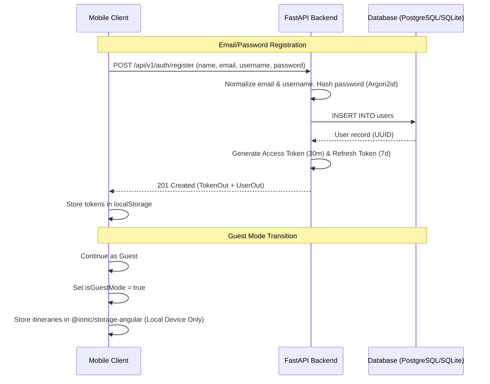
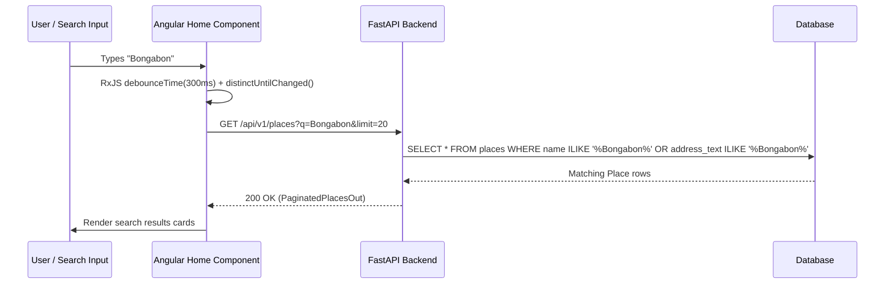

# System Architecture: Nueva Ecija Travel Itinerary

## 1. High-Level Component Topology

The system is organized as a monorepo containing a standalone client, an asynchronous REST API backend, an offline data processing pipeline, and a relational database:

```text
┌────────────────────────────────────────────────────────────────────────┐
│                        Ionic Angular Client (Project/)                 │
│  ├── Welcome / Login / Signup / Guest Onboarding                       │
│  ├── Home Tab: Debounced Search, Entry Cards, Popular Carousel         │
│  ├── Map Tab: Leaflet Map, 16 Category Filters, POI Bottom Sheet       │
│  ├── Itinerary Flow: Suggested Generator, Custom Builder, Day Timeline │
│  └── Storage: AuthService (JWT) & GuestStorageService (@ionic/storage) │
└───────────────────────────────────┬────────────────────────────────────┘
                                    │ HTTPS REST / JSON
                                    ▼
┌────────────────────────────────────────────────────────────────────────┐
│                        FastAPI Backend (backend/)                      │
│  ├── /api/v1/health: Liveness and provincial scope check               │
│  ├── /api/v1/auth: Argon2id hashing, JWT tokens, Google OAuth verify   │
│  ├── /api/v1/places: Full-text & bounding-box search, category filters │
│  ├── /api/v1/itineraries: BOLA-protected CRUD, stop reordering         │
│  └── algorithms/itinerary_generator: Deterministic Haversine clustering│
└───────────────────────────────────┬────────────────────────────────────┘
                                    │ SQLAlchemy 2.0 ORM
                                    ▼
┌────────────────────────────────────────────────────────────────────────┐
│                    Relational Database (PostgreSQL / SQLite)           │
│  ├── users & auth_identities (Accounts and linked Google OAuth)        │
│  ├── municipalities & places (Provincial entities & 16 POI categories) │
│  └── itineraries, itinerary_days, itinerary_items (Multi-day plans)    │
└───────────────────────────────────▲────────────────────────────────────┘
                                    │ Seed & Upsert Scripts
┌───────────────────────────────────┴────────────────────────────────────┐
│                    Offline Data Pipeline (scripts/)                    │
│  ├── import_osm.py (Overpass JSON ingestion with NE bounding box check)│
│  └── seed_featured_places.py (Curated Nueva Ecija featured destinations│
└────────────────────────────────────────────────────────────────────────┘
```

---

## 2. Component Responsibilities

### 2.1 Hybrid Mobile Client (`Project/`)
- **Technology**: Ionic 9, Angular 22, Capacitor 8, SCSS.
- **Role**: Renders the complete mobile application UI aligned with Figma design specifications (`Travel Itinerary App.fig`).
- **Data Boundary**: The client **never** communicates directly with PostgreSQL or third-party mapping geocoders. All dynamic data is fetched from the FastAPI backend via `HttpClient`.
- **Offline / Laptop-Down Resilience**: Intercepts HTTP 0, 502, and 504 errors via `authInterceptor` to alert users that the host laptop may be asleep while allowing local guest itineraries to remain operational.

### 2.2 REST API Backend (`backend/`)
- **Technology**: Python 3.14 / 3.11+, FastAPI, Pydantic v2, Uvicorn.
- **Role**: Validates payloads, manages authentication, performs database transactions, executes search queries, runs the deterministic itinerary recommendation engine, and enforces Broken Object-Level Authorization (BOLA) security checks.
- **Security**: Password hashing uses Argon2id (`pwdlib`), JWT token generation uses PyJWT with HMAC-SHA256, and Google ID tokens are verified cryptographically server-side.

### 2.3 Relational Database Layer
- **Production Mode**: Local PostgreSQL 15+ running on development host/container.
- **Development / Test Mode**: In-memory SQLite or file-based SQLite database with cross-compatible portable types (`JsonType = JSON().with_variant(JSONB(), "postgresql")`).
- **Isolation**: PostgreSQL port 5432 is strictly bound to `127.0.0.1` and never exposed over Wi-Fi or public interfaces.

### 2.4 Offline Ingestion Pipeline (`scripts/`)
- **`import_osm.py`**: Reads raw OpenStreetMap Overpass JSON exports, filters coordinates strictly within the Nueva Ecija bounding box (`15.15 <= lat <= 16.15`, `120.70 <= lng <= 121.40`), maps tags to 16 canonical categories, and idempotently upserts records.
- **`seed_featured_places.py`**: Seeds the 12 core Nueva Ecija municipalities and 17 curated featured places with verified descriptions, opening hours, and honest cost ranges.

---

## 3. Data Flow Diagrams

### 3.1 Authentication & Session Flow


### 3.2 Place Search Flow (Zero Nominatim Calls)


---

## 4. Security & Compliance Boundaries

1. **Broken Object-Level Authorization (BOLA / IDOR)**:
   - On every itinerary mutation (view, edit, delete, reorder), the backend verifies `itinerary.user_id == current_user.id`. A traveler guessing another user's UUID receives an immediate `404 Not Found`.
2. **OpenStreetMap Compliance**:
   - Tile layer requests standard OSM raster tiles with full attribution (`© OpenStreetMap contributors`).
   - Nominatim is strictly excluded from client-side search to respect OSM usage policies.
   - Overpass queries are run exclusively offline during data preparation.
3. **External Navigation Hand-Off**:
   - The app does not embed Google routing engines or incur API costs. It opens directions via standard browser URL schemes: `https://www.google.com/maps/dir/?api=1&destination={latitude},{longitude}`.

