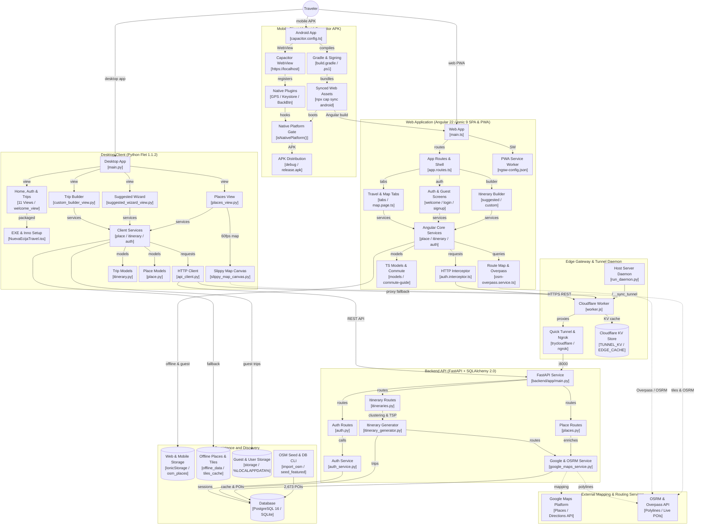
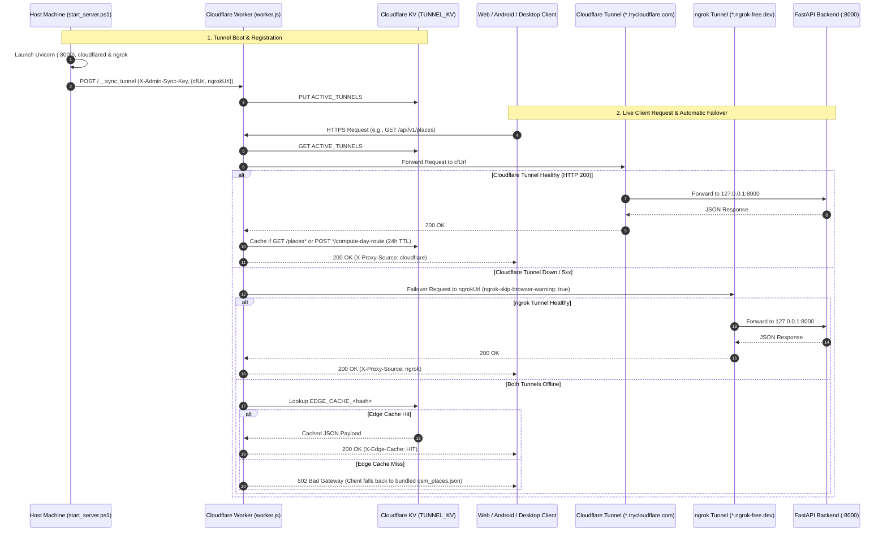

# 02 — System Architecture

## 1. High-Level Architecture

The Nueva Ecija Travel Itinerary system uses a **decoupled client-server architecture** augmented by an **edge reverse proxy** and **multi-tier offline fallbacks**. Both the Ionic Angular Web/Android client (`Project/`) and the Python Flet Desktop client (`desktop_client/`) communicate with the same FastAPI REST API (`backend/`) over HTTPS JSON, either directly (`http://127.0.0.1:8000/api/v1` in local development) or through the Cloudflare Worker edge proxy (`https://ne-itinerary-api.edselrenz0.workers.dev/api/v1`).

> **Interactive Diagram**: You can also open [`trip_mo_trip_ko_full_stack_repository_architecture_diagram.html`](./trip_mo_trip_ko_full_stack_repository_architecture_diagram.html) in any browser to pan, zoom, filter layers, and click individual nodes to inspect their file paths and incoming/outgoing edges.

---

## 2. Architectural Layers Breakdown

### 2.1 Frontend Architecture (`Project/` & `desktop_client/`)
- **Ionic Angular Web/PWA & Android (`Project/`)**:
  - **Bootstrap (`Project/src/main.ts`)**: Uses `provideZonelessChangeDetection()`, `IonicRouteStrategy`, `provideHttpClient(withInterceptors([authInterceptor]))`, `IonicStorageModule.forRoot()`, `withHashLocation()` (for GitHub Pages SPA routing compatibility), `PreloadAllModules`, and conditional `provideServiceWorker('ngsw-worker.js')` (enabled only in production non-Capacitor web builds).
  - **Leaflet Safety Guard**: `main.ts` defines a property guard on `window.L` to prevent destructive overwrites from stripping `MarkerClusterGroup` plugin methods.
  - **State Management**: Service-scoped RxJS `BehaviorSubject` observables (`AuthService.currentUser$`, `ConnectivityService.isHostOffline$`, `ItineraryService.itineraries$`, `ItineraryService.activeDraftItinerary$`, `FavoritesService.favorites$`, `GuestStorageService.isGuestMode$`, `RouteTrackingService.state$`). No NgRx or external store is used.
  - **Offline Resilience**: Bundles 2,673 OSM POIs in `Project/src/assets/data/osm_places.json`, curated places in `offline-places.data.ts`, and local guest storage via `@ionic/storage-angular` (IndexedDB/LocalStorage).
- **Flet Desktop Client (`desktop_client/`)**:
  - **Entry Point (`desktop_client/main.py`)**: Single-window Flet app with manual route dispatcher (`navigate_to()`), persistent 4-tab `BottomTabBar`, contextual `WorkflowHeader`, global `OfflineHostBanner`, and full-screen 2.8-second `SplashOverlay` (`TC-39`) followed by the boxless `WelcomeView` (`TC-40`) with the seamless 3-tile mirrored widescreen cityscape (`welcome_hero_buildings_wide.png`).
  - **Writable Storage & Tile Cache Relocation (`PKG-REV-01` / `TC-35`)**: Both `desktop_client/config/settings.py` and `desktop_client/components/slippy_map_canvas.py` (`_resolve_writable_tile_cache_dir()`) perform a startup `.write_probe` check. When installed under a read-only directory such as `C:\Program Files\NuevaEcijaTravel`, the client automatically redirects runtime JSON files (`session.json`, `guest_storage.json`, `favorites.json`, `profile_extra.json`) and cached map tiles (`tiles_cache/`) to `%LOCALAPPDATA%\NuevaEcijaTravel\storage`.
  - **State Management**: Singleton manager instances (`SessionManager`, `ConnectivityService`, `FavoritesService`, `ItineraryService`, `PlaceService`) using observer callback lists (`add_listener` / `_notify`).
  - **Custom Slippy Map (`desktop_client/components/slippy_map_canvas.py`)**: Renders OpenStreetMap tiles with bundled pre-seeded tiles (`assets/tiles/`), writable runtime disk cache, spatial indexing, marker clustering, and OSRM/Haversine/geodesic spline polyline overlays.

### 2.2 Backend Architecture (`backend/`)
- **Framework**: FastAPI (`backend/app/main.py`) served by Uvicorn on port `8000`.
- **Layered Separation**:
  - `app/core/`: Configuration (`config.py`), SQLAlchemy engine & fallback (`database.py`), and proxy-aware SlowAPI rate limiter (`limiter.py`).
  - `app/api/v1/`: Thin route handlers (`auth.py`, `places.py`, `itineraries.py`) handling HTTP semantics, dependency injection, rate-limit decorators, and BOLA enforcement.
  - `app/schemas/`: Pydantic v2 request/response contracts with custom input normalization validators (e.g., forgiving `planned_time` and `place_id` coercion for Web/Desktop payload parity).
  - `app/services/`: Business services (`auth_service.py`, `google_maps_service.py`).
  - `app/algorithms/`: Pure algorithmic itinerary planner (`itinerary_generator.py`).
  - `app/models/`: SQLAlchemy 2.0 ORM entities (`entities.py`).

### 2.3 Database Architecture
- **Primary DBMS**: PostgreSQL 16 (`postgres:16-alpine` via `docker-compose.yml` / `docker-compose.prod.yml`), connected via `psycopg` v3 driver (`postgresql+psycopg://...`).
- **Automatic Local Fallback**: On startup (`backend/app/core/database.py`), SQLAlchemy tests the configured PostgreSQL connection with `connect_timeout=2`. If unreachable, it logs a warning and seamlessly falls back to `sqlite:///<repo_root>/nueva_ecija_travel.db`.
- **Portable Column Types**: `JsonType = JSON().with_variant(JSONB(), "postgresql")` allows identical ORM models and tests to run on both PostgreSQL (`JSONB`) and SQLite (`JSON`).
- **Schema Governance**: 4 sequential Alembic migrations (`0001`–`0004`) plus an idempotent startup auto-check `ensure_user_profile_columns(engine)`.

### 2.4 API, Tunneling & Edge Proxy Communication Lifecycle
- **RESTful JSON API** prefixed under `/api/v1`:
  - `/api/v1/health` (liveness)
  - `/api/v1/auth/*` (7 routes)
  - `/api/v1/municipalities` & `/api/v1/places/*` (6 routes)
  - `/api/v1/itineraries/*` (13 routes)
- **Cloudflare Worker Reverse Proxy (`cloudflare-worker/worker.js`)**:
  - Solves dynamic tunnel URL rotation when hosting the backend on a local machine.
  - `scripts/start_server.ps1` / `scripts/run_daemon.py` POSTs active Cloudflare Tunnel & `ngrok` URLs to `/__sync_tunnel` (authenticated via `X-Admin-Sync-Key`), persisting them in Cloudflare KV (`ACTIVE_TUNNELS`).
  - Incoming API requests try `cfUrl` first, fail over to `ngrokUrl` on 5xx or `ngrok` offline headers, and serve 24-hour KV-cached JSON (`X-Edge-Cache: HIT`) for `GET /api/v1/places*` and `POST */compute-day-route` if both tunnels are down.

### 2.5 Authentication Architecture
- **Stateless Bearer JWT** (`HS256`): 30-minute access tokens + 7-day refresh tokens.
- **Web/Mobile Token Storage**: `SecureTokenStorageService` uses `capacitor-secure-storage-plugin` (Android Keystore) on native platforms and `localStorage`/`sessionStorage` (based on `rememberMe`) on web, with an in-memory synchronous cache for the HTTP interceptor.
- **Desktop Token Storage**: Plain JSON persisted in `storage/session.json` (or `%LOCALAPPDATA%\NuevaEcijaTravel\storage\session.json`) when `remember_me=True`.
- **Automatic Refresh Queue**: Both `auth.interceptor.ts` (RxJS `BehaviorSubject` gate) and `desktop_client/core/api_client.py` (`asyncio.Lock`) queue concurrent 401 requests during a single token refresh to prevent refresh storms.

### 2.6 Deployment Architecture
- **Web/PWA**: Built via GitHub Actions (`.github/workflows/deploy.yml`) and deployed to **GitHub Pages** (`https://edselrenz.github.io/Itinerary-App/`) with `.nojekyll` and `404.html` SPA fallback.
- **Android**: Built via `.github/workflows/release-builds.yml` and `scripts/build_android_apk.ps1` (`npx ng build --configuration production --no-service-worker` → `npx cap sync android` → Gradle 8.13 `assembleDebug` / `assembleRelease` with JDK 21 and `android.builder.sdkDownload=true`).
- **Windows Desktop**: Built via `scripts/build_standalone_exe.py` (staging in `build_temp/dist_stage/NuevaEcijaTravel` with PyInstaller + cached Flet Flutter engine + `icons.json` and NTFS `.old` hot-swap protection) and compiled into `dist_installer/NuevaEcijaTravel_Setup_v1.0.0.exe` (`156.58 MB`) via Inno Setup 6 (`installer/NuevaEcijaTravel.iss`) plus `dist_installer/NuevaEcijaTravel_Portable_Installer_v1.0.0.zip` (`232.64 MB`).
- **Backend**: Runs either via multi-stage Docker (`backend/Dockerfile` + `docker-compose.prod.yml`) or locally via `start_server.bat` (`scripts/start_server.ps1`) with dual Cloudflare + `ngrok` tunnels.

---

## 3. Component Responsibilities Matrix

| Component | Purpose | Main Files | Inputs | Outputs | Key Dependencies |
|---|---|---|---|---|---|
| **Angular Core & Auth Layer** | Session lifecycle, JWT injection, 401 refresh queue, offline health telemetry, guest migration | `auth.service.ts`, `auth.interceptor.ts`, `connectivity.service.ts`, `secure-token-storage.service.ts`, `guest-migration.service.ts` | User credentials, HTTP requests, `localStorage`/Keystore | Bearer headers, `User` observables, offline banner state | `HttpClient`, `Capacitor`, `SecureStoragePlugin` |
| **Angular Discovery & Map Layer** | POI catalog, 16-category filtering, Leaflet clustering, live Overpass fetch, GPS tracking | `place.service.ts`, `osm-overpass.service.ts`, `route-tracking.service.ts`, `map.page.ts`, `itinerary-route-map.component.ts` | Map bounds, search query, category/municipality/price filters, GPS coordinates | Clustered markers, route polylines, ETA/off-route alerts | `leaflet`, `leaflet.markercluster`, `@capacitor/geolocation` |
| **Angular Itinerary & Export Layer** | Suggested wizard, custom multi-day builder, detail editor, offline clustering fallback, `.ics`/text export | `itinerary.service.ts`, `suggested-wizard.page.ts`, `custom-builder.page.ts`, `itinerary-detail.page.ts`, `itinerary-export.util.ts` | Trip parameters, stops, drag/reorder operations | Persisted or guest `Itinerary`, `.ics`/Markdown exports | `PlaceService`, `GuestStorageService`, `date.utils.ts` |
| **Flet Desktop Client** | Native Windows desktop UI mirroring all web workflows with offline map tiles and `%LOCALAPPDATA%` fallback | `desktop_client/main.py`, `core/api_client.py`, `components/slippy_map_canvas.py`, `views/*.py`, `services/*.py` | User interactions, local JSON storage, REST API responses | Rendered Flet views, local exports, tile cache | `flet`, `flet-map`, `httpx`, `pydantic` |
| **FastAPI Auth Module** | Registration, login, token refresh, profile update, Google OAuth verification, Apple 501 gate | `backend/app/api/v1/auth.py`, `backend/app/services/auth_service.py`, `backend/app/schemas/auth.py` | Credentials, JWTs, Google ID tokens | `TokenOut`, `UserOut`, HTTP 401/403/409/501 | `pwdlib[argon2]`, `pyjwt`, `google-auth`, `slowapi` |
| **FastAPI Places & GIS Module** | Municipality/POI queries, Google Places v1 search/details, photo proxy, Google Routes v2 + OSRM/Haversine routing | `backend/app/api/v1/places.py`, `backend/app/services/google_maps_service.py`, `backend/app/schemas/place.py` | Filters, bounding boxes, search queries, waypoints | `PaginatedPlacesOut`, `PlaceOut`, `RouteComputeResponse`, proxied JPEG bytes | `httpx`, `GeospatialCache`, `Place`, `Municipality` |
| **FastAPI Itinerary & Generator Module** | Deterministic suggested trip generation, BOLA-protected CRUD, stop reordering, day route persistence | `backend/app/api/v1/itineraries.py`, `backend/app/algorithms/itinerary_generator.py`, `backend/app/schemas/itinerary.py` | `SuggestedItineraryRequest`, `ItineraryCreate/Update`, `ItineraryReorderIn` | `ItineraryOut` with days, stops, assumptions, polylines | `GoogleMapsService`, SQLAlchemy ORM |
| **Cloudflare Edge Proxy** | Fixed HTTPS gateway, dynamic tunnel failover, 24h read/route edge cache | `cloudflare-worker/worker.js`, `cloudflare-worker/wrangler.toml` | Client HTTPS requests, admin `/__sync_tunnel` POST | Proxied upstream responses or `X-Edge-Cache: HIT` JSON | Cloudflare Workers runtime, `TUNNEL_KV` |
| **Operations & Data Pipeline** | DB setup, dual-engine CLI querying, OSM Overpass scraping/import, curated seeding, backup/restore, APK/EXE packaging | `scripts/*.py`, `scripts/*.ps1`, `installer/NuevaEcijaTravel.iss` | Overpass API, local DB, source trees | Seeded DB, `osm_places.json`, backups, `.apk`, `Setup.exe`, Portable `.zip` | `sqlalchemy`, `alembic`, `pyinstaller`, `gradle`, `ISCC` |

---

## 4. Technical Terms & Concepts Explained (How It Works & What It Is Used For in This System)

| Technical Term | How It Works (Technical & Layman Explanation) | What It Is Used For in This System |
|---|---|---|
| **Reverse Proxy & Edge Computing** | **Layman**: Instead of giving customers the direct personal phone number of a worker in the back office, calls go through a front-desk switchboard located right near the caller. The switchboard forwards the call to whichever back-office line is working, or reads back an answer from its memo pad if the office is closed. **Technical**: An intermediary server (`cloudflare-worker/worker.js`) deployed across Cloudflare's global edge data centers that terminates client HTTPS connections, inspects request headers/methods, rewrites the target origin URL to the active tunnel (`cfUrl` or `ngrokUrl`), attaches CORS headers, and caches responses at the network edge. | Decouples the deployed GitHub Pages PWA (`https://edselrenz.github.io`), Android APK, and Desktop app from changing local tunnel URLs by giving all clients one permanent endpoint: `https://ne-itinerary-api.edselrenz0.workers.dev/api/v1`. |
| **Cloudflare Quick Tunnel (`cloudflared`)** | **Layman**: A free command-line tool from Cloudflare that creates an instant, encrypted public `https://....trycloudflare.com` web link pointing to a program running on your computer. **Technical**: The `cloudflared` daemon establishes 4 outbound HTTP/2 or QUIC connections to Cloudflare's nearest edge POP without requiring port forwarding on the local router, dynamically allocating an ephemeral `*.trycloudflare.com` subdomain. | Serves as the **Primary** host tunnel launched by `scripts/start_server.ps1` and `scripts/run_daemon.py` to expose local Uvicorn (`127.0.0.1:8000`) to the Cloudflare Worker. |
| **`ngrok` Tunnel & `ngrok-skip-browser-warning`** | **Layman**: A second, independent tunneling service that gives your laptop a public `https://....ngrok-free.dev` link. Free `ngrok` links normally show a warning webpage to human visitors, so our app attaches a special header (`ngrok-skip-browser-warning: true`) to bypass that warning automatically. **Technical**: An outbound TLS tunnel agent forwarding public HTTPS traffic to `127.0.0.1:8000`. Adding the custom HTTP header `ngrok-skip-browser-warning: true` instructs `ngrok`'s edge proxy to skip the HTML interstitial abuse warning and forward the JSON API request directly. | Serves as the **Secondary / Failover** host tunnel in `cloudflare-worker/worker.js`, `auth.interceptor.ts`, and `desktop_client/core/api_client.py` if the primary Cloudflare Quick Tunnel drops or returns a `5xx` error. |
| **Cloudflare KV (`TUNNEL_KV`)** | **Layman**: A fast, cloud-hosted key-value notepad attached to the Cloudflare Worker where each sticky note has a name (key) and text content (value), plus an optional self-destruct timer (TTL). **Technical**: A globally distributed, eventually consistent, low-latency key-value data store bound to the Cloudflare Worker via `env.TUNNEL_KV` in `wrangler.toml`. | Stores two types of keys: 1) `ACTIVE_TUNNELS` (the latest `cfUrl` and `ngrokUrl` pushed by the host laptop via `POST /__sync_tunnel`), and 2) `EDGE_CACHE_<key>` (24-hour cached JSON responses for `GET /api/v1/places*` and `POST */compute-day-route` served when the host laptop is offline). |
| **CORS (Cross-Origin Resource Sharing) & `OPTIONS` Preflight** | **Layman**: Web browsers have a strict security guard that blocks a website on Domain A (`github.io`) from quietly fetching data from a server on Domain B (`workers.dev` or `localhost:8000`) unless Domain B explicitly says "I trust Domain A." Before sending a real request, the browser sends a quick scout message (`OPTIONS` preflight) to check permissions. **Technical**: An HTTP-header security mechanism (`Access-Control-Allow-Origin`, `Access-Control-Allow-Methods`, `Access-Control-Allow-Headers`, `Access-Control-Allow-Credentials`) enforced by browsers when JavaScript makes cross-origin `fetch`/`XMLHttpRequest` calls. | Configured in both `cloudflare-worker/worker.js` and FastAPI's `CORSMiddleware` (`backend/app/main.py`) to allow legitimate requests from `https://edselrenz.github.io`, `http://localhost:4200`, `http://localhost:8100`, `capacitor://localhost`, and `http://localhost` (Android WebView). |
| **Hash Location Routing (`withHashLocation` & `404.html`)** | **Layman**: In a Single-Page Application (SPA), all screens live inside one `index.html` file. Putting a `#` in the URL (`/#/tabs/map`) tells the browser: "Don't ask GitHub's server for a folder named `/tabs/map` — just load the main page and let Angular switch to the Map screen inside the browser." **Technical**: Uses the URL fragment identifier (`window.location.hash`) for client-side routing (`withHashLocation()` in `Project/src/main.ts`), combined with a `404.html` redirect script so static file hosts like GitHub Pages never return an HTTP 404 on page refresh or deep links. | Guarantees that refreshing or bookmarking any route (e.g., `/#/tabs/home`, `/#/suggested-wizard`) on GitHub Pages or inside the Android Capacitor WebView works without server-side URL rewrite rules. |
| **RxJS `BehaviorSubject` & Refresh Queue Gate** | **Layman**: A smart live broadcast channel that always remembers the latest value (like who is currently logged in). When a user's 30-minute access token expires while 5 different parts of the screen are loading data at once, the Refresh Queue puts 4 requests in a waiting line while sending only 1 renewal request to the server. **Technical**: An RxJS observable stream (`BehaviorSubject<T>`) holding a current state value. In `auth.interceptor.ts` (and `asyncio.Lock` in `desktop_client/core/api_client.py`), an `isRefreshing` boolean + `refreshTokenSubject` queues concurrent HTTP `401` responses until `POST /api/v1/auth/refresh` resolves, then replays all queued requests with the new token. | Prevents "refresh token storms" and accidental logouts when multiple parallel API calls encounter an expired 30-minute access token simultaneously. |
| **Write-Probe Relocation (`.write_probe` → `%LOCALAPPDATA%`)** | **Layman**: Windows locks the `C:\Program Files` folder so regular apps cannot save or change files inside it. On startup, the desktop app tests if its installation folder is locked by trying to write a tiny test file (`.write_probe`). If Windows blocks it, the app automatically moves its save folder to the user's personal `%LOCALAPPDATA%` folder. **Technical**: A startup filesystem permission probe in `desktop_client/config/settings.py` and `desktop_client/components/slippy_map_canvas.py` (`_resolve_writable_tile_cache_dir()`) that attempts to create and unlink a `.write_probe` file in the bundle's `storage/` directory, falling back to `os.environ["LOCALAPPDATA"] / "NuevaEcijaTravel" / "storage"` on `PermissionError` or `OSError`. | Ensures the Windows Desktop app (`NuevaEcijaTravel.exe`) can always save login sessions, guest itineraries, favorites, custom avatars, and downloaded OpenStreetMap tiles regardless of where the user installed the app (`TC-35`). |
