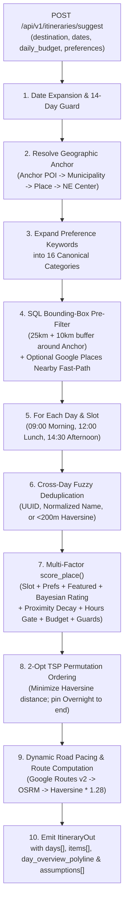

# 08 — Business Logic and Core System Functionality

This document explains every core domain process and algorithm implemented in `Edselrenz/Itinerary-App`, traced directly from the source code.

---

## 1. Deterministic Suggested Itinerary Generation (`backend/app/algorithms/itinerary_generator.py`)

### Purpose & Trigger
- **Trigger**: `POST /api/v1/itineraries/suggest` (invoked by `SuggestedWizardPage` on Web/Android and `SuggestedWizardView` on Desktop).
- **Inputs**: `destination`, `start_date`, `end_date` (max 14 days), `daily_budget` (PHP), `preferences[]`, `travel_mode` (`DRIVE` | `WALK`), `pacing`, `include_live_places`, optional `anchor_place_id` / `anchor_place_payload`, `save_immediately`.

### Step-by-Step Processing Pipeline
1. **Date Expansion & Guard**: Builds inclusive `travel_dates[]` from `start_date` to `end_date`. Raises `ValueError` (HTTP `400`) if `total_days > 14`.
2. **Geographic Anchor Resolution (`resolve_geographic_anchor`)**:
   - Priority 1: Explicit `anchor_place_id` or `anchor_place_payload` (if provided, pins this POI as Day 1, Stop 1).
   - Priority 2: Case-insensitive `Municipality` match by `name` or `slug`.
   - Priority 3: `Place` name match.
   - Priority 4: Default provincial center `(15.5800, 121.0000)` (`"Nueva Ecija"`).
3. **Preference Expansion (`resolve_preference_categories`)**: Maps user keywords (e.g., `nature` → `nature_park`, `tourist_attraction`; `heritage` → `church_religious`, `museum_cultural`; `food` → `restaurant`, `cafe`; `relaxation` → `resort_swimming`, `hotel_accommodation`).
4. **SQL Bounding-Box Pre-Filtering & Live Discovery Fast-Path**:
   - Computes a coordinate bounding box around `(anchor_lat, anchor_lng)` using `cluster_radius_km = settings.default_dest_radius_km` (`25.0 km`) + `10.0 km` buffer, then refines via `haversine_distance_km()`.
   - Only calls `google_maps_service.search_places_nearby()` when `GOOGLE_MAPS_API_KEY` is configured AND either `include_live_places=True` with `< max(total_days * 3, 15)` local POIs, or `< total_days * 3` total local candidates exist.
   - Falls back to all active provincial POIs if the bounding box yields insufficient candidates.
5. **Cross-Day Fuzzy Deduplication (`is_place_duplicate`)**:
   - Rejects candidates matching any already-scheduled `place.id`, any normalized venue name (`normalize_venue_name()` strips generic suffixes like `resort`, `cafe`, `viewdeck`, `park`), OR any coordinate within `0.2 km` (`200m`) of a scheduled stop.
6. **Multi-Factor Scoring (`score_place`)** — Targets 3 stops per day (`09:00` Morning Activity, `12:00` Lunch Dining, `14:30` Afternoon Activity):

| Scoring Factor | Rule / Formula | Points |
|---|---|---|
| **Base Slot Score** | Dining slot (`lunch_dining`): `restaurant`/`cafe` = `80`, others = `10`; Non-dining slot = `50` | `+10` to `+80` |
| **Preference Match** | `place.category in preferred_categories` (`+40`); matching tag (`+15`) | up to `+55` |
| **Featured Quality** | `place.is_featured == True` | `+20` |
| **Bayesian Rating** | $\frac{\frac{v}{v+15}R + \frac{15}{v+15}(3.8)}{5.0} \times 20.0$ (prevents 1-review 5-star bias) | up to `+20` |
| **Proximity Decay** | Within `25 km`: $\max(0, 30 - d \times 1.2)$; Beyond `25 km`: $-(d - 25) \times 2.0$ | `+30` down to negative |
| **Opening-Hours Gate** | `is_open_during_slot()` checks Google `regular_opening_hours.periods` or OSM `HH:MM-HH:MM` | `-50` if closed |
| **Category Diversity** | `place.category` already scheduled today | `-25` |
| **Cumulative Budget Fit** | Stop cost `<= remaining_daily_budget` (`+10`); exceeds remaining budget (`-30`) | `-30` to `+10` |
| **Mountain Peak Guard** | `day_has_mountain` and name matches `\b(mt\.?|mount)\b` (max 1 strenuous hike/day) | `-60` |
| **Overnight Lodging Guard** | Single-day trip: `-100`; Multi-day first slot: `-40`; Multi-day later slot: `+20` | `-100` to `+20` |

7. **2-Opt TSP Permutation Ordering & Overnight Placement**:
   - Separates overnight accommodations (`is_accommodation_place`) to the end of the day.
   - Evaluates all permutations (`itertools.permutations`) of non-accommodation stops (keeping Day 1's `anchor_place` fixed at index 0) to minimize total Haversine travel distance.
8. **Dynamic Road Pacing & Route Computation**:
   - Assigns realistic stay durations: `120 min` (lodging), `75 min` (dining), `90 min` (activities).
   - Starts Day at `09:00`, invokes `google_maps_service.compute_route()` between consecutive stops, falls back to `straight_km * 1.28` road factor at `32 km/h` if route distance is `0`, and rounds arrival times to the nearest 5-minute increment.
   - Computes full-day `day_overview_polyline`, `total_distance_meters`, `total_travel_duration_seconds`, and `route_legs`.
9. **Transparent Assumptions**: Appends pacing, geographic clustering, transit-exclusion, operating-hours, and honest unverified-pricing (`unverified_cost_count` stops not counted as `₱0`) notices.

---

## 2. Multi-Tier Turn-by-Turn Routing & Caching (`backend/app/services/google_maps_service.py`)

- **Cache Key**: `routes:{mode}:{orig_lat:.4f},{orig_lng:.4f}:{dest_lat:.4f},{dest_lng:.4f}:{intermediates}` checked against `geospatial_cache` (`TTL = 336 hours` / 14 days).
- **Tier 1 — Google Routes API v2**: Called when `GOOGLE_MAPS_API_KEY` is set (`TRAFFIC_AWARE` for `DRIVE`), returning `source: "google_routes"`.
- **Tier 2 — OSRM Public Router**: Called at `router.project-osrm.org/route/v1/driving/{coords}` with `3.0s` timeout, returning `source: "osrm"`.
- **Tier 3 — Offline Haversine Direct & Client Geodesic Spline**: Computes straight-line legs, encodes a Google precision-5 polyline via `encode_polyline()`, and estimates duration at `11.11 m/s` (`40 km/h` drive) or `1.25 m/s` (`4.5 km/h` walk), returning `source: "haversine_direct"`. On the client map (`polyline.util.ts` and `desktop_client/core/polyline.py`), sparse 2-point straight lines are smoothly interpolated using a quadratic Bézier geodesic spline so fallback routes remain visually legible.

---

## 3. Cross-Client Place Resolution & Upsert (`resolve_or_upsert_item_place`)

Because clients bundle 2,673 offline OSM POIs (some with non-UUID synthetic IDs like `dest-minalungao`) and support live Google Places discovery, `ItineraryItemCreate` and `resolve_or_upsert_item_place()` (`backend/app/api/v1/itineraries.py`):
1. Coerce non-UUID `place_id` strings into `place_payload["id"]` while setting `place_id = None`.
2. Look up existing `Place` by UUID, then by `google_place_id`, then by `source_record_id`, then by name + `±0.002°` coordinate tolerance.
3. If no match exists, upsert a new `Place` row (`upsert_google_place_to_db`), automatically assigning the closest `Municipality` via Haversine distance so foreign key integrity is always preserved.

---

## 4. Offline Resilience, Guest Mode & Account Migration

- **Offline Detection (`ConnectivityService`)**: Tracks consecutive gateway errors (`status === 0, 502, 503, 504`, or `404` on `/health`). Once `consecutiveErrors >= 2` (`ERROR_THRESHOLD`), displays the non-blocking offline host banner without interrupting local data access.
- **Offline Fallback Generation**: Both `ItineraryService` (Web) and `desktop_client/services/itinerary_service.py` (Desktop) contain local clustering fallbacks using the bundled 2,673-POI `osm_places.json` dataset when the backend is unreachable.
- **Guest-to-Account Migration (`GuestMigrationService`)**: Triggered automatically after login/registration (and manually from Profile). Reads all trips from `GuestStorageService` (`ne_guest_itineraries_v1`), normalizes `planned_time` via `toBackendIsoTime()`, POSTs each trip to `/api/v1/itineraries`, and removes migrated trips from local storage.

---

## 5. Live GPS Route Tracking (`Project/src/app/core/services/route-tracking.service.ts`)

- Uses `@capacitor/geolocation` (`watchPosition`) against the active day's decoded polyline (`decodePolyline()`).
- **Thresholds**: `stopArrivalThresholdMeters = 50m`, `offRouteThresholdMeters = 100m`, `movementThrottleMeters = 10m`, default speed `10 m/s` (`~36 km/h`).
- Emits `state$` (snapped position, distance & ETA to next stop, total remaining distance/duration, `completedStopIds`), `stopReached$`, and `rerouteNeeded$` observables.
- On the Windows Desktop client (`desktop_client/views/trip_detail_view.py` and `places_view.py`), clicking **Start Navigation / Open Route on Map** invokes `_launch_in_app_nav()` (`TC-36`), passing the itinerary's stops and decoded polyline directly into the in-app `SlippyMapCanvas` route mode rather than kicking the user out to an external browser.

---

## 6. Calendar & Text Export (`itinerary-export.util.ts` & `desktop_client/core/export.py`)

- Generates **RFC 5545 iCalendar (`.ics`)** files with `VEVENT` entries per stop (`DTSTART`, `DTEND` from `planned_time + duration_minutes`, `LOCATION`, `DESCRIPTION` with costs, notes, and Google Maps directions URL).
- Generates structured Markdown summaries, clipboard copy, Web Share API payloads, and printable views.

---

## 7. Technical Terms & Concepts Explained (How It Works & What It Is Used For in This System)

| Technical Term | How It Works (Technical & Layman Explanation) | What It Is Used For in This System |
|---|---|---|
| **Haversine Great-Circle Distance Formula** | **Layman**: Because the Earth is a curved sphere, you cannot measure the exact distance between two GPS coordinates using flat-paper geometry. The **Haversine formula** calculates the true "as-the-crow-flies" distance in kilometers over the curve of the Earth. **Technical**: Given latitudes $\phi_1, \phi_2$, longitudes $\lambda_1, \lambda_2$ in radians, and Earth radius $R = 6371.0\text{ km}$: $$a = \sin^2\left(\frac{\Delta\phi}{2}\right) + \cos(\phi_1)\cos(\phi_2)\sin^2\left(\frac{\Delta\lambda}{2}\right), \quad d = 2R\arctan2(\sqrt{a}, \sqrt{1-a})$$ | Used in `haversine_distance_km()` (`itinerary_generator.py`), `google_maps_service.py`, `PlaceService`, `RouteTrackingService`, and `desktop_client/core/geo.py` to cluster stops within `25 km`, detect 200m duplicate venues, assign the nearest Nueva Ecija municipality, and calculate live GPS proximity. |
| **Bayesian Quality Score (`bayesian_quality_score`)** | **Layman**: Which restaurant is better: Place A with a 5.0-star average from just 1 review (maybe the owner's cousin), or Place B with a 4.7-star average from 300 reviews? **Bayesian scoring** blends a venue's actual rating with a sensible province baseline (`3.8 stars` weighted by `15 phantom reviews`) so a venue needs enough real reviews to prove its high rating. **Technical**: Computes a weighted Bayesian average: $$S_{\text{Bayes}} = \frac{\frac{v}{v+m}R + \frac{m}{v+m}C}{5.0} \times 20.0$$ where $R$ is the venue's mean rating, $v$ is `user_rating_count`, $m = 15.0$ is the confidence threshold, and $C = 3.8$ is the prior mean rating. | Contributes up to `+20.0` points in `score_place()` (`backend/app/algorithms/itinerary_generator.py`) so well-reviewed Nueva Ecija landmarks outrank 1-review outliers. |
| **Traveling Salesperson Problem (TSP) & 2-Opt Permutation Ordering** | **Layman**: Once the planner picks 3 or 4 great places to visit on Day 1, in what order should you visit them so you don't zigzag back and forth across town? The **TSP optimizer** tests every possible visit sequence and picks the route with the shortest total driving distance. **Technical**: Separates overnight hotels to the final slot of the day, pins any user-requested `anchor_place` to Day 1 Stop 1, and evaluates all permutations (`itertools.permutations`) of the day's remaining activity/dining stops to minimize $\sum_{i} d_{\text{Haversine}}(p_i, p_{i+1})$. | Orders each day's stops chronologically in `itinerary_generator.py` (and client offline generators) before road-route polylines and arrival times are computed. |
| **Google Precision-5 Encoded Polyline** | **Layman**: A curvy road route between two towns can have over 1,000 GPS points. Instead of sending a bulky list of 1,000 latitude/longitude numbers in JSON, **Polyline Encoding** compresses the entire road line into one short text string (like `}_p~Fi~psU_ulLnnqC`). **Technical**: Multiplies coordinate deltas ($\Delta\text{lat}, \Delta\text{lng}$) by $10^5$, rounds to signed 32-bit integers, left-shifts and inverts negative values, splits into 5-bit chunks ORed with `0x20`, and adds `63` (`0x3F`) to produce printable ASCII characters. | Used by `encode_polyline()` / `decode_polyline()` in `backend/app/services/google_maps_service.py`, `Project/src/app/core/utils/polyline.util.ts`, and `desktop_client/core/polyline.py` to store and render `day_overview_polyline` and `route_polyline_from_prev`. |
| **Geodesic Quadratic Bézier Spline** | **Layman**: When the user is completely offline and no road-routing server is reachable, drawing a rigid ruler-straight line between two stops looks jarring on a map. A **Geodesic Spline** gently bends that fallback line into a smooth, natural-looking arc between the two pins. **Technical**: Given start $P_0$, end $P_2$, and perpendicular midpoint control point $P_1 = M + \alpha \cdot \vec{n}_{\perp}$, interpolates $N$ intermediate points along the quadratic Bézier curve $B(t) = (1-t)^2 P_0 + 2(1-t)t P_1 + t^2 P_2$ for $t \in [0, 1]$. | Used in `polyline.util.ts` (Web/Android) and `desktop_client/core/polyline.py` / `slippy_map_canvas.py` (Desktop) whenever a route leg falls back to `haversine_direct`. |
| **Fuzzy Venue Name Normalization (`normalize_venue_name`)** | **Layman**: OpenStreetMap and Google Maps sometimes list the same destination twice under slightly different names — like `"Minalungao National Park"` and `"Minalungao Park & Viewdeck"`. Fuzzy normalization strips out generic words (`park`, `resort`, `cafe`, `viewdeck`, punctuation) and checks if two pins are within 200 meters so the generator never schedules the same place twice. **Technical**: Lowercases the venue name, strips non-alphanumeric characters and stop-words (`resort`, `hotel`, `cafe`, `restaurant`, `park`, `national`, `viewdeck`, `farm`), and combines string equality with a `0.2 km` Haversine proximity check in `is_place_duplicate()`. | Prevents duplicate or overlapping stops across all days of a generated multi-day itinerary in `backend/app/algorithms/itinerary_generator.py`. |
| **Road Tortuosity Factor (`× 1.28` at `32 km/h`)** | **Layman**: Real provincial roads wind around rivers, rice paddies, and barangays, so actual driving distance is typically about 28% longer than a straight line on a map. **Technical**: When an external routing engine returns zero duration or is offline during itinerary generation, `itinerary_generator.py` multiplies the straight-line Haversine distance by a `1.28` road winding multiplier and divides by an average provincial speed of `32.0 km/h` (rounded to 5-minute increments). | Produces realistic `planned_time` arrival schedules (`09:00`, `11:15`, `13:30`) even when generating itineraries completely offline. |
