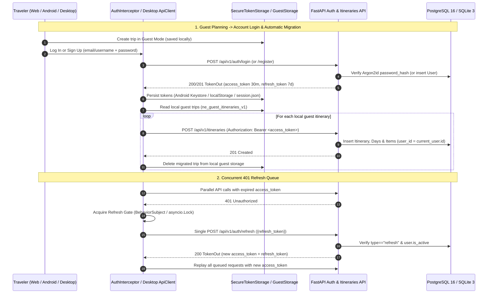

# 09 — Authentication, Authorization, and Security

This document records the **verified security controls** and **confirmed security weaknesses** identified during source inspection. No credentials, tokens, or secrets are reproduced here.

---

## 1. Verified Security Mechanisms

| Control Area | Implementation Status | Exact Implementation & File Reference |
|---|---|---|
| **Password Hashing** | Implemented & Verified | Argon2id via `pwdlib.PasswordHash.recommended()` (`backend/app/services/auth_service.py`). Passwords are never stored in plaintext and minimum length is 8 chars (`UserRegisterIn`, `UserUpdateIn`). |
| **JWT Token Issuance & Verification** | Implemented & Verified | `PyJWT` signed with `HS256` (`settings.jwt_secret_key`). Access tokens expire in `30 min` (`type: "access"`); refresh tokens expire in `7 days` (`type: "refresh"`). `decode_jwt_token()` enforces `expected_type` so refresh tokens cannot be used as access tokens. |
| **Production Secret Guard** | Implemented & Verified | `Settings.validate_secrets()` (`backend/app/core/config.py`) aborts startup if `APP_ENV != "development"` and `JWT_SECRET_KEY` is missing, `< 32` chars, or matches known default placeholders. |
| **Broken Object Level Authorization (BOLA)** | Implemented & Verified | Every itinerary read/update/delete/reorder/route endpoint queries `where(Itinerary.id == id, Itinerary.user_id == current_user.id)` and returns `404 Not Found` on mismatch (`backend/app/api/v1/itineraries.py`). |
| **User Enumeration Prevention** | Implemented & Verified | `authenticate_user()` returns generic `401 "Invalid email or password"` regardless of whether email/username exists or password is wrong. |
| **Rate Limiting & Proxy IP Resolution** | Implemented & Verified | `SlowAPIMiddleware` (`backend/app/core/limiter.py`): global `120/min`, `/auth/register` & `/auth/login` `30/min`, `/auth/refresh` `10/min`, `/auth/oauth/google` `5/min`. `get_client_ip()` trusts `CF-Connecting-IP` / `X-Forwarded-For` **only** when direct socket host is loopback (`127.0.0.1`, `localhost`, `::1`, `testclient`). |
| **SQL Injection Prevention** | Implemented & Verified | SQLAlchemy 2.0 parameterized queries across all endpoints; `escape_like()` (`backend/app/api/v1/places.py`) escapes `\`, `%`, and `_` before `ILIKE`. |
| **Google OAuth Server Verification** | Implemented & Verified (Backend) | `verify_google_id_token()` validates signature, audience (`GOOGLE_OAUTH_CLIENT_ID`), issuer (`accounts.google.com`), and `email_verified == True`. *(Frontend OAuth buttons are disabled in pilot build.)* |
| **API Key Protection (Google Maps)** | Implemented & Verified | `GOOGLE_MAPS_API_KEY` stays server-side; photos are proxied through `GET /api/v1/places/photos/{photo_name:path}` so the key is never exposed to clients. |
| **Client Token Storage** | Implemented & Verified | Android uses `capacitor-secure-storage-plugin` (native Keystore) via `SecureTokenStorageService`. Web uses `localStorage` (`rememberMe=true`) or `sessionStorage`. Desktop uses `storage/session.json` (relocating to `%LOCALAPPDATA%\NuevaEcijaTravel\storage\session.json` when installed in a read-only folder). |
| **Bearer Header Scoping** | Implemented & Verified | `authInterceptor` attaches `Authorization: Bearer` **only** to requests matching `activeApiBaseUrl` or `environment.apiBaseUrl` (prevents leaking JWT to Overpass/OSRM/third-party URLs). |
| **Custom API URL Hostname Allowlist** | Implemented & Verified | `Project/src/environments/environment.ts` (`isTrustedApiHostname()`) restricts `ne_custom_api_url` to `localhost`, `127.0.0.1`, `*.ngrok-free.dev`, `*.ngrok.app`, `*.ngrok.io`, `*.trycloudflare.com`, `*.workers.dev`, `*.onrender.com`, `*.koyeb.app`. |
| **CORS Policy** | Implemented & Verified | FastAPI `CORSMiddleware` + Cloudflare Worker `ALLOWED_ORIGINS` restrict origins to GitHub Pages, Capacitor localhost, and tunnel domains. |
| **Production OpenAPI Lockdown** | Implemented & Verified | `/docs` and `/redoc` are disabled (`None`) when `APP_ENV != "development"` (`backend/app/main.py`). |
| **Role-Based Access Control (RBAC)** | **Not Implemented** | Single traveler role; no admin role or permission scopes exist. |
| **Password Recovery / Reset** | **Not Implemented (UI-Simulated)** | Web `LoginPage.submitRecoveryRequest()` and Desktop `LoginView._send_recovery()` simulate success locally without a backend endpoint or email verification. |
| **Token Revocation / Blocklist** | **Not Implemented** | JWTs are stateless; logout only deletes tokens client-side. A stolen token remains valid until expiration (`30 min` access / `7 days` refresh). |
| **CSRF Protection** | **N/A (Bearer Auth)** | Uses `Authorization: Bearer` headers rather than auth cookies; no CSRF token middleware is present or required for Bearer flows. |

### Authentication, Token Refresh & Guest Migration Sequence

---

## 2. Security Assessment

### Confirmed Weaknesses (Verified in Source Code)

| Severity | Finding | Location | Risk & Recommended Fix |
|---|---|---|---|
| **CRITICAL** | **Hardcoded fallback `ADMIN_SYNC_KEY` committed in source** | `scripts/run_daemon.py` (line 77) & `cloudflare-worker/wrangler.toml` (line 16) | Anyone reading the public GitHub repo can discover the default fallback sync key and potentially hijack `/__sync_tunnel` if the Cloudflare Worker secret was not rotated via `wrangler secret put ADMIN_SYNC_KEY`. **Fix**: Remove the hardcoded fallback string in `run_daemon.py` (fail fast if env var missing), remove the default value from `wrangler.toml`, and immediately rotate `ADMIN_SYNC_KEY` in Cloudflare Workers. |
| **HIGH** | **Hardcoded default PostgreSQL password & fallback JWT secret in `docker-compose.prod.yml`** | `docker-compose.prod.yml` (lines 11, 28–29) | `docker-compose.prod.yml` falls back to `change_me_local_only` and the dev JWT placeholder if env vars are unset (though `Settings.validate_secrets()` blocks the JWT default when `APP_ENV=production`). **Fix**: Require `${POSTGRES_PASSWORD:?required}` and `${JWT_SECRET_KEY:?required}` without defaults, and avoid binding Postgres port `5432` to `0.0.0.0` in production. |
| **MEDIUM** | **No JWT revocation or refresh token rotation tracking** | `backend/app/services/auth_service.py`, `backend/app/api/v1/auth.py` | Logging out or changing a password does not invalidate existing refresh tokens issued prior to the change. **Fix**: Add a `token_version` column on `users` (incremented on password change/logout-all) or a `refresh_tokens` revocation table. |
| **MEDIUM** | **Plaintext token persistence on Web (`localStorage`) and Desktop (`session.json`)** | `SecureTokenStorageService`, `desktop_client/core/session.py` | Web `localStorage` tokens are readable by XSS; desktop `session.json` is unencrypted on disk. **Fix**: Enforce strict Content Security Policy (CSP) on GitHub Pages, and use OS keyring (`keyring` library / Windows DPAPI) for desktop tokens. |
| **MEDIUM** | **Startup auto-migration overwrites NULL profile fields with hardcoded personal/sample data** | `backend/app/core/database.py` (`ensure_user_profile_columns()`) | Executes a blanket `UPDATE users SET birthday='May 23, 2000', gender='Female', phone_number='+66 81 234 5678', ...` on every backend boot for any user with blank fields, polluting real user records with inaccurate PII. **Fix**: Remove the `UPDATE` backfill immediately; leave optional user profile columns `NULL` until provided by the user. |
| **LOW** | **Overly permissive `allow_headers=["*"]` & wildcard tunnel regex in CORS** | `backend/app/main.py`, `backend/app/core/config.py` | Regex allows any `*.trycloudflare.com`, `*.ngrok-free.dev`, or `*.workers.dev` origin with `allow_credentials=True`. **Fix**: Restrict production `CORS_ORIGINS` strictly to exact deployed frontend origins and disable wildcard tunnel regex in production. |

### Potential Risks Requiring Further Testing
- **SSRF / Path Traversal check on `/api/v1/places/photos/{photo_name:path}`**: `photo_name` is interpolated directly into `https://places.googleapis.com/v1/{photo_name}/media?...&key={api_key}`. While targeted at `places.googleapis.com`, validating `photo_name` against regex `^places/[A-Za-z0-9_-]+/photos/[A-Za-z0-9_-]+$` is recommended to prevent path manipulation.
- **Unrestricted `avatar_url` input**: `UserUpdateIn.avatar_url` accepts arbitrary `Text` (supporting base64 data URIs or URLs) without size cap or MIME validation, which could allow large payload storage abuse or `javascript:` URI injection if rendered unsafely.

---

## 3. Technical Terms & Concepts Explained (How It Works & What It Is Used For in This System)

| Technical Term | How It Works (Technical & Layman Explanation) | What It Is Used For in This System |
|---|---|---|
| **Argon2id Password Hashing (`pwdlib[argon2]`)** | **Layman**: When you create a password, the server never saves your actual password. Instead, it runs your password through a one-way mathematical blender (**Argon2id**) that deliberately eats up megabytes of computer RAM for a fraction of a second. A regular user logging in doesn't notice a 0.1-second pause, but a hacker trying to guess millions of passwords per second on graphics cards is slowed to a crawl. **Technical**: Winner of the 2015 Password Hashing Competition, combining data-independent memory access (**Argon2i**, resisting side-channel timing attacks) and data-dependent memory access (**Argon2d**, resisting GPU/ASIC brute-force attacks) with a per-user random salt encoded in PHC string format (`$argon2id$v=19$m=...,t=...,p=...$<salt>$<hash>`). | Hashes and verifies all user passwords in `backend/app/services/auth_service.py` (`hash_password()` and `verify_password()`), stored in `users.password_hash`. |
| **HS256 JWT (`access_token` vs. `refresh_token`)** | **Layman**: Instead of the server looking up a session table on every click, it issues two signed passes: a short **30-minute Access Token** used for everyday API clicks, and a **7-day Refresh Token** kept tucked away solely to request a fresh 30-minute Access Token when the old one expires. **Technical**: **JSON Web Token (RFC 7519)** signed with **HMAC-SHA256 (`HS256`)** using `settings.jwt_secret_key`. Payload claims include `sub` (User UUID), `type` (`"access"` or `"refresh"`), `iat` (issued-at epoch), and `exp` (expiration epoch). `decode_jwt_token()` strictly verifies `payload.get("type") == expected_type` to prevent token-type confusion attacks. | Authenticates all protected API calls across Web, Android, and Desktop while allowing 7-day persistent "Remember Me" logins. |
| **User Enumeration Prevention** | **Layman**: If a login page says *"That email does not exist"* vs. *"Wrong password for that email"*, hackers can test a list of 10,000 emails to find out who has an account. Returning the exact same message (*"Invalid email or password"*) either way keeps user accounts private. **Technical**: Uniform HTTP `401 Unauthorized` response (`detail="Invalid email or password"`) in `authenticate_user()` (`backend/app/services/auth_service.py`) whether the `SELECT` query found no matching user, found an OAuth-only user without a password hash, or failed Argon2id verification. | Protects `POST /api/v1/auth/login` against automated account-discovery scraping. |
| **Android Keystore (`capacitor-secure-storage-plugin`)** | **Layman**: A hardware-backed digital safe built into Android phones where apps can lock away sensitive login tokens so other apps or malware cannot read them. **Technical**: Uses Android's `KeyStore` system to generate an AES/RSA hardware-backed encryption key bound to the app's signing certificate (`ph.nuevaecijatravel.app`), encrypting key-value pairs stored in `SharedPreferences` via `SecureStoragePlugin`. | Used by `SecureTokenStorageService` (`Project/src/app/core/services/secure-token-storage.service.ts`) when running inside the native Android APK to store `ne_access_token`, `ne_refresh_token`, and `ne_user_profile`. |
| **SQL Injection & LIKE Wildcard Escaping (`escape_like`)** | **Layman**: **SQL Injection** is a classic attack where someone types database commands (like `' OR 1=1 --`) into a search box hoping to trick the database. Additionally, in SQL search boxes (`ILIKE`), the characters `%` and `_` act as wildcards that match everything unless escaped. **Technical**: SQLAlchemy 2.0 binds all filter values as out-of-band prepared-statement parameters (`:param_1`), neutralizing SQL injection. Furthermore, `escape_like()` in `backend/app/api/v1/places.py` prefixes `\`, `%`, and `_` with `\` (`ESCAPE '\'`) before building `ILIKE` search patterns. | Secures `GET /api/v1/places?q=...` and `GET /api/v1/municipalities?q=...` against both SQL injection and wildcard denial-of-service queries. |
| **SSRF (Server-Side Request Forgery) & Hostname Allowlisting (`isTrustedApiHostname`)** | **Layman**: If an app lets a user type in any custom server URL and then blindly sends the user's secret login token to that URL, an attacker could trick a user into sending their token to an evil server. An **Allowlist** ensures the app only talks to approved domains. **Technical**: `isTrustedApiHostname()` in `Project/src/environments/environment.ts` parses the URL via `new URL(url)` and validates `hostname` against an explicit allowlist (`localhost`, `127.0.0.1`, `*.workers.dev`, `*.trycloudflare.com`, `*.ngrok-free.dev`, `*.onrender.com`, `*.koyeb.app`) before accepting a custom API endpoint. | Prevents credential exfiltration if a user or malicious script attempts to override `ne_custom_api_url` in `localStorage`. |
