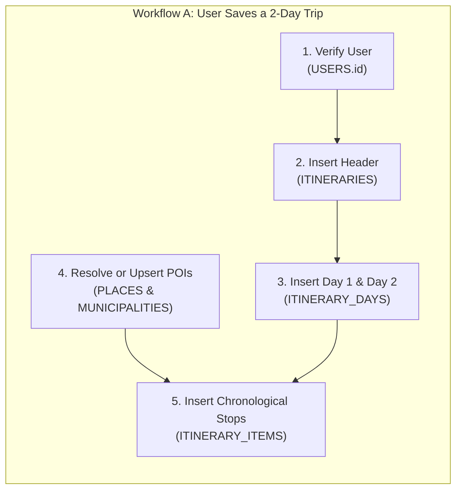

# 17 — Entity-Relationship Diagram (ERD) Explanation and Discussion

This document provides a complete **technical and layman-friendly explanation and architectural discussion** of the **Entity-Relationship Diagram (ERD)** for **Trip Mo, Trip Ko (Nueva Ecija Travel Itinerary System — `v1.0.0`)**.

Every table, column, primary key, foreign key, cardinality symbol, and deletion rule discussed below is verified **1-to-1** against [`backend/app/models/entities.py`](../backend/app/models/entities.py) and Alembic migrations [`0001` through `0005`](../backend/alembic/versions/).

---

## 1. What Is an ERD and How Do You Read It?

### Plain-Language (Layman) Explanation
Imagine the database as a **company's master filing room** containing **8 specialized filing cabinets (Tables / Entities)**. Instead of typing the same traveler's name, email, and phone number over and over on every single trip schedule, or re-typing a restaurant's address and GPS coordinates every time someone adds it to a trip, each cabinet stores **one specific type of thing** (Users, Municipalities, Places, Itineraries, Trip Days, Trip Stops, etc.) and links them together using unique ID tags (**Primary Keys** and **Foreign Keys**).

An **Entity-Relationship Diagram (ERD)** is the **visual blueprint of that filing room**. It shows:
1. **The Boxes (Entities / Tables)**: What cabinets exist and what fields (columns) are inside each folder.
2. **The Connecting Lines (Relationships)**: Which cabinets are linked to each other and how many folders in Cabinet B can belong to one folder in Cabinet A (**Cardinality**).

### Reading Crow's Foot Notation (`||--o{`)
In the ERD diagram below, the lines between tables use **Crow's Foot Notation**:
- **`||` (Exactly One)**: The double vertical bar on the left side of `||--o{` means **"One and only one"** parent record (for example, every saved itinerary belongs to *exactly one* User).
- **`o{` (Zero or Many)**: The circle (`o` = zero) and three-pronged "crow's foot" (`{` = many) on the right side of `||--o{` means **"Zero, one, or many"** child records (for example, a newly registered User starts with *zero* saved itineraries, and over time can create *many* saved itineraries).
- **`PK` (Primary Key)**: The unique ID stamp (`UUID`) that identifies a single row in that table.
- **`FK` (Foreign Key)**: A pointer column that holds the `PK` of a row in another table, creating the link between them.
- **`UK` (Unique Key)**: A rule guaranteeing no two rows in that table can have the same value in that column (for example, no two users can register the same email address).

---

## 2. Complete System ERD (8 Tables, 109 Columns)

```mermaid
erDiagram
    USERS ||--o{ AUTH_IDENTITIES : "has linked OAuth (CASCADE)"
    USERS ||--o{ ITINERARIES : "owns (CASCADE)"
    MUNICIPALITIES ||--o{ PLACES : "contains (SET NULL)"
    ITINERARIES ||--o{ ITINERARY_DAYS : "composed of (CASCADE)"
    ITINERARY_DAYS ||--o{ ITINERARY_ITEMS : "schedules (CASCADE)"
    PLACES ||--o{ ITINERARY_ITEMS : "referenced by (SET NULL)"

    USERS {
        uuid id PK
        varchar first_name
        varchar last_name
        varchar username_normalized UK
        varchar email_normalized UK
        varchar password_hash
        varchar middle_initial
        varchar phone_number
        varchar birthday
        varchar gender
        text avatar_url
        numeric default_daily_budget
        boolean is_active
        timestamptz created_at
        timestamptz updated_at
    }

    AUTH_IDENTITIES {
        uuid id PK
        uuid user_id FK
        varchar provider
        varchar provider_subject
        varchar provider_email
        timestamptz created_at
    }

    MUNICIPALITIES {
        uuid id PK
        varchar name UK
        varchar slug UK
        boolean is_city
        float center_lat
        float center_lng
        jsonb boundary_geojson
    }

    PLACES {
        uuid id PK
        varchar name
        varchar category
        float latitude
        float longitude
        uuid municipality_id FK
        varchar address_text
        text description
        varchar phone
        varchar website
        varchar opening_hours
        numeric estimated_cost_min
        numeric estimated_cost_max
        varchar cost_currency
        varchar image_url
        varchar image_license
        varchar source_name
        varchar source_record_id
        varchar source_url
        timestamptz imported_at
        timestamptz verified_at
        boolean is_featured
        boolean is_active
        jsonb tags
        varchar google_place_id UK
        jsonb google_types
        text editorial_summary
        jsonb regular_opening_hours
        float rating
        integer user_rating_count
        integer price_level
        jsonb photos
        jsonb reviews
        varchar business_status
        varchar google_maps_uri
        timestamptz details_cached_at
    }

    ITINERARIES {
        uuid id PK
        uuid user_id FK
        varchar title
        varchar destination
        date start_date
        date end_date
        numeric daily_budget
        jsonb preferences
        varchar type
        jsonb assumptions
        timestamptz created_at
        timestamptz updated_at
    }

    ITINERARY_DAYS {
        uuid id PK
        uuid itinerary_id FK
        integer day_number
        date travel_date
        varchar title
        text day_overview_polyline
        integer total_distance_meters
        integer total_travel_duration_seconds
        jsonb route_legs
    }

    ITINERARY_ITEMS {
        uuid id PK
        uuid day_id FK
        uuid place_id FK
        varchar custom_title
        float custom_lat
        float custom_lng
        integer sort_order
        time planned_time
        integer duration_minutes
        text notes
        numeric estimated_cost_min
        numeric estimated_cost_max
        varchar google_place_id
        varchar travel_mode_from_prev
        integer travel_distance_meters
        integer travel_duration_seconds
        text route_polyline_from_prev
        timestamptz created_at
        timestamptz updated_at
    }

    GEOSPATIAL_CACHE {
        varchar cache_key PK
        varchar cache_type
        jsonb payload
        timestamptz created_at
        timestamptz expires_at
    }
```

---

## 3. Architectural Grouping of the 8 Entities (4 Core Domains)

To understand how the ERD is organized, the 8 tables divide naturally into **four functional domains**:

1. **Identity & Account Domain (`USERS`, `AUTH_IDENTITIES`)**:
   - Handles *who* is using the system, their login credentials, and their personal profile settings.
2. **Provincial Geography & POI Catalog Domain (`MUNICIPALITIES`, `PLACES`)**:
   - Handles *where* travelers can go in Nueva Ecija — the 32 cities/municipalities and the 2,673+ tourist attractions, cafes, restaurants, hotels, churches, and essential services.
3. **Hierarchical Trip Planning Domain (`ITINERARIES`, `ITINERARY_DAYS`, `ITINERARY_ITEMS`)**:
   - Handles *what* the traveler planned — structured as a 3-level parent-child hierarchy: **1 Trip (`ITINERARIES`) → Many Calendar Days (`ITINERARY_DAYS`) → Many Chronological Stops per Day (`ITINERARY_ITEMS`)**.
4. **Performance & Offline Caching Domain (`GEOSPATIAL_CACHE`)**:
   - An independent key-value cache table that stores expensive external Google Maps and OSRM road-routing responses with expiration timestamps (`expires_at`).

---

## 4. Entity-by-Entity Deep Dive (Technical & Layman Discussion)

### 4.1 `USERS` (15 Columns) — Traveler Accounts & Profile Preferences

| Aspect | Explanation |
|---|---|
| **Layman Explanation (How It Works & What It Is For)** | This is the **Master Traveler Directory**. Every registered user gets one row here holding their name, username, email, scrambled password (`password_hash`), optional profile details (birthday, gender, phone, avatar picture), and their preferred default daily travel budget (`₱3,000` by default). |
| **Technical Design Decisions** | 1. **Normalized Unique Identifiers (`username_normalized`, `email_normalized`)**: Emails and usernames are trimmed and lowercased before insertion and indexed with `UNIQUE` B-Tree indexes (`ix_users_email_normalized`, `ix_users_username_normalized`). This prevents case-sensitivity duplicates (e.g., `Juan@mail.com` vs. `juan@mail.com`) and makes login lookups $O(\log N)$. 2. **Nullable `password_hash`**: Allows a user account created purely through Google OAuth (`AUTH_IDENTITIES`) to exist without a local password, while local accounts store an Argon2id hash string. 3. **Soft Deactivation (`is_active`)**: Instead of hard-deleting an account when suspending access, setting `is_active = false` immediately blocks login and token refresh (`403 Forbidden`) while preserving relational history. |

---

### 4.2 `AUTH_IDENTITIES` (6 Columns) — External OAuth Provider Links

| Aspect | Explanation |
|---|---|
| **Layman Explanation (How It Works & What It Is For)** | Think of this as the **Social Login ID Card Clip** attached to a user's folder. If a traveler signs in with Google, Google gives us a permanent Google Account ID number (`provider_subject`). Keeping social login IDs in their own table (`AUTH_IDENTITIES`) linked to `USERS` means one traveler can use *both* email/password login and Google login (or future Apple login) on the exact same account without creating two separate accounts. |
| **Technical Design Decisions** | 1. **1-to-Many Separation from `USERS`**: Avoids polluting the `users` table with nullable `google_id`, `apple_id`, `facebook_id` columns. 2. **Composite Unique Constraint (`uq_provider_subject`)**: Enforces uniqueness across `(provider, provider_subject)` so a Google `sub` claim can never be linked to two different `user_id` rows. |

---

### 4.3 `MUNICIPALITIES` (7 Columns) — The 32 Cities & Municipalities of Nueva Ecija

| Aspect | Explanation |
|---|---|
| **Layman Explanation (How It Works & What It Is For)** | This is the **Official Town & City Registry of Nueva Ecija**. It holds the province's component cities (like Cabanatuan City, Gapan City, Palayan City, San Jose City, Science City of Muñoz) and municipalities (like Bongabon, Gabaldon, Pantabangan, General Tinio), along with the GPS center point (`center_lat`, `center_lng`) of each town. |
| **Technical Design Decisions** | 1. **Geographic Anchor for the Itinerary Generator**: When a user types `"Bongabon"` in the Suggested Itinerary Wizard, `resolve_geographic_anchor()` looks up Bongabon's `center_lat` and `center_lng` in `municipalities` and draws a `25 km` bounding box around that center point. 2. **City-First Ordering (`is_city`)**: `GET /api/v1/municipalities` orders by `is_city DESC, name ASC` so major commercial hub cities appear at the top of dropdowns and autocomplete lists. 3. **Nearest-Town Auto-Assignment**: When a new place is imported from OpenStreetMap or discovered via Google Places, the backend calculates the Haversine distance from the place to every row in `municipalities` and assigns the closest `municipality_id`. |

---

### 4.4 `PLACES` (36 Columns) — The Unified Point-of-Interest (POI) Catalog

| Aspect | Explanation |
|---|---|
| **Layman Explanation (How It Works & What It Is For)** | This is the **Master Destination Catalog** — the largest table in the database (36 columns, 2,673+ rows). Every tourist attraction, waterfall, church, cafe, restaurant, resort, hotel, terminal, hospital, pharmacy, and ATM in Nueva Ecija lives here. It stores where the place is (`latitude`, `longitude`, `municipality_id`), what type of place it is (`category` — one of 16 canonical categories), when it is open (`opening_hours` and `regular_opening_hours`), how much it costs (`estimated_cost_min`, `estimated_cost_max`), star ratings (`rating`, `user_rating_count`), photos, reviews, and where the data came from (`OpenStreetMap`, `CuratedNuevaEcijaMVP`, or `google_places`). |
| **Technical Design Decisions** | 1. **Honest Nullable Cost Design (`estimated_cost_min`, `estimated_cost_max`)**: A core requirement of the system (`ADR-001`) is never fabricating prices. If a venue's entrance fee is unknown, `estimated_cost_min` and `estimated_cost_max` are stored as `NULL` (not `0.00`). Only verified free venues store `0.00` and `0.00`. This allows the budget calculator to distinguish *"Free (₱0)"* from *"Fee not listed / Unverified"*. 2. **Multi-Source Provenance & Idempotent Upserts (`uq_place_source_record` & `ix_places_google_place_id`)**: By enforcing a unique constraint on `(source_name, source_record_id)` and a unique index on `google_place_id`, the database merges OpenStreetMap imports (`import_osm.py`), curated seeds (`seed_featured_places.py`), and live Google Places v1 discoveries (`upsert_google_place_to_db()`) into one unified catalog without duplicates. 3. **Composite Spatial Index (`ix_places_lat_lng` & `ix_places_lat_lng_active`)**: Indexes `(latitude, longitude, is_active)` so map viewport queries (`GET /api/v1/places?min_lat=...&max_lat=...`) and the itinerary generator's `25 km` bounding-box pre-filter execute via fast B-Tree range scans instead of full-table scans. 4. **Hybrid Relational + `JsonType` (`JSONB`/`JSON`) Columns**: Core filterable attributes (`category`, `latitude`, `longitude`, `rating`, `is_featured`, `is_active`) are strict relational columns with B-Tree indexes, while nested variable-length structures (`tags`, `google_types`, `regular_opening_hours`, `photos`, `reviews`) use `JsonType` to avoid unnecessary join tables for read-heavy display metadata. |

---

### 4.5 `ITINERARIES` (12 Columns) — Saved Multi-Day Trip Headers

| Aspect | Explanation |
|---|---|
| **Layman Explanation (How It Works & What It Is For)** | This is the **Cover Page of a Saved Trip**. Whenever an authenticated traveler saves a Suggested Itinerary or creates a Custom Itinerary (or migrates a local Guest trip after logging in), one row is created here. It records who owns the trip (`user_id`), the trip's title (e.g., *"Bongabon Weekend Escape"*), target destination, start and end dates, daily budget in Philippine Pesos (`daily_budget`), selected interest tags (`preferences`), whether it was `'suggested'` or `'custom'` (`type`), and transparent planning notes (`assumptions`). |
| **Technical Design Decisions** | 1. **Security & BOLA Ownership Anchor (`user_id`)**: Indexed via `ix_itineraries_user_id`. Every single query or mutation on an itinerary, its days, or its stops joins or filters through `Itinerary.user_id == current_user.id`. If User A requests User B's `itinerary_id`, the query returns zero rows and FastAPI responds with `404 Not Found`. 2. **Transparent `assumptions` Array (`JsonType`)**: Stores the deterministic itinerary generator's audit disclosures (e.g., clustering radius used, road speed assumptions, and how many stops had unverified pricing) right on the trip header so both Web and Desktop clients render the exact same assumptions accordion after saving. |

---

### 4.6 `ITINERARY_DAYS` (9 Columns) — Calendar Days & Day-Level Road Geometry

| Aspect | Explanation |
|---|---|
| **Layman Explanation (How It Works & What It Is For)** | If `ITINERARIES` is the cover of a trip binder, `ITINERARY_DAYS` are the **Day 1, Day 2, Day 3 tab dividers** inside that binder. Each row represents one calendar date of the trip (`day_number = 1`, `travel_date = 2026-12-05`). In addition to grouping that day's stops, it stores the **entire day's connected driving route line** (`day_overview_polyline`), total driving distance in meters (`total_distance_meters`), total driving time in seconds (`total_travel_duration_seconds`), and turn-by-turn leg summaries (`route_legs`). |
| **Technical Design Decisions** | 1. **Composite Uniqueness (`uq_itinerary_day_num`)**: Enforces `UNIQUE (itinerary_id, day_number)` at the database level so an itinerary can never accidentally contain two "Day 1" records (`409 Conflict`). 2. **Pre-Computed Day Route Persistence**: Storing `day_overview_polyline` (Google precision-5 encoded polyline string) and `route_legs` (`JSONB`/`JSON`) directly on `itinerary_days` means that opening a saved trip on Web, Android, or Desktop immediately draws the road polyline on the map with zero external routing API calls required on load. |

---

### 4.7 `ITINERARY_ITEMS` (19 Columns) — Chronological Stops & The Hybrid Stop Pattern

| Aspect | Explanation |
|---|---|
| **Layman Explanation (How It Works & What It Is For)** | These are the **individual scheduled stops** listed under a specific Day (for example: *Stop 1 at 09:00 AM for 90 mins → Stop 2 at 12:00 PM for 75 mins → Stop 3 at 02:30 PM for 90 mins*). What makes this table special is its **Hybrid Stop Design**: a stop can *either* point to an official tourist spot in the `PLACES` catalog (`place_id`), **or** it can be a traveler's own custom "Off-Grid Venue" (like *"Grandma's Farmhouse in Bongabon"*) using `custom_title`, `custom_lat`, and `custom_lng`! It also stores the driving distance, travel duration, and road line from the previous stop (`travel_distance_meters`, `travel_duration_seconds`, `route_polyline_from_prev`). |
| **Technical Design Decisions** | 1. **Nullable `place_id` + Custom Coordinate Columns (`custom_title`, `custom_lat`, `custom_lng`)**: Gives travelers complete freedom to mix catalog POIs (`place_id IS NOT NULL`) with custom off-grid waypoints (`place_id IS NULL, custom_title IS NOT NULL`) in the same chronological timeline. 2. **Stop-Level Cost & Note Overrides (`estimated_cost_min`, `estimated_cost_max`, `notes`)**: Initialized from the linked `Place` when added, but stored on `itinerary_items` so the traveler can customize their personal spending estimate or notes for that stop without altering the global `places` catalog. 3. **Sequential `sort_order` Management**: Indexed by `day_id` and ordered by `sort_order` (`1..N`). When a stop is deleted (`DELETE .../items/{item_id}`) or reordered (`POST .../reorder`), the backend re-compacts `sort_order` sequentially within the transaction. |

---

### 4.8 `GEOSPATIAL_CACHE` (5 Columns) — Standalone External GIS Response Cache

| Aspect | Explanation |
|---|---|
| **Layman Explanation (How It Works & What It Is For)** | Think of this as the backend's **high-speed memory notepad for Google Maps and road directions**. Calling external mapping servers over the internet takes time and (for Google Maps) costs money per request. Whenever the backend looks up a Google Place search, fetches rich venue details, or calculates driving directions between coordinates, it writes the answer into `GEOSPATIAL_CACHE` with an expiration timestamp (`expires_at`: 7 days for searches, 24 hours for place details, 14 days for road routes). If any traveler asks for the same search or route before the timer expires, the database hands back the saved answer instantaneously! |
| **Technical Design Decisions** | 1. **Intentionally Unlinked (No Foreign Keys)**: Notice in the ERD that `GEOSPATIAL_CACHE` has **no lines connecting it to `USERS`, `PLACES`, or `ITINERARIES`**. That is intentional: cached routes and searches are **global and stateless** (shared across all users, including unauthenticated Guest travelers calling `POST /api/v1/itineraries/compute-day-route`). 2. **Deterministic Hash/Coordinate Primary Key (`cache_key`)**: Uses `VARCHAR(255)` as a natural primary key (e.g., `routes:DRIVE:15.4865,120.9734:15.2981,121.1223:` or `places_text:<sha256>`) paired with `ix_geospatial_cache_expires_at` for single-lookup cache hits. |

---

## 5. Complete Relationship & Deletion Cascade Matrix (All 6 Links Explained)

Why do four relationships use **`ON DELETE CASCADE`** while two relationships use **`ON DELETE SET NULL`**? This is one of the most important architectural safeguards in the database schema:

| Relationship (`Parent ||--o{ Child`) | Foreign Key (`Child.column → Parent.id`) | Cardinality | On Delete Rule | Technical Mechanics | Layman Explanation (Why It Works This Way) |
|---|---|---|---|---|---|
| **`USERS` → `AUTH_IDENTITIES`** | `auth_identities.user_id → users.id` | `1 : 0..N` | **`ON DELETE CASCADE`** | Deleting a `User` row automatically deletes all linked `AuthIdentity` rows in the same transaction. | If a user account is permanently deleted, their linked Google Sign-In ID clip has no reason to exist anymore and is cleaned up automatically. |
| **`USERS` → `ITINERARIES`** | `itineraries.user_id → users.id` | `1 : 0..N` | **`ON DELETE CASCADE`** | Deleting a `User` row automatically deletes all `Itinerary` rows owned by that user (which in turn cascades down to their days and stops). | A saved itinerary is private to the traveler who created it. If the user's account is deleted, all of their private trips are deleted with it so no "orphaned" private trips remain in the database. |
| **`ITINERARIES` → `ITINERARY_DAYS`** | `itinerary_days.itinerary_id → itineraries.id` | `1 : 0..N` | **`ON DELETE CASCADE`** | Configured with DB-level `ON DELETE CASCADE` and SQLAlchemy `cascade="all, delete-orphan"`. Deleting an `Itinerary` (or replacing `itinerary.days` during a full `PATCH`) automatically deletes its `ItineraryDay` rows. | "Day 1" and "Day 2" of a trip only make sense as part of that specific trip. When you delete a saved trip from the **Saved** tab, all of its calendar days are erased automatically. |
| **`ITINERARY_DAYS` → `ITINERARY_ITEMS`** | `itinerary_items.day_id → itinerary_days.id` | `1 : 0..N` | **`ON DELETE CASCADE`** | Configured with DB-level `ON DELETE CASCADE` and SQLAlchemy `cascade="all, delete-orphan"`. Deleting an `ItineraryDay` automatically deletes all scheduled `ItineraryItem` stops on that day. | If you remove "Day 3" from your trip (or delete the whole trip), all the 9:00 AM, 12:00 PM, and 2:30 PM stops scheduled on Day 3 are cleaned up automatically. |
| **`MUNICIPALITIES` → `PLACES`** | `places.municipality_id → municipalities.id` | `1 : 0..N` | **`ON DELETE SET NULL`** | `places.municipality_id` is nullable (`Nullable = Yes`). If a `Municipality` row were ever removed or re-keyed, `places.municipality_id` is set to `NULL` rather than deleting the `Place` rows. | **Safety Guard**: If an administrator re-imports or updates the `municipalities` table, we *never* want that to accidentally wipe out all 2,673 tourist spots in the `places` catalog! Instead, the tourist spots stay safe and simply have their town link reset until reassigned. |
| **`PLACES` → `ITINERARY_ITEMS`** | `itinerary_items.place_id → places.id` | `1 : 0..N` | **`ON DELETE SET NULL`** | `itinerary_items.place_id` is nullable (`Nullable = Yes`). If a `Place` row in the catalog is ever deleted, `itinerary_items.place_id` becomes `NULL` while the stop itself (`planned_time`, `duration_minutes`, `notes`, `estimated_cost_min/max`, `custom_title`) remains intact in the user's itinerary. | **Traveler Schedule Protection**: Suppose a traveler planned a 3-day trip that includes a local cafe at 12:00 PM on Day 2. If an OSM catalog refresh later removes that cafe from the master `places` table, **`ON DELETE SET NULL` prevents the traveler's Day 2 schedule from breaking or losing its 12:00 PM slot** — the stop stays in their itinerary! |

---

## 6. Real-World Data Walkthroughs Across the ERD

To see how these 8 tables interact during real user actions, trace the three core workflows below:

### Walkthrough A: Creating or Migrating a Multi-Day Trip (`POST /api/v1/itineraries`)
1. **`USERS` Lookup**: FastAPI decodes the `Authorization: Bearer` JWT, extracts `sub` (User UUID), and queries `USERS` to confirm `is_active == True`.
2. **`ITINERARIES` Insert**: Creates 1 parent row in `itineraries` with `user_id = current_user.id`, `title`, `destination`, `start_date`, `end_date`, `daily_budget`, `preferences`, and `assumptions`, then calls `db.flush()` so `itinerary.id` is assigned.
3. **`ITINERARY_DAYS` Insert**: Loops over `payload.days`, inserting 1 row per day into `itinerary_days` (`itinerary_id = itinerary.id`, `day_number = 1..N`, `travel_date`, `day_overview_polyline`), and calls `db.flush()` to obtain each `day.id`.
4. **`PLACES` & `MUNICIPALITIES` Resolution (`resolve_or_upsert_item_place`)**: For each stop in a day, if the stop references an offline OSM place or live Google place not yet in `places` by UUID, the backend looks it up by `google_place_id` → `source_record_id` → `name + ±0.002° coordinates`. If not found, it inserts a new `Place` into `places` (assigning the closest `municipality_id` from `municipalities` via Haversine distance).
5. **`ITINERARY_ITEMS` Insert & Commit**: Inserts each stop into `itinerary_items` (`day_id = day.id`, `place_id = resolved_place.id` or `custom_title`/`custom_lat`/`custom_lng`, `sort_order`, `planned_time`, `duration_minutes`, costs, and leg polyline), then executes a single atomic `db.commit()`.

### Walkthrough B: Loading a Saved Trip (`GET /api/v1/itineraries/{id}`)
1. Instead of running dozens of separate queries (which would cause the $N+1$ query problem), `get_eager_itinerary_stmt()` uses SQLAlchemy's 3-level `selectinload`:
   - **Query 1**: Fetches the `ITINERARIES` row matching `id == itinerary_id AND user_id == current_user.id` (BOLA check).
   - **Query 2**: Fetches all child `ITINERARY_DAYS` rows ordered by `day_number ASC`.
   - **Query 3**: Fetches all child `ITINERARY_ITEMS` rows for those days ordered by `sort_order ASC`.
   - **Query 4**: Fetches all referenced `PLACES` rows (`WHERE places.id IN (...)`) so every stop card has its full venue photo, category, coordinates, and opening hours ready for the UI.

---

## 7. ERD & Database Technical Terms Explained (How It Works & What It Is Used For in This System)

| Technical Term | How It Works (Technical & Layman Explanation) | What It Is Used For in This System |
|---|---|---|
| **Entity-Relationship Diagram (ERD)** | **Layman**: A visual map showing all the data tables in a software system, what fields are inside each table, and how the tables connect to one another. **Technical**: A structural data model diagram depicting relational database entities (tables), attributes (columns and data types), primary/foreign/unique keys, and relationship cardinalities (`1:N`). | Models all 8 tables and 109 columns defined in [`backend/app/models/entities.py`](../backend/app/models/entities.py) so engineers and auditors can trace how users, places, and multi-day itineraries relate. |
| **Entity, Attribute & Tuple (Table, Column & Row)** | **Layman**: In a spreadsheet, the whole sheet is an **Entity (Table)**, each vertical header like `first_name` or `latitude` is an **Attribute (Column)**, and each horizontal entry for a single person or place is a **Tuple (Row)**. **Technical**: Formal relational algebra terminology mapped to SQL `TABLE`, `COLUMN`, and `ROW` constructs and Python SQLAlchemy `DeclarativeBase` classes, `Mapped[...]` attributes, and model instances. | The system comprises 8 Entities (`users`, `auth_identities`, `municipalities`, `places`, `itineraries`, `itinerary_days`, `itinerary_items`, `geospatial_cache`) with 109 total Attributes. |
| **Cardinality (`1:N` / One-to-Many & `||--o{`)** | **Layman**: A rule describing how many items on Side B can belong to one item on Side A — like "One mother can have many children, but each child has one biological mother." **Technical**: The numerical relationship constraint between two entities. In Crow's Foot notation, `||--o{` denotes a **One-to-Zero-or-Many** relationship enforced by placing a Foreign Key column on the "Many" (`o{`) child table pointing to the Primary Key of the "One" (`||`) parent table. | All 6 foreign-key relationships in our schema are `1 : 0..N` (`||--o{`): one User has many Itineraries, one Itinerary has many Days, one Day has many Items, one Municipality has many Places, and one Place can appear in many Itinerary Items. |
| **Referential Integrity** | **Layman**: A database guarantee that no link between two tables can ever point to a ghost/non-existent record (for example, preventing a stop from pointing to a `day_id` that doesn't exist). **Technical**: Enforced by relational database `FOREIGN KEY` constraints so every non-null foreign key value in a child table must match an existing primary key value in the referenced parent table. | Guarantees that every row in `auth_identities`, `itineraries`, `itinerary_days`, `itinerary_items`, and `places` maintains valid parent links across PostgreSQL 16 and SQLite 3. |
| **Database Normalization (3NF) vs. Intentional Denormalization (`JSONB`)** | **Layman**: **Normalization** means splitting data into separate tables so you don't repeat the same town or place info a thousand times. **Intentional Denormalization** means keeping small lists that are always read together (like a place's 3 photo URLs or 5 tag words) directly inside one column (`JSONB`) so the database doesn't have to glue 15 tiny tables together on every search. **Technical**: Core entities follow **Third Normal Form (3NF)** (`municipalities` → `places` → `itinerary_items`), while read-only array/document attributes (`tags`, `photos`, `reviews`, `regular_opening_hours`, `preferences`, `assumptions`, `route_legs`, `payload`) use `JsonType` (`JSONB` on PostgreSQL / `JSON` on SQLite). | Balances relational data integrity on core entities (`USERS`, `PLACES`, `ITINERARIES`) with high-speed single-query reads for map discovery and route rendering. |
| **Hybrid / Optional Foreign Key Pattern (`place_id` vs. `custom_title`)** | **Layman**: A flexible design on `ITINERARY_ITEMS` that lets a trip stop either link to an official catalog pin (`place_id`) OR store a freeform custom stop (`custom_title`, `custom_lat`, `custom_lng`) when a traveler adds a private home, farm, or off-grid meeting point. **Technical**: A nullable foreign key (`place_id UUID NULL REFERENCES places(id) ON DELETE SET NULL`) paired with inline fallback attributes (`custom_title`, `custom_lat`, `custom_lng`) validated at the Pydantic schema layer (`ItineraryItemCreate.validate_target()`). | Powers both catalog stop selection and the **"Off-Grid Venue"** custom stop modal in the Web/Android and Desktop Custom Itinerary Builders (`TC-38`, `TC-100`). |
| **Orphan Prevention (`cascade="all, delete-orphan"`)** | **Layman**: When you edit a 3-day trip and shorten it to a 2-day trip, you don't want the old "Day 3" floating around disconnected in the database. `delete-orphan` tells SQLAlchemy: "Whenever a child day or stop is detached from its parent trip list, delete it from the database automatically." **Technical**: An ORM-level relationship cascade setting on `User.identities`, `User.itineraries`, `Itinerary.days`, and `ItineraryDay.items` in [`backend/app/models/entities.py`](../backend/app/models/entities.py) that complements SQL `ON DELETE CASCADE` during in-session collection replacements (`itinerary.days.clear()`). | Ensures `PATCH /api/v1/itineraries/{id}` cleanly replaces days and stops without leaving orphaned rows in `itinerary_days` or `itinerary_items`. |
